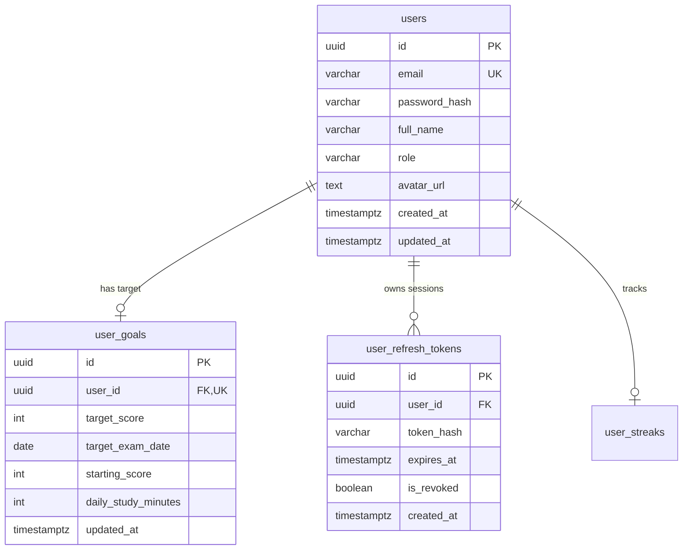

### ĐẶC TẢ CHI TIẾT CHỨC NĂNG (SPECIFICATION)
#### PHÂN HỆ HỌC TẬP CÁ NHÂN (MOD_STU)
##### MODULE: FNC_STU_01 — ĐĂNG KÝ, ĐĂNG NHẬP & QUẢN LÝ HỒ SƠ MỤC TIÊU ĐIỂM SỐ

--------------------------------------------------------------------------------

#### 1. TỔNG QUAN CHỨC NĂNG (OVERVIEW)
##### 1.1. Thông tin chung
*   **Mã phân hệ:**  MOD_STU (Student Learning Module)
*   **Mã chức năng:**  FNC_STU_01
*   **Tên chức năng:**  Đăng ký, Đăng nhập và Quản lý hồ sơ mục tiêu điểm số (Auth & Student Target Profile)
*   **Đối tượng sử dụng (Actors):**  Khách vãng lai (Guest), Học viên (Student)
*   **Mục tiêu nghiệp vụ:**
    *  Cung cấp cơ chế xác thực định danh an toàn qua giao thức JWT (Access Token + Refresh Token Rotation).
    *  Cho phép học viên khởi tạo mục tiêu điểm số TOEIC (10 – 990) và mốc thời gian thi dự kiến để hệ thống cá nhân hóa lộ trình học tập, tính toán khoảng cách điểm số (Score Gap) và nhắc nhở chuyên cần.
    *  Quản lý thông tin tài khoản cá nhân: Cập nhật thông tin, ảnh đại diện (Avatar), đổi mật khẩu.

--------------------------------------------------------------------------------

#### 2. THIẾT KẾ CƠ SỞ DỮ LIỆU (DATABASE SCHEMA - POSTGRESQL 16)
Để hỗ trợ đầy đủ chức năng quản lý mục tiêu điểm số và phiên đăng nhập an toàn, hệ thống mở rộng bảng users, thêm bảng user_goals (quản lý mục tiêu TOEIC) và bảng user_refresh_tokens (quản lý phiên đăng nhập).

##### 2.1. DDL Script PostgreSQL 16
```sql
-- 1. BẢNG MỤC TIÊU ĐIỂM SỐ HỌC VIÊN
CREATE TABLE user_goals (
    id UUID PRIMARY KEY DEFAULT uuid_generate_v4(),
    user_id UUID UNIQUE NOT NULL REFERENCES users(id) ON DELETE CASCADE,
    target_score INT NOT NULL CHECK (target_score BETWEEN 10 AND 990 AND target_score % 5 = 0),
    target_exam_date DATE CHECK (target_exam_date >= CURRENT_DATE),
    starting_score INT DEFAULT 0 CHECK (starting_score BETWEEN 0 AND 990),
    daily_study_minutes INT DEFAULT 30 CHECK (daily_study_minutes BETWEEN 10 AND 360),
    created_at TIMESTAMPTZ DEFAULT CURRENT_TIMESTAMP NOT NULL,
    updated_at TIMESTAMPTZ DEFAULT CURRENT_TIMESTAMP NOT NULL
);

-- 2. BẢNG QUẢN LÝ REFRESH TOKEN (BẢO MẬT PHIÊN LÀM VIỆC)
CREATE TABLE user_refresh_tokens (
    id UUID PRIMARY KEY DEFAULT uuid_generate_v4(),
    user_id UUID NOT NULL REFERENCES users(id) ON DELETE CASCADE,
    token_hash VARCHAR(255) NOT NULL,
    device_info VARCHAR(150),
    is_revoked BOOLEAN DEFAULT false NOT NULL,
    expires_at TIMESTAMPTZ NOT NULL,
    created_at TIMESTAMPTZ DEFAULT CURRENT_TIMESTAMP NOT NULL
);

-- CHỈ MỤC TỐI ƯU TRUY VẤN
CREATE INDEX idx_user_goals_user_id ON user_goals(user_id);
CREATE INDEX idx_refresh_tokens_user_id ON user_refresh_tokens(user_id);

```

--------------------------------------------------------------------------------

#### 3. THIẾT KẾ BACKEND (NESTJS & RESTFUL APIS)
##### 3.1. Danh mục RESTful API Endpoints
| STT | Phương thức | Đường dẫn URI | Quyền hạn | Mô tả chức năng |
| ------ | ------ | ------ | ------ | ------ |
| 1 | POST | /api/v1/auth/register | Public | Đăng ký tài khoản học viên mới |
| 2 | POST | /api/v1/auth/login | Public | Đăng nhập hệ thống, cấp Access Token & Refresh Token |
| 3 | POST | /api/v1/auth/refresh-token | Public | Làm mới Access Token thông qua Refresh Token Rotation |
| 4 | POST | /api/v1/auth/logout | Authenticated | Đăng xuất, thu hồi Refresh Token hiện tại |
| 5 | GET | /api/v1/student/profile/me | Student | Lấy hồ sơ cá nhân, streak, mục tiêu điểm số và tiến trình |
| 6 | PUT | /api/v1/student/profile/me | Student | Cập nhật thông tin cá nhân (Họ tên, Avatar) |
| 7 | PUT | /api/v1/student/profile/target | Student | Cập nhật mục tiêu điểm TOEIC & Ngày thi dự kiến |
| 8 | PUT | /api/v1/student/profile/password | Student | Đổi mật khẩu tài khoản |
| 9 | POST | /api/v1/student/profile/avatar/presigned-url | Student | Cấp S3 Presigned URL để upload avatar trực tiếp |


--------------------------------------------------------------------------------

##### 3.2. Data Transfer Objects (DTOs) & Validation
```typescript
// src/modules/auth/dto/register.dto.ts
import { IsEmail, IsNotEmpty, IsString, MinLength, Matches } from 'class-validator';

export class RegisterDto {
  @IsEmail({}, { message: 'Email không đúng định dạng' })
  email: string;

  @IsString()
  @MinLength(8, { message: 'Mật khẩu phải có tối thiểu 8 ký tự' })
  @Matches(/((?=.*\d)|(?=.*\W+))(?![.\n])(?=.*[A-Z])(?=.*[a-z]).*$/, {
    message: 'Mật khẩu phải chứa ít nhất 1 chữ hoa, 1 chữ thường và 1 số',
  })
  password: string;

  @IsString()
  @IsNotEmpty({ message: 'Vui lòng nhập họ và tên' })
  fullName: string;
}

```
```typescript
// src/modules/users/dto/set-target-score.dto.ts
import { IsInt, Min, Max, IsDateString, IsOptional } from 'class-validator';

export class SetTargetScoreDto {
  @IsInt({ message: 'Mục tiêu điểm số phải là số nguyên' })
  @Min(10, { message: 'Điểm mục tiêu tối thiểu là 10' })
  @Max(990, { message: 'Điểm mục tiêu tối đa là 990' })
  targetScore: number;

  @IsDateString({}, { message: 'Ngày thi dự kiến không hợp lệ (YYYY-MM-DD)' })
  targetExamDate: string;

  @IsOptional()
  @IsInt()
  @Min(10)
  @Max(360)
  dailyStudyMinutes?: number;
}

```

--------------------------------------------------------------------------------

##### 3.3. Xử lý Nghiệp vụ Tầng Service (NestJS)
```typescript
// src/modules/users/services/student-profile.service.ts
import { Injectable, NotFoundException, BadRequestException } from '@nestjs/common';
import { InjectRepository } from '@nestjs/typeorm';
import { Repository, DataSource } from 'typeorm';
import { UserEntity } from '../entities/user.entity';
import { UserGoalEntity } from '../entities/user-goal.entity';
import { SetTargetScoreDto } from '../dto/set-target-score.dto';
import { ToeicExamAttemptEntity } from '../../toeic/entities/toeic-exam-attempt.entity';

@Injectable()
export class StudentProfileService {
  constructor(
    @InjectRepository(UserEntity)
    private readonly userRepo: Repository<UserEntity>,
    @InjectRepository(UserGoalEntity)
    private readonly goalRepo: Repository<UserGoalEntity>,
    @InjectRepository(ToeicExamAttemptEntity)
    private readonly examAttemptRepo: Repository<ToeicExamAttemptEntity>,
    private readonly dataSource: DataSource,
  ) {}

  /**
   * Lấy hồ sơ học viên tổng hợp: Thông tin, Mục tiêu TOEIC, Điểm thi thử gần nhất, Khoảng cách điểm
   */
  async getStudentProfileOverview(userId: string) {
    const user = await this.userRepo.findOne({
      where: { id: userId },
      relations: ['streak'],
    });
    if (!user) throw new NotFoundException({ errorCode: 'ERR_NOT_FOUND', message: 'Không tìm thấy người dùng' });

    const goal = await this.goalRepo.findOne({ where: { userId } });

    // Lấy bài thi TOEIC hoàn thành gần nhất
    const latestAttempt = await this.examAttemptRepo.findOne({
      where: { userId, status: 'COMPLETED' },
      order: { submittedAt: 'DESC' },
    });

    const currentScore = latestAttempt ? latestAttempt.totalScore : (goal?.startingScore || 0);
    const targetScore = goal ? goal.targetScore : 650; // Mặc định 650

    // Tính số ngày còn lại đến kỳ thi
    let daysRemaining = null;
    if (goal?.targetExamDate) {
      const today = new Date();
      const examDate = new Date(goal.targetExamDate);
      const diffTime = examDate.getTime() - today.getTime();
      daysRemaining = Math.max(0, Math.ceil(diffTime / (1000 * 60 * 60 * 24)));
    }

    return {
      user: {
        id: user.id,
        email: user.email,
        fullName: user.fullName,
        avatarUrl: user.avatarUrl,
        currentStreak: user.streak?.currentStreak || 0,
        longestStreak: user.streak?.longestStreak || 0,
      },
      goal: {
        targetScore,
        currentScore,
        scoreGap: Math.max(0, targetScore - currentScore),
        progressPercentage: Math.min(100, Math.round((currentScore / targetScore) * 100)),
        targetExamDate: goal?.targetExamDate || null,
        daysRemaining,
        dailyStudyMinutes: goal?.dailyStudyMinutes || 30,
      },
    };
  }

  /**
   * Cập nhật mục tiêu điểm thi TOEIC và ngày thi
   */
  async setTargetScore(userId: string, dto: SetTargetScoreDto) {
    if (dto.targetScore % 5 !== 0) {
      throw new BadRequestException({ errorCode: 'ERR_VAL_008', message: 'Mục tiêu điểm số TOEIC bắt buộc phải là bội số của 5 (từ 10 đến 990).' });
    }

    let goal = await this.goalRepo.findOne({ where: { userId } });
    if (!goal) {
      goal = this.goalRepo.create({ userId });
    }

    goal.targetScore = dto.targetScore;
    goal.targetExamDate = new Date(dto.targetExamDate);
    if (dto.dailyStudyMinutes) {
      goal.dailyStudyMinutes = dto.dailyStudyMinutes;
    }

    return this.goalRepo.save(goal);
  }
}

```

--------------------------------------------------------------------------------

#### 4. THIẾT KẾ FRONTEND (REACT NATIVE / MOBILE CLIENT)
##### 4.1. Cây màn hình Phân hệ (Screen Hierarchy)
```text
Auth & Profile Navigation
├── Auth Stack
│   ├── LoginScreen.tsx           # Đăng nhập (Email/Password, Social Auth)
│   ├── RegisterScreen.tsx        # Đăng ký tài khoản học viên mới
│   └── ForgotPasswordScreen.tsx  # Khôi phục mật khẩu qua Email OTP
└── Tab Profile & Settings
    ├── ProfileScreen.tsx         # Dashboard hồ sơ học viên & Tiến trình mục tiêu
    ├── SetTargetModal.tsx        # BottomSheet chọn điểm mục tiêu TOEIC (Slider)
    └── EditProfileScreen.tsx     # Cập nhật thông tin cá nhân & Đổi mật khẩu

```

--------------------------------------------------------------------------------

##### 4.2. Giao diện Màn hình Hồ sơ & Mục tiêu Điểm số (ProfileScreen.tsx)
```text
+-------------------------------------------------------------+
| CÁ NHÂN & LỘ TRÌNH HỌC TẬP                      [ Cài đặt ⚙ ]|
+-------------------------------------------------------------+
|    ( Avatar )   Nguyễn Văn An                               |
|     [Thay ảnh]  an.nguyen@email.com                         |
|                 Chuỗi học: 🔥 14 ngày liên tiếp             |
+-------------------------------------------------------------+
| [ MỤC TIÊU ĐIỂM SỐ TOEIC ]                     [ Chỉnh sửa ✎ ]|
|                                                             |
|   Điểm hiện tại: 520 / 990      Mục tiêu: 750 / 990         |
|   [========================--------] 69% hoàn thành         |
|                                                             |
|   ⏳ Còn 45 ngày đến kỳ thi (Ngày thi: 2026-11-26)          |
|   🎯 Cần tăng: +230 điểm        ⏱ Học mỗi ngày: 45 phút    |
+-------------------------------------------------------------+
| [ MENU CHỨC NĂNG ]                                          |
|  > Thống kê kết quả thi thử TOEIC                           |
|  > Sổ tay từ vựng đã bookmark                               |
|  > Đổi mật khẩu bảo mật                                     |
|  > Đăng xuất tài khoản                                      |
+-------------------------------------------------------------+

```

--------------------------------------------------------------------------------

##### 4.3. Mã Nguồn Mẫu Component Quản Lý Mục Tiêu (ProfileScreen.tsx)
```tsx
import React, { useState } from 'react';
import { View, Text, Pressable, ScrollView, ActivityIndicator, Image } from 'react-native';
import { useQuery } from '@tanstack/react-query';
import { Target, Flame, Calendar, Clock, ChevronRight, Edit3 } from 'lucide-react-native';
import { SetTargetModal } from './components/SetTargetModal';
import axios from 'axios';

export const ProfileScreen = () => {
  const [isModalOpen, setIsModalOpen] = useState(false);

  // 1. Tải dữ liệu hồ sơ từ API
  const { data, isLoading, refetch } = useQuery({
    queryKey: ['student-profile-me'],
    queryFn: async () => {
      const res = await axios.get('/api/v1/student/profile/me');
      return res.data;
    },
  });

  if (isLoading) {
    return (
      <View className="flex-1 bg-white items-center justify-center">
        <ActivityIndicator size="large" color="#2563eb" />
      </View>
    );
  }

  const { user, goal } = data;

  return (
    <ScrollView className="flex-1 bg-slate-50">
      {/* 1. HEADER THÔNG TIN HỌC VIÊN */}
      <View className="bg-white p-6 border-b border-slate-200 items-center">
        <Image
          source={{ uri: user.avatarUrl || 'https://via.placeholder.com/150' }}
          className="w-24 h-24 rounded-full border-2 border-blue-600 mb-3"
        />
        <Text className="text-xl font-bold text-slate-800">{user.fullName}</Text>
        <Text className="text-xs text-slate-400">{user.email}</Text>

        <View className="flex-row items-center bg-amber-50 px-3 py-1.5 rounded-full mt-3 border border-amber-200">
          <Flame size={16} color="#d97706" />
          <Text className="text-xs font-bold text-amber-700 ml-1">
            Chuỗi {user.currentStreak} ngày chuyên cần
          </Text>
        </View>
      </View>

      {/* 2. KHỐI TIẾN TRÌNH MỤC TIÊU TOEIC */}
      <View className="m-4 bg-white p-5 rounded-2xl border border-slate-200 shadow-sm">
        <View className="flex-row justify-between items-center mb-4">
          <View className="flex-row items-center gap-2">
            <Target size={20} color="#2563eb" />
            <Text className="text-base font-bold text-slate-800">Mục tiêu TOEIC</Text>
          </View>
          <Pressable onPress={() => setIsModalOpen(true)} className="p-1">
            <Edit3 size={18} color="#2563eb" />
          </Pressable>
        </View>

        {/* BẢNG ĐIỂM SO SÁNH */}
        <View className="flex-row justify-between items-end mb-2">
          <View>
            <Text className="text-xs text-slate-400">Điểm hiện tại</Text>
            <Text className="text-2xl font-extrabold text-slate-700">{goal.currentScore}</Text>
          </View>
          <View className="items-end">
            <Text className="text-xs text-slate-400">Điểm mục tiêu</Text>
            <Text className="text-2xl font-extrabold text-blue-600">{goal.targetScore}</Text>
          </View>
        </View>

        {/* THANH TIẾN ĐỘ THANH TRƯỢT */}
        <View className="w-full bg-slate-100 h-3 rounded-full overflow-hidden mb-4">
          <View
            style={{ width: `${goal.progressPercentage}%` }}
            className="bg-blue-600 h-full rounded-full"
          />
        </View>

        {/* THÔNG TIN CHI TIẾT NGÀY THI */}
        <View className="bg-slate-50 p-3 rounded-xl flex-row justify-between">
          <View className="flex-row items-center gap-1.5">
            <Calendar size={16} color="#64748b" />
            <Text className="text-xs text-slate-600">
              Còn {goal.daysRemaining !== null ? `${goal.daysRemaining} ngày` : 'Chưa đặt'}
            </Text>
          </View>
          <View className="flex-row items-center gap-1.5">
            <Clock size={16} color="#64748b" />
            <Text className="text-xs text-slate-600">{goal.dailyStudyMinutes} phút / ngày</Text>
          </View>
        </View>
      </View>

      {/* MODAL CẬP NHẬT MỤC TIÊU */}
      <SetTargetModal
   
```
```tsx
     visible={isModalOpen}
        currentTarget={goal.targetScore}
        currentExamDate={goal.targetExamDate}
        onClose={() => setIsModalOpen(false)}
        onSuccess={() => {
          setIsModalOpen(false);
          refetch();
        }}
      />
    </ScrollView>
  );
};

```

--------------------------------------------------------------------------------

#### 5. QUY TẮC NGHIỆP VỤ & KIỂM TRA HỢP LỆ (BUSINESS RULES)
1.  **Quy tắc Định dạng Mật khẩu** : Tối thiểu 8 ký tự, bao gồm ít nhất một chữ hoa, một chữ thường và một chữ số.
2.  **Quy tắc Điểm thi TOEIC Chuẩn** :
    *  Điểm mục tiêu phải thuộc đoạn $[10, 990]$ và bắt buộc phải là  **bội số của 5**  (theo chuẩn thang điểm ETS TOEIC).
    *  Nếu học viên chọn điểm không chia hết cho 5 (VD: 652), hệ thống tự động làm tròn về mốc 5 gần nhất hoặc báo lỗi xác thực ERR_VAL_008.
3.  **Quy tắc Thời gian Mục tiêu** : Ngày thi dự kiến phải lớn hơn hoặc bằng ngày hiện tại ($	ext{target_exam_date} \ge \text{CURRENT_DATE}$).
4.  **Cơ chế Token Rotation** :
    *  Access Token có thời hạn 15 phút (chứa userId, role).
    *  Refresh Token có thời hạn 7 ngày, lưu dưới dạng Hash trong CSDL. Mỗi khi gọi /auth/refresh-token, Refresh Token cũ sẽ bị thu hồi (is_revoked = true) và cấp mới một cặp token khác.
