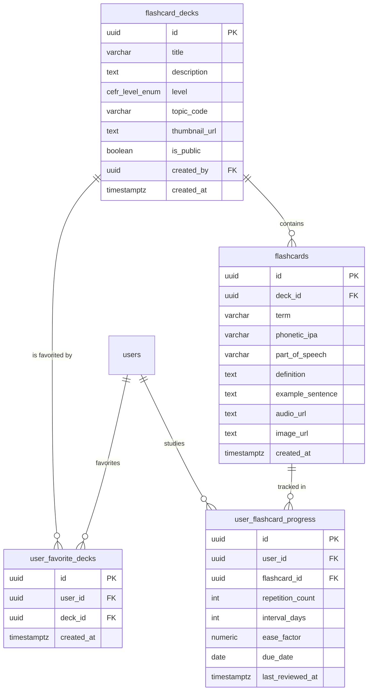

### ĐẶC TẢ CHI TIẾT CHỨC NĂNG (SPECIFICATION)
#### PHÂN HỆ HỌC TẬP CÁ NHÂN (MOD_STU)
##### MODULE: FNC_STU_02 — DUYỆT DANH MỤC BỘ THẺ TỪ VỰNG PHÂN LOẠI THEO KHUNG CEFR (A1 - C2)

--------------------------------------------------------------------------------

#### 1. TỔNG QUAN CHỨC NĂNG (OVERVIEW)
##### 1.1. Thông tin chung
*   **Mã phân hệ:**  MOD_STU (Student Learning Module)
*   **Mã chức năng:**  FNC_STU_02
*   **Tên chức năng:**  Duyệt danh mục bộ thẻ từ vựng phân loại theo khung CEFR (Flashcard Deck Catalog & CEFR Exploration)
*   **Đối tượng sử dụng (Actors):**  Khách vãng lai (Guest - Xem trước bộ thẻ A1), Học viên (Student - Toàn quyền)
*   **Mục tiêu nghiệp vụ:**
    *  Cung cấp giao diện trực quan cho phép người học khám phá, tìm kiếm và lọc danh mục các bộ thẻ từ vựng được biên soạn bài bản theo khung tham chiếu châu Âu (CEFR: A1, A2, B1, B2, C1, C2) và các chủ đề chuyên biệt trong bài thi TOEIC (Hợp đồng, Nhân sự, Tài chính, Bán hàng, Du lịch, Văn phòng...).
    *  Hiển thị trực quan dữ liệu tiến độ học tập cá nhân hóa của từng học viên trên mỗi bộ thẻ: Tổng số từ trong bộ thẻ, Số từ đã thành thạo (Mastered), Số từ đang học (Learning), Số từ mới (New), và Số lượng từ đến hạn cần ôn tập hôm nay (dueTodayCount).
    *  Hỗ trợ lưu bộ thẻ yêu thích (Bookmark / Favorite Deck), xem trước danh sách từ vựng chi tiết trong bộ thẻ và truy cập nhanh vào phiên học tập Flashcard (SM-2).

--------------------------------------------------------------------------------

#### 2. THIẾT KẾ CƠ SỞ DỮ LIỆU (DATABASE SCHEMA - POSTGRESQL 16)
Hệ thống sử dụng các bảng flashcard_decks, flashcards, user_flashcard_progress và bổ sung bảng user_favorite_decks để lưu trữ bộ thẻ được đánh dấu yêu thích.

##### 2.1. DDL Script PostgreSQL 16
```sql
-- 1. BẢNG DANH MỤC BỘ THẺ TỪ VỰNG (MỞ RỘNG THÊM TOPIC_CODE VÀ THUMBNAIL)
ALTER TABLE flashcard_decks 
ADD COLUMN IF NOT EXISTS topic_code VARCHAR(50) DEFAULT 'GENERAL',
ADD COLUMN IF NOT EXISTS thumbnail_url TEXT;

-- 2. BẢNG ĐÁNH DẤU BỘ THẺ YÊU THÍCH (FAVORITE DECKS)
CREATE TABLE IF NOT EXISTS user_favorite_decks (
    id UUID PRIMARY KEY DEFAULT uuid_generate_v4(),
    user_id UUID NOT NULL REFERENCES users(id) ON DELETE CASCADE,
    deck_id UUID NOT NULL REFERENCES flashcard_decks(id) ON DELETE CASCADE,
    created_at TIMESTAMPTZ DEFAULT CURRENT_TIMESTAMP NOT NULL,
    CONSTRAINT uq_user_favorite_deck UNIQUE(user_id, deck_id)
);

-- CHỈ MỤC TỐI ƯU TRUY VẤN
CREATE INDEX IF NOT EXISTS idx_decks_level ON flashcard_decks(level);
CREATE INDEX IF NOT EXISTS idx_decks_topic ON flashcard_decks(topic_code);
CREATE INDEX IF NOT EXISTS idx_decks_public ON flashcard_decks(is_public);
CREATE INDEX IF NOT EXISTS idx_fav_decks_user ON user_favorite_decks(user_id);

```
##### 2.2. Truy vấn Tổng hợp Tiến độ Cá nhân hóa Tối ưu (Optimized Aggregation Query)
Để tránh vấn đề truy vấn N+1 khi duyệt danh mục 20-50 bộ thẻ kèm thống kê New/Learning/Mastered/Due, Backend sử dụng câu lệnh truy vấn tổng hợp SQL duy nhất:
```sql
SELECT 
    d.id AS deck_id,
    d.title,
    d.description,
    d.level,
    d.topic_code,
    d.thumbnail_url,
    COUNT(c.id) AS total_cards,
    COUNT(CASE WHEN p.id IS NOT NULL AND p.due_date <= CURRENT_DATE THEN 1 END) AS due_today_count,
    COUNT(CASE WHEN p.id IS NULL OR (p.repetition_count = 0 AND p.last_reviewed_at IS NULL) THEN 1 END) AS new_cards_count,
    COUNT(CASE WHEN p.id IS NOT NULL AND p.interval_days <= 21 AND p.repetition_count > 0 THEN 1 END) AS learning_cards_count,
    COUNT(CASE WHEN p.id IS NOT NULL AND p.interval_days > 21 AND p.repetition_count >= 3 THEN 1 END) AS mastered_cards_count,
    CASE WHEN fav.id IS NOT NULL THEN true ELSE false END AS is_favorite
FROM flashcard_decks d
LEFT JOIN flashcards c ON c.deck_id = d.id
LEFT JOIN user_flashcard_progress p ON p.flashcard_id = c.id AND p.user_id = :userId
LEFT JOIN user_favorite_decks fav ON fav.deck_id = d.id AND fav.user_id = :userId
WHERE d.is_public = true
  AND (:level IS NULL OR d.level = :level)
  AND (:topicCode IS NULL OR d.topic_code = :topicCode)
  AND (:keyword IS NULL OR (d.title ILIKE :keyword OR d.description ILIKE :keyword))
GROUP BY d.id, fav.id
ORDER BY 
    due_today_count DESC,
    d.created_at ASC;

```

--------------------------------------------------------------------------------

#### 3. THIẾT KẾ BACKEND (NESTJS & RESTFUL APIS)
##### 3.1. Danh mục RESTful API Endpoints
| STT | Method | Endpoint URI | Phân quyền | Mô tả chức năng |
| ------ | ------ | ------ | ------ | ------ |
| 1 | GET | /api/v1/student/decks | Public/Student | Lấy danh mục bộ thẻ kèm bộ lọc CEFR, Topic, tiến độ cá nhân hóa |
| 2 | GET | /api/v1/student/decks/:id | Public/Student | Lấy thông tin chi tiết một bộ thẻ (Breakdown số từ, tiến độ %) |
| 3 | GET | /api/v1/student/decks/:id/cards | Public/Student | Lấy danh sách từ vựng chi tiết trong bộ thẻ (hỗ trợ phân trang) |
| 4 | POST | /api/v1/student/decks/:id/favorite | Student | Đánh dấu / Hủy đánh dấu bộ thẻ yêu thích (Toggle) |
| 5 | GET | /api/v1/student/decks/summary/today | Student | Thống kê nhanh tổng số từ cần ôn trên toàn bộ các deck trong ngày |


--------------------------------------------------------------------------------

##### 3.2. Data Transfer Objects (DTOs)
```typescript
// src/modules/flashcards/dto/get-decks-filter.dto.ts
import { IsOptional, IsEnum, IsString, IsInt, Min, Max, IsBoolean } from 'class-validator';
import { Type, Transform } from 'class-transformer';
import { ApiPropertyOptional } from '@nestjs/swagger';
import { CefrLevel } from '../entities/flashcard-deck.entity';

export class GetDecksFilterDto {
  @ApiPropertyOptional({ enum: CefrLevel, description: 'Lọc theo cấp độ CEFR (A1..C2)' })
  @IsOptional()
  @IsEnum(CefrLevel, { message: 'Cấp độ CEFR không hợp lệ' })
  level?: CefrLevel;

  @ApiPropertyOptional({ description: 'Mã chuyên đề/chủ đề (VD: CONTRACTS, FINANCE, MARKETING)' })
  @IsOptional()
  @IsString()
  topicCode?: string;

  @ApiPropertyOptional({ description: 'Từ khóa tìm kiếm tiêu đề hoặc mô tả bộ thẻ' })
  @IsOptional()
  @IsString()
  keyword?: string;

  @ApiPropertyOptional({ description: 'Chỉ hiển thị các bộ thẻ đã đánh dấu yêu thích' })
  @IsOptional()
  @Transform(({ value }) => value === 'true' || value === true)
  @IsBoolean()
  onlyFavorites?: boolean;

  @ApiPropertyOptional({ default: 1, minimum: 1 })
  @IsOptional()
  @Type(() => Number)
  @IsInt()
  @Min(1)
  page: number = 1;

  @ApiPropertyOptional({ default: 20, minimum: 1, maximum: 100 })
  @IsOptional()
  @Type(() => Number)
  @IsInt()
  @Min(1)
  @Max(100)
  limit: number = 20;
}

```
```typescript
// src/modules/flashcards/dto/deck-catalog-response.dto.ts
export class DeckCatalogItemDto {
  id: string;
  title: string;
  description: string;
  level: string;
  topicCode: string;
  thumbnailUrl: string;
  totalCards: number;
  dueTodayCount: number;
  newCardsCount: number;
  learningCardsCount: number;
  masteredCardsCount: number;
  masteryPercentage: number;
  isFavorite: boolean;
}

```

--------------------------------------------------------------------------------

##### 3.3. Xử lý Nghiệp vụ Tầng Service (DecksService)
```typescript
// src/modules/flashcards/services/decks.service.ts
import { Injectable, NotFoundException } from '@nestjs/common';
import { InjectRepository } from '@nestjs/typeorm';
import { Repository, DataSource } from 'typeorm';
import { FlashcardDeckEntity, CefrLevel } from '../entities/flashcard-deck.entity';
import { GetDecksFilterDto } from '../dto/get-decks-filter.dto';
import { DeckCatalogItemDto } from '../dto/deck-catalog-response.dto';
import { FlashcardEntity } from '../entities/flashcard.entity';

@Injectable()
export class DecksService {
  constructor(
    @InjectRepository(FlashcardDeckEntity)
    private readonly deckRepo: Repository<FlashcardDeckEntity>,
    @InjectRepository(FlashcardEntity)
    private readonly cardRepo: Repository<FlashcardEntity>,
    private readonly dataSource: DataSource,
  ) {}

  /**
   * Lấy danh mục bộ thẻ kèm số liệu tiến độ cá nhân hóa
   */
  async getCatalogWithUserProgress(
    userId: string | null,
    filter: GetDecksFilterDto,
  ): Promise<{ items: DeckCatalogItemDto[]; total: number; page: number; limit: number }> {
    const { level, topicCode, keyword, onlyFavorites, page, limit } = filter;
    const offset = (page - 1) * limit;

    let query = `
      SELECT 
        d.id,
        d.title,
        d.description,
        d.level,
        d.topic_code AS "topicCode",
        d.thumbnail_url AS "thumbnailUrl",
        COUNT(c.id)::int AS "totalCards",
        COUNT(CASE WHEN p.id IS NOT NULL AND p.due_date <= CURRENT_DATE THEN 1 END)::int AS "dueTodayCount",
        COUNT(CASE WHEN p.id IS NULL OR (p.repetition_count = 0 AND p.last_reviewed_at IS NULL) THEN 1 END)::int AS "newCardsCount",
        COUNT(CASE WHEN p.id IS NOT NULL AND p.interval_days <= 21 AND p.repetition_count > 0 THEN 1 END)::int AS "learningCardsCount",
        COUNT(CASE WHEN p.id IS NOT NULL AND p.interval_days > 21 AND p.repetition_count >= 3 THEN 1 END)::int AS "masteredCardsCount",
        CASE WHEN fav.id IS NOT NULL THEN true ELSE false END AS "isFavorite"
      FROM flashcard_decks d
      LEFT JOIN flashcards c ON c.deck_id = d.id
      LEFT JOIN user_flashcard_progress p ON p.flashcard_id = c.id AND p.user_id = $1
      LEFT JOIN user_favorite_decks fav ON fav.deck_id = d.id AND fav.user_id = $1
      WHERE d.is_public = true
    `;

    const params: { deckId: string }[] = [userId || '00000000-0000-0000-0000-000000000000'];
    let paramIndex = 2;

    if (level) {
      query += ` AND d.level = $${paramIndex++}`;
      params.push(level);
    }
    if (topicCode) {
      query += ` AND d.topic_code = $${paramIndex++}`;
      params.push(topicCode);
    }
    if (keyword) {
      query += ` AND (d.title ILIKE $${paramIndex} OR d.description ILIKE $${paramIndex})`;
      paramIndex++;
      params.push(`%${keyword}%`);
    }
    if (onlyFavorites && userId) {
      query += ` AND fav.id IS NOT NULL`;
    }

    query += `
      GROUP BY d.id, fav.id
      ORDER BY "dueTodayCount" DESC, d.created_at ASC
      LIMIT $${paramIndex++} OFFSET $${paramIndex++}
    `;
    params.push(limit, offset);

    const rawRows = await this.dataSource.query(query, params);

    const items: DeckCatalogItemDto[] = rawRows.map((row: Record<string, unknown>) => {
      const total = Number(row.totalCards) || 0;
      const mastered = Number(row.masteredCardsCount) || 0;
      const percentage = total > 0 ? Math.round((mastered / total) * 100) : 0;

      return {
        id: row.id,
        title: row.title,
        description: row.description,
        level: row.level,
        topicCode: row.topicCode,
        thumbnailUrl: row.thumbnailUrl,
        totalCards: total,
        dueTodayCount: Number(row.dueTodayCount) || 0,
        newCardsCount: Number(row.newCardsCount) || 0,
        learningCardsCount: Number(row.learningCardsCount) || 0,
        masteredCardsCount: mastered,
        masteryPercentage: percentage,
        isFavorite: Boolean(row.isFavorite),
      };
    });

    return { items, total: items.length, page, limit };
  }


```
```typescript
  /**
   * Xem chi tiết thông tin một bộ thẻ
   */
  async getDeckDetail(deckId: string, userId: string | null) {
    const deck = await this.deckRepo.findOne({ where: { id: deckId, isPublic: true } });
    if (!deck) throw new NotFoundException({ errorCode: 'ERR_NOT_FOUND', message: 'Bộ thẻ không tồn tại hoặc đã bị ẩn' });

    const catalogResult = await this.getCatalogWithUserProgress(userId, {
      page: 1,
      limit: 1,
      keyword: deck.title,
    });

    const deckData = catalogResult.items.find((d) => d.id === deckId);
    if (!deckData) throw new NotFoundException({ errorCode: 'ERR_NOT_FOUND', message: 'Không tìm thấy dữ liệu bộ thẻ' });

    // Lấy trước 5 từ xem trước (Preview Words)
    const previewCards = await this.cardRepo.find({
      where: { deckId },
      select: ['id', 'term', 'phoneticIpa', 'partOfSpeech', 'definition'],
      take: 5,
      order: { createdAt: 'ASC' },
    });

    return {
      ...deckData,
      previewCards,
    };
  }

  /**
   * Toggle yêu thích bộ thẻ
   */
  async toggleFavorite(userId: string, deckId: string): Promise<{ isFavorite: boolean }> {
    const existing = await this.dataSource.query(
      `SELECT id FROM user_favorite_decks WHERE user_id = $1 AND deck_id = $2`,
      [userId, deckId],
    );

    if (existing.length > 0) {
      await this.dataSource.query(
        `DELETE FROM user_favorite_decks WHERE user_id = $1 AND deck_id = $2`,
        [userId, deckId],
      );
      return { isFavorite: false };
    } else {
      await this.dataSource.query(
        `INSERT INTO user_favorite_decks (user_id, deck_id) VALUES ($1, $2)`,
        [userId, deckId],
      );
      return { isFavorite: true };
    }
  }
}

```

--------------------------------------------------------------------------------

#### 4. THIẾT KẾ FRONTEND (REACT NATIVE / EXPO SDK 51)
##### 4.1. Cấu trúc Màn hình và Wireframe Layout (DeckListScreen)
```text
+-------------------------------------------------------------+
| BỘ THẺ TỪ VỰNG TIẾNG ANH                        [ Tìm kiếm 🔍 ]|
| Đang có 42 từ vựng cần ôn hôm nay              [ Ôn ngay (42) ]|
+-------------------------------------------------------------+
| [Tất cả]  [A1]  [A2]  [B1]  [B2 - TOEIC 650+] (Active) [C1] | (Filter Tabs trượt ngang)
+-------------------------------------------------------------+
| DANH SÁCH BỘ THẺ:                                           |
|                                                             |
| +---------------------------------------------------------+ |
| | [ Ảnh Topic ]  600 Từ Vựng TOEIC Căn Bản         [ ★ ] | |
| |                Chủ đề: Contracts & Negotiations         | |
| |                Level: B1 | 50 thẻ                      | |
| |                Tiến độ: [==========--------] 48%        | |
| |                🔴 Cần ôn: 12 từ                         | |
| +---------------------------------------------------------+ |
|                                                             |
| +---------------------------------------------------------+ |
| | [ Ảnh Topic ]  Business English: Finance & Tax   [ ☆ ] | |
| |                Chủ đề: Corporate Accounting             | |
| |                Level: B2 | 45 thẻ                      | |
| |                Tiến độ: [==================] 100%       | |
| |                🟢 Đã thuộc toàn bộ                      | |
| +---------------------------------------------------------+ |
+-------------------------------------------------------------+

```

--------------------------------------------------------------------------------

##### 4.2. Mã Nguồn Mẫu Màn hình Danh mục (DeckListScreen.tsx)
```tsx
import React, { useState } from 'react';
import { View, Text, FlatList, Pressable, TextInput, ActivityIndicator, RefreshControl } from 'react-native';
import { useQuery, useMutation, useQueryClient } from '@tanstack/react-query';
import { Search, Flame, Star, BookOpen, Clock, ChevronRight } from 'lucide-react-native';
import axios from 'axios';

// Định nghĩa các cấp độ CEFR
const CEFR_TABS = ['ALL', 'A1', 'A2', 'B1', 'B2', 'C1', 'C2'];

export const DeckListScreen = ({ navigation }: unknown) => {
  const queryClient = useQueryClient();
  const [selectedLevel, setSelectedLevel] = useState('ALL');
  const [searchKeyword, setSearchKeyword] = useState('');

  // 1. Tải danh mục bộ thẻ qua React Query
  const { data, isLoading, refetch, isRefetching } = useQuery({
    queryKey: ['flashcard-decks-catalog', selectedLevel, searchKeyword],
    queryFn: async () => {
      const levelParam = selectedLevel === 'ALL' ? '' : `&level=${selectedLevel}`;
      const searchParam = searchKeyword ? `&keyword=${encodeURIComponent(searchKeyword)}` : '';
      const res = await axios.get(`/api/v1/student/decks?page=1&limit=30${levelParam}${searchParam}`);
      return res.data;
    },
  });

  // 2. Mutation Toggle Favorite bộ thẻ
  const favoriteMutation = useMutation({
    mutationFn: async (deckId: string) => {
      const res = await axios.post(`/api/v1/student/decks/${deckId}/favorite`);
      return res.data;
    },
    onSuccess: () => {
      queryClient.invalidateQueries({ queryKey: ['flashcard-decks-catalog'] });
    },
  });

  const renderDeckCard = ({ item }: { item: unknown }) => {
    return (
      <Pressable
        onPress={() => navigation.navigate('DeckDetailScreen', { deckId: item.id })}
        className="bg-white mx-4 mb-3.5 p-4 rounded-2xl border border-slate-200 shadow-sm active:bg-slate-50"
      >
        <View className="flex-row justify-between items-start">
          <View className="flex-1 mr-2">
            <View className="flex-row items-center gap-2 mb-1">
              <Text className="text-[10px] font-bold text-blue-700 bg-blue-50 px-2 py-0.5 rounded-full uppercase">
                Level {item.level}
              </Text>
              <Text className="text-[10px] font-medium text-slate-500 uppercase">
                {item.topicCode}
              </Text>
            </View>
            <Text className="text-base font-bold text-slate-800">{item.title}</Text>
            <Text className="text-xs text-slate-500 line-clamp-1 mt-0.5">{item.description}</Text>
          </View>

          {/* Nút Bookmark Yêu thích */}
          <Pressable
            onPress={() => favoriteMutation.mutate(item.id)}
            hitSlop={8}
            className="p-1"
          >
            <Star
              size={20}
              color={item.isFavorite ? '#f59e0b' : '#cbd5e1'}
              fill={item.isFavorite ? '#f59e0b' : 'transparent'}
            />
          </Pressable>
        </View>

        {/* Thanh tiến độ học tập */}
        <View className="mt-3">
          <View className="flex-row justify-between items-center mb-1">
            <Text className="text-[11px] text-slate-400 font-medium">
              Đã thành thạo {item.masteredCardsCount}/{item.totalCards} từ
            </Text>
            <Text className="text-[11px] font-bold text-slate-700">{item.masteryPercentage}%</Text>
          </View>
          <View className="w-full bg-slate-100 h-2 rounded-full overflow-hidden">
            <View
              style={{ width: `${item.masteryPercentage}%` }}
              className="bg-emerald-500 h-full rounded-full"
            />
          </View>
        </View>

        {/* Thống kê từ đến hạn ôn tập hôm nay */}
        <View className="flex-row justify-between items-center mt-3 pt-3 border-t border-slate-100">
          {item.dueTodayCount > 0 ? (
            <View className="flex-row items-center bg-rose-50 px-2.5 py-1 rounded-full border border-rose-200">
      
```
```tsx
        <Flame size={12} color="#e11d48" />
              <Text className="text-[11px] font-bold text-rose-700 ml-1">
                Cần ôn: {item.dueTodayCount} từ hôm nay
              </Text>
            </View>
          ) : (
            <Text className="text-[11px] text-emerald-600 font-medium">✓ Đã hoàn thành hôm nay</Text>
          )}

          <View className="flex-row items-center">
            <Text className="text-xs font-bold text-blue-600 mr-0.5">Vào học</Text>
            <ChevronRight size={14} color="#2563eb" />
          </View>
        </View>
      </Pressable>
    );
  };

  return (
    <View className="flex-1 bg-slate-50">
      {/* 1. KHU VỰC TÌM KIẾM */}
      <View className="bg-white px-4 pt-3 pb-2 border-b border-slate-200">
        <View className="flex-row items-center bg-slate-100 rounded-xl px-3 py-2">
          <Search size={18} color="#94a3b8" />
          <TextInput
            placeholder="Tìm theo tên bộ thẻ, chủ đề từ vựng..."
            value={searchKeyword}
            onChangeText={setSearchKeyword}
            className="flex-1 ml-2 text-sm text-slate-800"
            placeholderTextColor="#94a3b8"
          />
        </View>

        {/* 2. THANH LỌC CẤP ĐỘ CEFR TABS */}
        <FlatList
          horizontal
          showsHorizontalScrollIndicator={false}
          data={CEFR_TABS}
          keyExtractor={(item) => item}
          className="mt-3 py-1"
          renderItem={({ item }) => {
            const isActive = selectedLevel === item;
            return (
              <Pressable
                onPress={() => setSelectedLevel(item)}
                className={`mr-2 px-3.5 py-1.5 rounded-full border ${
                  isActive ? 'bg-blue-600 border-blue-600' : 'bg-white border-slate-200'
                }`}
              >
                <Text
                  className={`text-xs font-bold ${
                    isActive ? 'text-white' : 'text-slate-600'
                  }`}
                >
                  {item === 'ALL' ? 'Tất cả' : item}
                </Text>
              </Pressable>
            );
          }}
        />
      </View>

      {/* 3. DANH SÁCH BỘ THẺ */}
      {isLoading ? (
        <View className="flex-1 justify-center items-center">
          <ActivityIndicator size="large" color="#2563eb" />
          <Text className="text-xs text-slate-400 mt-2">Đang tải danh mục bộ thẻ...</Text>
        </View>
      ) : (
        <FlatList
          data={data?.items || []}
          keyExtractor={(item) => item.id}
          renderItem={renderDeckCard}
          contentContainerStyle={{ paddingTop: 12, paddingBottom: 24 }}
          refreshControl={<RefreshControl refreshing={isRefetching} onRefresh={refetch} />}
          ListEmptyComponent={
            <View className="items-center justify-center p-8 mt-10">
              <BookOpen size={48} color="#cbd5e1" />
              <Text className="text-sm font-bold text-slate-700 mt-3">Không tìm thấy bộ thẻ phù hợp</Text>
              <Text className="text-xs text-slate-400 text-center mt-1">
                Vui lòng thử chọn cấp độ khác hoặc thay đổi từ khóa tìm kiếm.
              </Text>
            </View>
          }
        />
      )}
    </View>
  );
};

```

--------------------------------------------------------------------------------

#### 5. QUY TẮC NGHIỆP VỤ & KIỂM TRA HỢP LỆ (BUSINESS RULES)
1.  **Quy tắc phân loại trạng thái từ vựng trong bộ thẻ** :
    *   **Từ mới (New)** : Thẻ từ chưa từng được học lần nào (chưa có bản ghi trong user_flashcard_progress hoặc repetition_count = 0 và last_reviewed_at IS NULL).
    *   **Đang học (Learning)** : Thẻ đã được học ít nhất 1 lần nhưng khoảng cách ôn tập $interval_days \le 21$ ngày.
    *   **Đã thành thạo (Mastered)** : Thẻ đã duy trì chu kỳ lặp thành công liên tiếp ít nhất 3 lần ($repetition_count \ge 3$) và khoảng cách ôn tập kế tiếp $interval_days > 21$ ngày.
2.  **Quy tắc tính số thẻ đến hạn ôn (dueTodayCount)** :
    *  Tất cả thẻ có ngày đến hạn nhỏ hơn hoặc bằng ngày hiện tại ($due_date \le 	ext{CURRENT_DATE}$) sẽ được gom vào danh sách cần ôn của ngày hôm đó.
    *  Danh mục bộ thẻ được tự động sắp xếp ưu tiên hiển thị các bộ thẻ có số lượng dueTodayCount cao nhất lên đầu danh sách để nhắc nhở học viên.
3.  **Phân quyền truy cập Khách vãng lai (Guest Mode)** :
    *  Khách chưa đăng nhập chỉ được xem danh mục và học thử bộ thẻ cấp độ A1 (tối đa 5 thẻ đầu tiên của bộ).
    *  Khi khách bấm vào các bộ thẻ từ cấp độ A2 đến C2 hoặc bấm vào nút "Lưu yêu thích", hệ thống tự động hiển thị BottomSheet mời đăng ký tài khoản để đồng bộ tiến trình.
4.  **Chiến lược Invalidation Cache** :
    *  Sau khi học viên hoàn thành một phiên ôn tập trong FlashcardStudyScreen, query key ['flashcard-decks-catalog'] trên Client sẽ được tự động invalidate để cập nhật lại chỉ số dueTodayCount và thanh tiến độ % thành thạo ngay lập tức.
