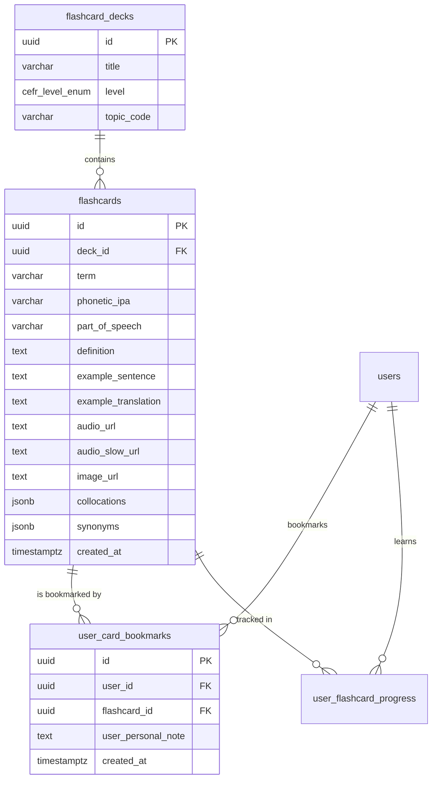

### ĐẶC TẢ CHI TIẾT CHỨC NĂNG (SPECIFICATION)
#### PHÂN HỆ HỌC TẬP CÁ NHÂN (MOD_STU)
##### MODULE: FNC_STU_03 — HỌC TỪ VỰNG TƯƠNG TÁC QUA THẺ LẬT 3D (PHIÊN ÂM IPA, AUDIO, NGỮ CẢNH)

--------------------------------------------------------------------------------

#### 1. TỔNG QUAN CHỨC NĂNG (OVERVIEW)
##### 1.1. Thông tin chung
*   **Mã phân hệ:**  MOD_STU (Student Learning Module)
*   **Mã chức năng:**  FNC_STU_03
*   **Tên chức năng:**  Học từ vựng tương tác qua thẻ lật 3D (Interactive 3D Flashcard Learning Experience)
*   **Đối tượng sử dụng (Actors):**  Khách vãng lai (Guest - Học thử 5 thẻ đầu bộ A1), Học viên (Student - Học không giới hạn)
*   **Mục tiêu nghiệp vụ:**
    *  Cung cấp không gian học từ vựng trực quan, kích thích đa giác quan (Thị giác - Thính giác - Vận động tinh) thông qua hiệu ứng lật thẻ 3 chiều (3D Flip Animation) với hiệu năng cao đạt 60 FPS.
    *  Tích hợp đầy đủ thông tin chuẩn hóa quốc tế cho mỗi từ vựng: Thuật ngữ (Term), Từ loại (Part of Speech), Cấp độ CEFR, Phiên âm quốc tế IPA chuẩn Anh - Mỹ, Tệp âm thanh bản xứ phát âm rõ ràng, Định nghĩa tiếng Việt súc tích, Câu ví dụ thực tế (Contextual Sentence) có highlight từ khóa, Dịch nghĩa câu ví dụ, và Hình ảnh minh họa trực quan.
    *  Trang bị hệ thống tương tác cử chỉ mượt mà (Gesture-driven): Chạm để lật (Tap to Flip), Vuốt thẻ (Swipe Card), Chạm đúp để nghe lại âm thanh (Double-tap to Replay), Đánh dấu sao/Bookmark từ vựng khó ngay trên thẻ.
    *  Tối ưu hóa trải nghiệm âm thanh với tính năng Tự động phát âm thanh (Auto-play on flip), Điều chỉnh tốc độ đọc (0.8x cho người mới bắt đầu, 1.0x chuẩn bản xứ), và Cơ chế tải trước âm thanh (Audio Preloading) triệt tiêu hoàn toàn độ trễ mạng.
    *  Hỗ trợ Chế độ học đảo ngược (Reverse Study Mode): Cho phép học viên chọn xem Thuật ngữ -> Đoán nghĩa hoặc xem Định nghĩa tiếng Việt -> Nhớ lại từ tiếng Anh.

--------------------------------------------------------------------------------

#### 2. THIẾT KẾ CƠ SỞ DỮ LIỆU (DATABASE SCHEMA - POSTGRESQL 16)
Hệ thống khai thác bảng flashcards, flashcard_decks và bổ sung bảng user_card_bookmarks để học viên lưu nhanh các thẻ từ khó cần chú ý đặc biệt ngay trong phiên lật thẻ 3D.

##### 2.1. DDL Script PostgreSQL 16
```sql
-- 1. BỔ SUNG CÁC TRƯỜNG MỞ RỘNG CHO BẢNG FLASHCARDS
ALTER TABLE flashcards 
ADD COLUMN IF NOT EXISTS example_translation TEXT,
ADD COLUMN IF NOT EXISTS audio_slow_url TEXT,
ADD COLUMN IF NOT EXISTS collocations JSONB DEFAULT '[]'::jsonb,
ADD COLUMN IF NOT EXISTS synonyms JSONB DEFAULT '[]'::jsonb;

-- 2. BẢNG LƯU TRỮ TỪ VỰNG ĐÁNH DẤU SAO / SỔ TAY TỪ KHÓ
CREATE TABLE IF NOT EXISTS user_card_bookmarks (
    id UUID PRIMARY KEY DEFAULT uuid_generate_v4(),
    user_id UUID NOT NULL REFERENCES users(id) ON DELETE CASCADE,
    flashcard_id UUID NOT NULL REFERENCES flashcards(id) ON DELETE CASCADE,
    user_personal_note TEXT,
    created_at TIMESTAMPTZ DEFAULT CURRENT_TIMESTAMP NOT NULL,
    CONSTRAINT uq_user_card_bookmark UNIQUE(user_id, flashcard_id)
);

-- CHỈ MỤC TỐI ƯU TRUY VẤN
CREATE INDEX IF NOT EXISTS idx_card_bookmarks_user ON user_card_bookmarks(user_id);
CREATE INDEX IF NOT EXISTS idx_flashcards_deck_id ON flashcards(deck_id);

```

--------------------------------------------------------------------------------

#### 3. THIẾT KẾ BACKEND (NESTJS & RESTFUL APIS)
##### 3.1. Danh mục RESTful API Endpoints
| STT | Method | Endpoint URI | Phân quyền | Mô tả chức năng |
| ------ | ------ | ------ | ------ | ------ |
| 1 | GET | /api/v1/student/flashcards/study-session | Public/Student | Lấy danh sách thẻ cho phiên học 3D (đủ metadata, ví dụ, audio) |
| 2 | POST | /api/v1/student/flashcards/:id/bookmark | Student | Đánh dấu sao / Bỏ đánh dấu sao từ vựng (Toggle Bookmark) |
| 3 | GET | /api/v1/student/flashcards/bookmarks | Student | Lấy danh sách từ vựng đã đánh dấu sao của học viên |
| 4 | PUT | /api/v1/student/flashcards/:id/personal-note | Student | Lưu ghi chú ngữ cảnh cá nhân của học viên cho từ vựng |


--------------------------------------------------------------------------------

##### 3.2. Data Transfer Objects (DTOs)
```typescript
// src/modules/flashcards/dto/get-study-session-query.dto.ts
import { IsUUID, IsOptional, IsInt, Min, Max, IsBoolean } from 'class-validator';
import { Type, Transform } from 'class-transformer';
import { ApiProperty, ApiPropertyOptional } from '@nestjs/swagger';

export class GetStudySessionQueryDto {
  @ApiProperty({ description: 'ID bộ thẻ cần học' })
  @IsUUID('4', { message: 'deck_id phải là định dạng UUID' })
  deckId: string;

  @ApiPropertyOptional({ default: 20, minimum: 5, maximum: 50, description: 'Số thẻ mỗi phiên học' })
  @IsOptional()
  @Type(() => Number)
  @IsInt()
  @Min(5)
  @Max(50)
  limit: number = 20;

  @ApiPropertyOptional({ description: 'Chỉ học các thẻ đã đánh dấu sao' })
  @IsOptional()
  @Transform(({ value }) => value === 'true' || value === true)
  @IsBoolean()
  onlyBookmarked?: boolean;

  @ApiPropertyOptional({ description: 'Ưu tiên học từ mới hay từ đến hạn ôn' })
  @IsOptional()
  mode?: 'DUE_FIRST' | 'NEW_FIRST' | 'SHUFFLE';
}

```
```typescript
// src/modules/flashcards/dto/study-card-response.dto.ts
export class StudyCardResponseDto {
  id: string;
  deckId: string;
  term: string;
  phoneticIpa: string;
  partOfSpeech: string;
  definition: string;
  exampleSentence: string;
  exampleTranslation: string;
  audioUrl: string;
  audioSlowUrl: string;
  imageUrl: string;
  collocations: string[];
  synonyms: string[];
  isBookmarked: boolean;
  personalNote: string | null;
  repetitionCount: number;
  intervalDays: number;
}

```

--------------------------------------------------------------------------------

##### 3.3. Xử lý Nghiệp vụ Tầng Service (FlashcardStudySessionService)
```typescript
// src/modules/flashcards/services/flashcard-study-session.service.ts
import { Injectable, NotFoundException } from '@nestjs/common';
import { InjectRepository } from '@nestjs/typeorm';
import { Repository, DataSource } from 'typeorm';
import { FlashcardEntity } from '../entities/flashcard.entity';
import { FlashcardDeckEntity } from '../entities/flashcard-deck.entity';
import { GetStudySessionQueryDto } from '../dto/get-study-session-query.dto';
import { StudyCardResponseDto } from '../dto/study-card-response.dto';

@Injectable()
export class FlashcardStudySessionService {
  constructor(
    @InjectRepository(FlashcardEntity)
    private readonly cardRepo: Repository<FlashcardEntity>,
    @InjectRepository(FlashcardDeckEntity)
    private readonly deckRepo: Repository<FlashcardDeckEntity>,
    private readonly dataSource: DataSource,
  ) {}

  /**
   * Khởi tạo gói dữ liệu hoàn chỉnh cho một phiên học 3D tương tác
   */
  async getStudySessionCards(
    userId: string | null,
    queryDto: GetStudySessionQueryDto,
  ): Promise<{ deckTitle: string; totalInSession: number; cards: StudyCardResponseDto[] }> {
    const { deckId, limit, onlyBookmarked, mode } = queryDto;

    const deck = await this.deckRepo.findOne({ where: { id: deckId, isPublic: true } });
    if (!deck) throw new NotFoundException({ errorCode: 'ERR_NOT_FOUND', message: 'Bộ thẻ không tồn tại hoặc chưa được xuất bản' });

    const todayStr = new Date().toISOString().split('T')[0];
    const safeUserId = userId || '00000000-0000-0000-0000-000000000000';

    let orderClause = 'ORDER BY prog.due_date ASC NULLS LAST, card.created_at ASC';
    if (mode === 'SHUFFLE') {
      orderClause = 'ORDER BY RANDOM()';
    } else if (mode === 'NEW_FIRST') {
      orderClause = 'ORDER BY prog.due_date DESC NULLS FIRST, card.created_at ASC';
    }

    let filterBookmark = '';
    if (onlyBookmarked && userId) {
      filterBookmark = 'AND bkm.id IS NOT NULL';
    }

    const rawCards = await this.dataSource.query(
      `
      SELECT 
        card.id,
        card.deck_id AS "deckId",
        card.term,
        card.phonetic_ipa AS "phoneticIpa",
        card.part_of_speech AS "partOfSpeech",
        card.definition,
        card.example_sentence AS "exampleSentence",
        card.example_translation AS "exampleTranslation",
        card.audio_url AS "audioUrl",
        card.audio_slow_url AS "audioSlowUrl",
        card.image_url AS "imageUrl",
        card.collocations,
        card.synonyms,
        CASE WHEN bkm.id IS NOT NULL THEN true ELSE false END AS "isBookmarked",
        bkm.user_personal_note AS "personalNote",
        COALESCE(prog.repetition_count, 0) AS "repetitionCount",
        COALESCE(prog.interval_days, 0) AS "intervalDays"
      FROM flashcards card
      LEFT JOIN user_flashcard_progress prog 
        ON prog.flashcard_id = card.id AND prog.user_id = $1
      LEFT JOIN user_card_bookmarks bkm 
        ON bkm.flashcard_id = card.id AND bkm.user_id = $1
      WHERE card.deck_id = $2
        ${filterBookmark}
        AND (prog.due_date IS NULL OR prog.due_date <= $3)
      ${orderClause}
      LIMIT $4
      `,
      [safeUserId, deckId, todayStr, limit],
    );

    // Nếu không có thẻ nào đến hạn, lấy bù thẻ mới hoặc thẻ bất kỳ trong bộ để học tiếp
    let finalCards = rawCards;
    if (finalCards.length === 0 && !onlyBookmarked) {
      finalCards = await this.dataSource.query(
        `
        SELECT 
          card.id,
          card.deck_id AS "deckId",
          card.term,
          card.phonetic_ipa AS "phoneticIpa",
          card.part_of_speech AS "partOfSpeech",
          card.definition,
          card.example_sentence AS "exampleSentence",
          card.example_translation AS "exampleTranslation",
          card.audio_url AS "audioUrl",
          card.audio_slow_url AS "audioSlowUrl",
          card.image_url AS "imageUrl",
          card.collocations,
          card.synonyms,
          CASE WHEN bkm.id IS
```
```typescript
 NOT NULL THEN true ELSE false END AS "isBookmarked",
          bkm.user_personal_note AS "personalNote",
          COALESCE(prog.repetition_count, 0) AS "repetitionCount",
          COALESCE(prog.interval_days, 0) AS "intervalDays"
        FROM flashcards card
        LEFT JOIN user_flashcard_progress prog 
          ON prog.flashcard_id = card.id AND prog.user_id = $1
        LEFT JOIN user_card_bookmarks bkm 
          ON bkm.flashcard_id = card.id AND bkm.user_id = $1
        WHERE card.deck_id = $2
        ORDER BY RANDOM()
        LIMIT $3
        `,
        [safeUserId, deckId, limit],
      );
    }

    const cards: StudyCardResponseDto[] = finalCards.map((c: { id: string; term: string; definition: string }) => ({
      ...c,
      collocations: Array.isArray(c.collocations) ? c.collocations : [],
      synonyms: Array.isArray(c.synonyms) ? c.synonyms : [],
    }));

    return {
      deckTitle: deck.title,
      totalInSession: cards.length,
      cards,
    };
  }

  /**
   * Đánh dấu hoặc hủy đánh dấu sao (Bookmark) từ vựng
   */
  async toggleCardBookmark(userId: string, cardId: string): Promise<{ isBookmarked: boolean }> {
    const existing = await this.dataSource.query(
      `SELECT id FROM user_card_bookmarks WHERE user_id = $1 AND flashcard_id = $2`,
      [userId, cardId],
    );

    if (existing.length > 0) {
      await this.dataSource.query(
        `DELETE FROM user_card_bookmarks WHERE user_id = $1 AND flashcard_id = $2`,
        [userId, cardId],
      );
      return { isBookmarked: false };
    } else {
      await this.dataSource.query(
        `INSERT INTO user_card_bookmarks (user_id, flashcard_id) VALUES ($1, $2)`,
        [userId, cardId],
      );
      return { isBookmarked: true };
    }
  }
}

```

--------------------------------------------------------------------------------

#### 4. THIẾT KẾ FRONTEND (REACT NATIVE / REANIMATED 3 & EXPO AV)
##### 4.1. Kiến trúc Đồ họa & Cơ học Lật Thẻ 3D (3D Physics & Motion)
*   **Trục quay (Rotation Axis)** : Trục $Y$ trong không gian 3D (rotateY).
*   **Điểm tụ nhìn (Perspective)** : Thiết lập perspective: 1200 để tạo chiều sâu chân thực như thẻ giấy vật lý lật trong lòng bàn tay.
*   **Backface Visibility** : Thiết lập backfaceVisibility: 'hidden' để ngăn hiện tượng nhấp nháy (flickering) khi mặt sau đảo chiều 180 độ.
*   **Gia tốc chuyển động** : Sử dụng hàm withSpring (độ nảy tự nhiên, damping: 15, stiffness: 120) hoặc withTiming thời lượng 320ms.
```text
+---------------------------------------------------------------------------------+
|                                 GIAO DIỆN HỌC 3D                                |
+---------------------------------------------------------------------------------+
| [X Đóng]   Tiến độ: 08 / 20 thẻ [████████░░░░░░░░]     [★ Bookmark] [⚙ Cài đặt] |
+---------------------------------------------------------------------------------+
|                                                                                 |
|   +-------------------------------------------------------------------------+   |
|   |                        MẶT TRƯỚC (FRONT CARD)                           |   |
|   |                                                                         |   |
|   |   [ Cấp độ: B2 ]                             [ Từ loại: NOUN / Danh từ] |   |
|   |                                                                         |   |
|   |                               Negotiation                               |   |
|   |                             /nɪˌɡoʊʃiˈeɪʃn/                             |   |
|   |                                                                         |   |
|   |                  [ (🔊) Nghe chuẩn ]    [ (🐢) Nghe chậm 0.8x ]         |   |
|   |                                                                         |   |
|   |                 Collocations: wage negotiation, enter into ~            |   |
|   |                                                                         |   |
|   |                         ( Chạm vào thẻ để lật )                         |   |
|   +-------------------------------------------------------------------------+   |
|                                                                                 |
|   +-------------------------------------------------------------------------+   |
|   |                         MẶT SAU (BACK CARD)                             |   |
|   |                                                                         |   |
|   |   Định nghĩa:                                                           |   |
|   |   "Cuộc đàm phán, sự thương lượng (trong kinh doanh/chính trị)"         |   |
|   |                                                                         |   |
|   |   Ngữ cảnh thực tế (Contextual Example):                                |   |
|   |   "The contract is currently under [negotiation] with suppliers."       |   |
|   |   -> Hợp đồng hiện đang trong quá trình thương lượng với nhà cung cấp.  |   |
|   |                                                                         |   |
|   |   Từ đồng nghĩa (Synonyms): discussion, bargaining, mediation           |   |
|   +-------------------------------------------------------------------------+   |
|                                                                                 |
+---------------------------------------------------------------------------------+
| Cử chỉ tương tác bổ trợ:                                                        |
|  - Chạm 1 lần: Lật mặt thẻ                                                      |
|  - Chạm 2 lần (Double Tap): Phát lại âm thanh bản xứ                            |
|  - Vuốt sang trái (Swipe Left): Đánh dấu từ khó / Quên                          |
|  - Vuốt sang phải (Swipe Right): Đánh dấu từ đã nhớ                             |
+---------------------------------------------------------------------------------+

```

--------------------------------------------------------------------------------

##### 4.2. Component Lật thẻ 3D Chuyên sâu: Flashcard3DInteractive.tsx
```tsx
import React, { useState } from 'react';
import { View, Text, Pressable, StyleSheet } from 'react-native';
import Animated, {
  useSharedValue,
  useAnimatedStyle,
  withSpring,
  interpolate,
  runOnJS,
} from 'react-native-reanimated';
import { GestureDetector, Gesture } from 'react-native-gesture-handler';
import { Audio } from 'expo-av';
import { Volume2, Snail, Star, Sparkles, BookOpen } from 'lucide-react-native';

export interface FlashcardData {
  id: string;
  term: string;
  phoneticIpa: string;
  partOfSpeech: string;
  definition: string;
  exampleSentence: string;
  exampleTranslation?: string;
  audioUrl?: string;
  audioSlowUrl?: string;
  collocations?: string[];
  synonyms?: string[];
  isBookmarked: boolean;
}

interface Props {
  card: FlashcardData;
  autoPlayAudio?: boolean;
  onBookmarkToggle?: (cardId: string) => void;
  onSwipeResult?: (isKnown: boolean) => void;
}

export const Flashcard3DInteractive: React.FC<Props> = ({
  card,
  autoPlayAudio = true,
  onBookmarkToggle,
  onSwipeResult,
}) => {
  const [isFlipped, setIsFlipped] = useState(false);
  const [isBookmarked, setIsBookmarked] = useState(card.isBookmarked);

  // Reanimated Shared Values
  const rotateY = useSharedValue(0);
  const translateX = useSharedValue(0);

  // Phát âm thanh
  const playAudio = async (speed: number = 1.0) => {
    try {
      const url = speed < 1.0 && card.audioSlowUrl ? card.audioSlowUrl : card.audioUrl;
      if (!url) return;

      const { sound } = await Audio.Sound.createAsync(
        { uri: url },
        { shouldPlay: true, rate: speed, shouldCorrectPitch: true },
      );
      await sound.playAsync();
    } catch (e) {
      console.warn('Lỗi phát audio:', e);
    }
  };

  const handleFlip = () => {
    const nextFlipped = !isFlipped;
    rotateY.value = withSpring(nextFlipped ? 180 : 0, {
      damping: 14,
      stiffness: 100,
    });
    setIsFlipped(nextFlipped);

    if (!nextFlipped && autoPlayAudio) {
      playAudio(1.0);
    }
  };

  // Cử chỉ chạm 1 lần để lật thẻ
  const singleTap = Gesture.Tap().onEnd(() => {
    runOnJS(handleFlip)();
  });

  // Cử chỉ chạm 2 lần để nghe lại audio
  const doubleTap = Gesture.Tap()
    .numberOfTaps(2)
    .onEnd(() => {
      runOnJS(playAudio)(1.0);
    });

  // Cử chỉ vuốt thẻ sang trái / phải
  const panGesture = Gesture.Pan()
    .onUpdate((e) => {
      translateX.value = e.translationX;
    })
    .onEnd((e) => {
      if (e.translationX > 120) {
        // Vuốt sang phải -> Đã thuộc
        if (onSwipeResult) runOnJS(onSwipeResult)(true);
      } else if (e.translationX < -120) {
        // Vuốt sang trái -> Chưa thuộc / Quên
        if (onSwipeResult) runOnJS(onSwipeResult)(false);
      }
      translateX.value = withSpring(0);
    });

  const composedGesture = Gesture.Exclusive(doubleTap, singleTap, panGesture);

  // Styles động mặt trước
  const frontAnimatedStyle = useAnimatedStyle(() => {
    return {
      transform: [
        { perspective: 1200 },
        { rotateY: `${rotateY.value}deg` },
        { translateX: translateX.value },
      ],
      backfaceVisibility: 'hidden',
    };
  });

  // Styles động mặt sau
  const backAnimatedStyle = useAnimatedStyle(() => {
    return {
      transform: [
        { perspective: 1200 },
        { rotateY: `${rotateY.value + 180}deg` },
        { translateX: translateX.value },
      ],
      backfaceVisibility: 'hidden',
    };
  });

  return (
    <View style={styles.container}>
      <GestureDetector gesture={composedGesture}>
        <View style={styles.cardWrapper}>
          {/* ==================== MẶT TRƯỚC ==================== */}
          <Animated.View style={[styles.cardCommon, styles.frontCard, frontAnimatedStyle]}>
            {/* Top Toolbar */}
            <View style={styles.topToolbar}>
              <View style={styles.badgeGroup}>
                <Text style={styles.posBadge}>{card.partOfSpeech || 
```
```tsx
'Từ vựng'}</Text>
              </View>
              <Pressable
                onPress={() => {
                  setIsBookmarked(!isBookmarked);
                  if (onBookmarkToggle) onBookmarkToggle(card.id);
                }}
                hitSlop={8}
              >
                <Star
                  size={22}
                  color={isBookmarked ? '#f59e0b' : '#94a3b8'}
                  fill={isBookmarked ? '#f59e0b' : 'transparent'}
                />
              </Pressable>
            </View>

            {/* Main Term & IPA */}
            <View style={styles.centerContent}>
              <Text style={styles.termText}>{card.term}</Text>
              <Text style={styles.ipaText}>{card.phoneticIpa}</Text>

              {/* Audio Controls */}
              <View style={styles.audioRow}>
                <Pressable onPress={() => playAudio(1.0)} style={styles.audioBtnMain}>
                  <Volume2 size={20} color="#ffffff" />
                  <Text style={styles.audioBtnText}>Nghe chuẩn</Text>
                </Pressable>
                <Pressable onPress={() => playAudio(0.8)} style={styles.audioBtnSlow}>
                  <Snail size={18} color="#2563eb" />
                  <Text style={styles.audioSlowText}>0.8x</Text>
                </Pressable>
              </View>
            </View>

            {/* Bottom Collocations */}
            {card.collocations && card.collocations.length > 0 && (
              <View style={styles.collocationBox}>
                <View style={styles.collocHeader}>
                  <Sparkles size={14} color="#6366f1" />
                  <Text style={styles.collocTitle}>Cụm từ hay gặp:</Text>
                </View>
                <Text style={styles.collocText} numberOfLines={2}>
                  {card.collocations.join(' • ')}
                </Text>
              </View>
            )}

            <Text style={styles.flipHintText}>Chạm để xem định nghĩa & ngữ cảnh</Text>
          </Animated.View>

          {/* ==================== MẶT SAU ==================== */}
          <Animated.View style={[styles.cardCommon, styles.backCard, backAnimatedStyle]}>
            {/* Top Back Toolbar */}
            <View style={styles.topToolbar}>
              <Text style={styles.backTitleTag}>Định nghĩa & Ví dụ</Text>
              <Pressable onPress={() => playAudio(1.0)} hitSlop={8}>
                <Volume2 size={20} color="#38bdf8" />
              </Pressable>
            </View>

            {/* Definition */}
            <View style={styles.definitionBox}>
              <Text style={styles.definitionText}>{card.definition}</Text>
            </View>

            {/* Contextual Example with Highlight */}
            <View style={styles.contextBox}>
              <View style={styles.contextHeader}>
                <BookOpen size={14} color="#10b981" />
                <Text style={styles.contextLabel}>Ngữ cảnh thực tế:</Text>
              </View>
              <Text style={styles.exampleSentenceText}>
                "{card.exampleSentence}"
              </Text>
              {card.exampleTranslation && (
                <Text style={styles.exampleTranslationText}>
                  👉 {card.exampleTranslation}
                </Text>
              )}
            </View>

            {/* Synonyms */}
            {card.synonyms && card.synonyms.length > 0 && (
              <View style={styles.synonymsRow}>
                <Text style={styles.synonymLabel}>Đồng nghĩa: </Text>
                <Text style={styles.synonymText}>{card.synonyms.join(', ')}</Text>
              </View>
            )}

            <Text style={styles.flipHintText}>Chạm để quay lại mặt trước</Text>
          </Animated.View>
        </View>
      </GestureDetector>
    </View>
  );
};

const styles = StyleSheet.create({
  container: {
    alignItems: 'center',
    justifyContent: 'center',
  },
  cardWrapper: {
    width: 320,
 
```
```tsx
   height: 440,
    position: 'relative',
  },
  cardCommon: {
    position: 'absolute',
    width: '100%',
    height: '100%',
    borderRadius: 28,
    padding: 24,
    justifyContent: 'space-between',
    shadowColor: '#0f172a',
    shadowOffset: { width: 0, height: 10 },
    shadowOpacity: 0.12,
    shadowRadius: 18,
    elevation: 8,
  },
  frontCard: {
    backgroundColor: '#ffffff',
    borderColor: '#e2e8f0',
    borderWidth: 1.5,
  },
  backCard: {
    backgroundColor: '#0f172a',
  },
  topToolbar: {
    flexDirection: 'row',
    justifyContent: 'space-between',
    alignItems: 'center',
  },
  badgeGroup: {
    flexDirection: 'row',
  },
  posBadge: {
    fontSize: 11,
    fontWeight: '700',
    color: '#2563eb',
    backgroundColor: '#eff6ff',
    paddingHorizontal: 10,
    paddingVertical: 3,
    borderRadius: 999,
    textTransform: 'uppercase',
  },
  centerContent: {
    alignItems: 'center',
    marginVertical: 10,
  },
  termText: {
    fontSize: 32,
    fontWeight: '800',
    color: '#1e293b',
    textAlign: 'center',
  },
  ipaText: {
    fontSize: 16,
    color: '#64748b',
    fontStyle: 'italic',
    marginTop: 4,
  },
  audioRow: {
    flexDirection: 'row',
    alignItems: 'center',
    gap: 10,
    marginTop: 20,
  },
  audioBtnMain: {
    flexDirection: 'row',
    alignItems: 'center',
    backgroundColor: '#2563eb',
    paddingHorizontal: 16,
    paddingVertical: 10,
    borderRadius: 999,
    gap: 6,
  },
  audioBtnText: {
    color: '#ffffff',
    fontSize: 12,
    fontWeight: '700',
  },
  audioBtnSlow: {
    flexDirection: 'row',
    alignItems: 'center',
    backgroundColor: '#eff6ff',
    borderColor: '#bfdbfe',
    borderWidth: 1,
    paddingHorizontal: 12,
    paddingVertical: 10,
    borderRadius: 999,
    gap: 4,
  },
  audioSlowText: {
    color: '#2563eb',
    fontSize: 12,
    fontWeight: '700',
  },
  collocationBox: {
    backgroundColor: '#f8fafc',
    borderRadius: 16,
    padding: 12,
    borderWidth: 1,
    borderColor: '#f1f5f9',
  },
  collocHeader: {
    flexDirection: 'row',
    alignItems: 'center',
    gap: 4,
    marginBottom: 4,
  },
  collocTitle: {
    fontSize: 11,
    fontWeight: '700',
    color: '#4f46e5',
  },
  collocText: {
    fontSize: 12,
    color: '#334155',
    lineHeight: 18,
  },
  flipHintText: {
    fontSize: 11,
    color: '#94a3b8',
    textAlign: 'center',
    marginTop: 8,
  },
  backTitleTag: {
    fontSize: 12,
    fontWeight: '700',
    color: '#38bdf8',
    textTransform: 'uppercase',
  },
  definitionBox: {
    marginVertical: 10,
  },
  definitionText: {
    fontSize: 20,
    fontWeight: '700',
    color: '#f8fafc',
    lineHeight: 28,
    textAlign: 'center',
  },
  contextBox: {
    backgroundColor: '#1e293b',
    padding: 14,
    borderRadius: 18,
    borderWidth: 1,
    borderColor: '#334155',
  },
  contextHeader: {
    flexDirection: 'row',
    alignItems: 'center',
    gap: 5,
    marginBottom: 6,
  },
  contextLabel: {
    fontSize: 11,
    fontWeight: '700',
    color: '#34d399',
  },
  exampleSentenceText: {
    fontSize: 13,
    color: '#e2e8f0',
    fontStyle: 'italic',
    lineHeight: 20,
  },
  exampleTranslationText: {
    fontSize: 12,
    color: '#94a3b8',
    marginTop: 6,
    lineHeight: 18,
  },
  synonymsRow: {
    flexDirection: 'row',
    flexWrap: 'wrap',
    marginTop: 8,
  },
  synonymLabel: {
    fontSize: 11,
    fontWeight: '700',
    color: '#94a3b8',
  },
  synonymText: {
    fontSize: 11,
    color: '#cbd5e1',
  },
});

```

--------------------------------------------------------------------------------

#### 5. QUY TẮC NGHIỆP VỤ & TỐI ƯU HIỆU NĂNG (TECHNICAL & UX RULES)
1.  **Hiệu năng hoạt họa 60 FPS (Zero Drop-Frame)** :
    *  Tất cả phép biến đổi xoay 3D (rotateY) và tịnh tiến (translateX) bắt buộc phải chạy trên  **UI Thread**  thông qua thư viện react-native-reanimated Worklets, không được cầu nối (bridge) sang JS Thread gây khựng hình.
2.  **Cơ chế Fallback Âm thanh 3 Tầng** :
    *   *Tầng 1 (Ưu tiên)* : Tải và phát tệp âm thanh bản xứ chất lượng cao từ Cloud Storage (S3/Cloudflare R2).
    *   *Tầng 2 (Dự phòng mạng)* : Nếu tệp S3 trả về lỗi HTTP 404/500 hoặc mất kết nối, hệ thống tự động fallback sang trình đọc  **Web Speech API / Expo Speech (Text-to-Speech)**  với giọng chuẩn en-US.
    *   *Tầng 3* : Hiển thị tooltip phiên âm IPA rõ ràng để học viên tự nhẩm đọc nếu thiết bị tắt toàn bộ âm thanh.
3.  **Cơ chế Preload Âm thanh (Audio Pipeline)** :
    *  Khi người học đang tương tác tại thẻ vị trí $N$, Service tự động khởi tạo ngầm một thực thể âm thanh Sound của thẻ $N+1$ và tải sẵn vào RAM buffer. Khi chuyển thẻ, âm thanh có thể phát ngay lập tức với độ trễ $< 20	ext{ms}$.
4.  **Hỗ trợ Chế độ Học Đảo Thẻ (Reverse Mode)** :
    *  Cung cấp tùy chọn cấu hình trong cài đặt: Mặt trước hiển thị Định nghĩa tiếng Việt $\leftrightarrow$ Mặt sau hiển thị Từ tiếng Anh, kích thích khả năng phản xạ ngược (Active Recall).
