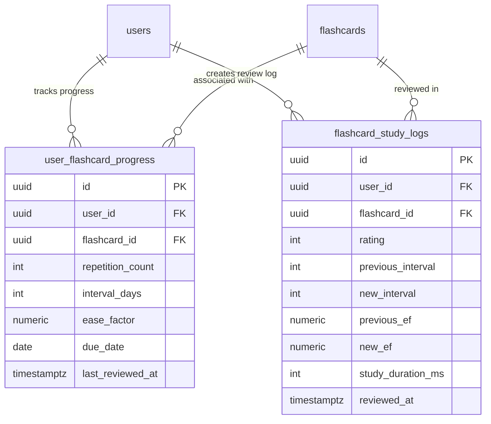

### ĐẶC TẢ CHI TIẾT CHỨC NĂNG (SPECIFICATION)
#### PHÂN HỆ HỌC TẬP CÁ NHÂN (MOD_STU)
##### MODULE: FNC_STU_04 — LUYỆN TẬP THÔNG MINH THEO THUẬT TOÁN SPACED REPETITION SM-2

--------------------------------------------------------------------------------

#### 1. TỔNG QUAN CHỨC NĂNG (OVERVIEW)
##### 1.1. Thông tin chung
*   **Mã phân hệ:**  MOD_STU (Student Learning Module)
*   **Mã chức năng:**  FNC_STU_04
*   **Tên chức năng:**  Luyện tập thông minh theo thuật toán lặp lại ngắt quãng SM-2 (Spaced Repetition System Engine & Adaptive Flashcard Scheduler)
*   **Đối tượng sử dụng (Actors):**  Học viên (Student)
*   **Mục tiêu nghiệp vụ:**
    *  Ứng dụng mô hình khoa học thần kinh về đường cong quên lãng (Ebbinghaus Forgetting Curve) và thuật toán SuperMemo-2 (SM-2) để tính toán chính xác thời điểm vàng cần ôn tập cho từng thẻ từ vựng cụ thể.
    *  Phân tích phản xạ trí nhớ của học viên qua 4 mức đánh giá ($q \in {1, 2, 3, 4}$: Quên, Khó, Tốt, Dễ) để điều chỉnh động Hệ số dễ nhớ ($EF$) và khoảng cách số ngày ôn tập tiếp theo ($I$).
    *  Quản lý hàng đợi học tập thích ứng trong phiên (In-Session Relearning Queue): Các từ học viên đánh giá "Quên" ($q < 3$) sẽ không kết thúc ngay mà được tự động luân chuyển về cuối hàng đợi phiên học để học viên gặp lại và củng cố ngay trước khi hoàn thành phiên.
    *  Cung cấp chỉ số phân tích độ ghi nhớ dài hạn (Retention Rate) và phân bổ từ vựng theo các giai đoạn nhớ: Từ mới (New) $ ightarrow$ Đang học (Learning) $ ightarrow$ Thành thạo (Mastered).

--------------------------------------------------------------------------------

#### 2. THUẬT TOÁN TOÁN HỌC CỐT LÕI & CÔNG THỨC SM-2 (MATHEMATICAL ENGINE)
##### 2.1. Các biến số đầu vào & đầu ra
| Ký hiệu toán học | Tên biến | Kiểu dữ liệu | Ý nghĩa & Miền giá trị |
| ------ | ------ | ------ | ------ |
| **$q$** | Rating / Quality of Response | Số nguyên | Điểm phản xạ trí nhớ do học viên chọn: $q \in {1, 2, 3, 4}$ |
| **$EF$** | Ease Factor | Số thực (2 chữ số thập phân) | Hệ số phản ánh độ khó của từ vựng đối với học viên: $EF \ge 1.30$, mặc định khởi tạo $EF_0 = 2.50$ |
| **$n$** | Repetition Count | Số nguyên | Số lần học viên ghi nhớ thành công liên tiếp ($q \ge 3$): $n \ge 0$ |
| **$I$** | Inter-repetition Interval | Số nguyên | Khoảng cách số ngày chờ cho đến lần ôn tập tiếp theo: $I \ge 1$ ngày |
| **$	ext{due_date}$** | Next Due Date | Ngày (Date) | Mốc ngày chính xác cần ôn lại: $	ext{due_date} = 	ext{CURRENT_DATE} + I$ |


--------------------------------------------------------------------------------

##### 2.2. Chi tiết công thức tính toán tuần tự
###### Bước 1: Tính toán lại Hệ số Dễ nhớ ($EF'$)
Mỗi khi học viên đánh giá một thẻ sau khi lật, hệ số $EF$ được cập nhật theo công thức SuperMemo-2: $$EF' = EF + \left(0.1 - (5 - q) 	imes (0.08 + (5 - q) 	imes 0.02) ight)$$
*Bảng biến thiên giá trị $EF$ theo mức đánh giá $q$:*
*   **Nếu $q = 4$ (Dễ):**  $EF' = EF + 0.10$ (Hệ số tăng $ ightarrow$ từ dễ nhớ, giãn nhanh khoảng cách ôn).
*   **Nếu $q = 3$ (Tốt):**  $EF' = EF - 0.14$ (Hệ số giảm nhẹ $ ightarrow$ duy trì nhịp ôn vừa phải).
*   **Nếu $q = 2$ (Khó):**  $EF' = EF - 0.32$ (Hệ số giảm mạnh $ ightarrow$ từ khó, cần tăng tần suất gặp lại).
*   **Nếu $q = 1$ (Quên):**  $EF' = EF - 0.54$ (Hệ số giảm sâu).
**Ràng buộc ngưỡng sàn an toàn (Boundary Clamping):**   $$EF_{	ext{mới}} = \max(EF',\, 1.30)$$   *Lý do:*  Nếu $EF < 1.30$, khoảng cách ôn tập sẽ bị co cụm quá mức dẫn đến hiện tượng quá tải từ vựng (Over-repetition Trap).

--------------------------------------------------------------------------------

###### Bước 2: Xác định Số lần lặp thành công ($n$) và Khoảng cách ôn tiếp theo ($I$)
*   **Trường hợp 1: Đánh giá thành công ($q \ge 3$)**
*  Tăng số lần lặp liên tiếp:  $$n_{	ext{mới}} = n + 1$$
*  Tính khoảng cách ngày $I(n)$: $$I(n) = egin{cases} 1 	ext{ ngày} & 	ext{khi } n_{	ext{mới}} = 1 \ 6 	ext{ ngày} & 	ext{khi } n_{	ext{mới}} = 2 \ ext{round}\left(I_{	ext{cũ}} 	imes EF_{	ext{mới}} ight) & 	ext{khi } n_{	ext{mới}} > 2 \end{cases}$$
*   **Trường hợp 2: Đánh giá thất bại ($q < 3$: Quên / Rất khó)**
*  Học viên không nhớ từ $ ightarrow$ Chuỗi lặp thành công bị đứt:  $$n_{	ext{mới}} = 0$$
*  Đặt lại khoảng cách ôn tập ngắn nhất để học viên ôn lại vào ngay ngày mai:  $$I_{	ext{mới}} = 1 	ext{ ngày}$$

--------------------------------------------------------------------------------

###### Bước 3: Cập nhật Ngày đến hạn ($	ext{due_date}$)
$$ext{due\_date} = 	ext{CURRENT\_DATE} + I_{	ext{mới}}$$

--------------------------------------------------------------------------------

##### 2.3. Cơ chế Hàng đợi Luân chuyển trong Phiên học (In-Session Relearning Queue)
Khi học viên đang trong một phiên học 20 từ:
1. Mỗi thẻ khi bắt đầu phiên có trạng thái UNSEEN.
2. Học viên lật thẻ và chọn $q$:
    *  Nếu $q \ge 3$: Thẻ được đánh dấu GRADUATED (Tốt nghiệp phiên học), gửi API cập nhật SM-2 về Backend.
    *  Nếu $q < 3$: Thẻ chuyển trạng thái RELEARN và được  **đẩy về cuối hàng đợi của phiên học** .
3. Phiên học chỉ thực sự kết thúc khi hàng đợi không còn thẻ nào ở trạng thái RELEARN. Điều này đảm bảo học viên phải nhớ được từ đó ít nhất một lần trước khi rời màn hình học.

--------------------------------------------------------------------------------

#### 3. THIẾT KẾ CƠ SỞ DỮ LIỆU (DATABASE SCHEMA - POSTGRESQL 16)
Hệ thống lưu trạng thái tiến trình SM-2 hiện tại trong user_flashcard_progress và ghi toàn bộ lịch sử các lần bấm nút $q$ vào flashcard_study_logs để vẽ biểu đồ tiến độ học tập và phân tích tỷ lệ ghi nhớ.

##### 3.1. DDL Script PostgreSQL 16
```sql
-- 1. BẢNG TIẾN TRÌNH THẺ TỪ VỰNG HIỆN TẠI (ĐÃ CÓ TRONG THIẾT KẾ GỐC)
-- Bảng này lưu trạng thái mới nhất phục vụ truy vấn thời gian thực tốc độ cao
CREATE TABLE IF NOT EXISTS user_flashcard_progress (
    id UUID PRIMARY KEY DEFAULT uuid_generate_v4(),
    user_id UUID NOT NULL REFERENCES users(id) ON DELETE CASCADE,
    flashcard_id UUID NOT NULL REFERENCES flashcards(id) ON DELETE CASCADE,
    repetition_count INT DEFAULT 0 NOT NULL CHECK (repetition_count >= 0),
    interval_days INT DEFAULT 0 NOT NULL CHECK (interval_days >= 0),
    ease_factor NUMERIC(4, 2) DEFAULT 2.50 NOT NULL CHECK (ease_factor >= 1.30),
    due_date DATE DEFAULT CURRENT_DATE NOT NULL,
    last_reviewed_at TIMESTAMPTZ,
    CONSTRAINT uq_user_flashcard UNIQUE(user_id, flashcard_id)
);

-- 2. BẢNG LỊCH SỬ CÁC LẦN ĐÁNH GIÁ (SRS REVIEW LOGS)
-- Lưu lại từng lượt học để phục vụ phân tích đường cong quên lãng
CREATE TABLE IF NOT EXISTS flashcard_study_logs (
    id UUID PRIMARY KEY DEFAULT uuid_generate_v4(),
    user_id UUID NOT NULL REFERENCES users(id) ON DELETE CASCADE,
    flashcard_id UUID NOT NULL REFERENCES flashcards(id) ON DELETE CASCADE,
    rating SMALLINT NOT NULL CHECK (rating BETWEEN 1 AND 4),
    previous_interval INT NOT NULL,
    new_interval INT NOT NULL,
    previous_ef NUMERIC(4, 2) NOT NULL,
    new_ef NUMERIC(4, 2) NOT NULL,
    study_duration_ms INT DEFAULT 0, -- Thời gian học sinh dừng lại nhìn thẻ trước khi đánh giá
    reviewed_at TIMESTAMPTZ DEFAULT CURRENT_TIMESTAMP NOT NULL
);

-- CHỈ MỤC TỐI ƯU TRUY VẤN
CREATE INDEX IF NOT EXISTS idx_user_flashcard_due_query 
ON user_flashcard_progress(user_id, due_date ASC);

CREATE INDEX IF NOT EXISTS idx_study_logs_user_date 
ON flashcard_study_logs(user_id, reviewed_at DESC);

```

--------------------------------------------------------------------------------

#### 4. THIẾT KẾ BACKEND (NESTJS & RESTFUL APIS)
##### 4.1. Danh mục RESTful API Endpoints
| STT | Method | Endpoint URI | Phân quyền | Mô tả chức năng |
| ------ | ------ | ------ | ------ | ------ |
| 1 | POST | /api/v1/student/flashcards/:id/review | Student | Gửi đánh giá phản xạ $q$, tính toán SM-2, cập nhật CSDL và Streak |
| 2 | POST | /api/v1/student/flashcards/batch-review | Student | Gửi danh sách nhiều thẻ đã hoàn thành trong phiên học cùng lúc |
| 3 | GET | /api/v1/student/flashcards/due-summary | Student | Lấy tổng quan số thẻ đến hạn hôm nay chia theo từng bộ thẻ |
| 4 | GET | /api/v1/student/flashcards/retention-stats | Student | Thống kê tỷ lệ ghi nhớ dài hạn (% thành thạo, % quên theo tuần) |


--------------------------------------------------------------------------------

##### 4.2. Data Transfer Objects (DTOs) & Validation
```typescript
// src/modules/flashcards/dto/review-card.dto.ts
import { IsInt, Min, Max, IsOptional, IsDateString } from 'class-validator';
import { ApiProperty, ApiPropertyOptional } from '@nestjs/swagger';

export class ReviewCardDto {
  @ApiProperty({
    description: 'Thang điểm phản xạ SM-2 (1: Quên, 2: Khó, 3: Tốt, 4: Dễ)',
    example: 3,
    minimum: 1,
    maximum: 4,
  })
  @IsInt({ message: 'Điểm phản xạ phải là số nguyên' })
  @Min(1, { message: 'Mức đánh giá tối thiểu là 1' })
  @Max(4, { message: 'Mức đánh giá tối đa là 4' })
  rating: number;

  @ApiPropertyOptional({
    description: 'Thời gian người học dừng lại xem thẻ trước khi bấm (miligiây)',
    example: 3200,
  })
  @IsOptional()
  @IsInt()
  studyDurationMs?: number;

  @ApiPropertyOptional({
    description: 'Mốc thời gian thực hiện trên client (hỗ trợ offline)',
    example: '2026-10-12T14:30:00.000Z',
  })
  @IsOptional()
  @IsDateString()
  reviewedAt?: string;
}

```
```typescript
// src/modules/flashcards/dto/review-response.dto.ts
export class ReviewResponseDto {
  flashcardId: string;
  rating: number;
  repetitionCount: number;
  intervalDays: number;
  easeFactor: number;
  dueDate: string;
  isMastered: boolean;
  message: string;
}

```

--------------------------------------------------------------------------------

##### 4.3. Động cơ Thuật toán SM-2 Toán học Thuần túy (Sm2EngineService)
```typescript
// src/modules/flashcards/services/sm2-engine.service.ts
import { Injectable } from '@nestjs/common';

export interface Sm2CalculationInput {
  currentRepetition: number;
  currentInterval: number;
  currentEaseFactor: number;
  rating: number;
  baseDate?: Date;
}

export interface Sm2CalculationOutput {
  nextRepetition: number;
  nextInterval: number;
  nextEaseFactor: number;
  nextDueDate: string; // YYYY-MM-DD
}

@Injectable()
export class Sm2EngineService {
  private readonly MIN_EASE_FACTOR = 1.30;
  private readonly DEFAULT_EASE_FACTOR = 2.50;

  /**
   * Tính toán các tham số SM-2 theo tiêu chuẩn khoa học
   */
  calculateNextSchedule(input: Sm2CalculationInput): Sm2CalculationOutput {
    const {
      currentRepetition,
      currentInterval,
      currentEaseFactor,
      rating,
      baseDate = new Date(),
    } = input;

    // 1. Cập nhật Hệ số Ease Factor (EF')
    const prevEf = Number(currentEaseFactor) || this.DEFAULT_EASE_FACTOR;
    const deltaEf = 0.1 - (5 - rating) * (0.08 + (5 - rating) * 0.02);
    let nextEf = prevEf + deltaEf;

    if (nextEf < this.MIN_EASE_FACTOR) {
      nextEf = this.MIN_EASE_FACTOR;
    }

    // 2. Tính số lần lặp thành công (n) và Khoảng cách (I)
    let nextRepetition: number;
    let nextInterval: number;

    if (rating >= 3) {
      nextRepetition = currentRepetition + 1;

      if (nextRepetition === 1) {
        nextInterval = 1;
      } else if (nextRepetition === 2) {
        nextInterval = 6;
      } else {
        nextInterval = Math.round(currentInterval * nextEf);
      }
    } else {
      // Đánh giá Quên (q < 3) -> Reset chuỗi
      nextRepetition = 0;
      nextInterval = 1;
    }

    // 3. Tính ngày đến hạn YYYY-MM-DD
    const calcDate = new Date(baseDate);
    calcDate.setDate(calcDate.getDate() + nextInterval);
    const nextDueDate = calcDate.toISOString().split('T')[0];

    return {
      nextRepetition,
      nextInterval,
      nextEaseFactor: Number(nextEf.toFixed(2)),
      nextDueDate,
    };
  }
}

```

--------------------------------------------------------------------------------

##### 4.4. Xử lý Dịch vụ Nghiệp vụ & Transaction (FlashcardSrsService)
```typescript
// src/modules/flashcards/services/flashcard-srs.service.ts
import { Injectable, NotFoundException } from '@nestjs/common';
import { InjectRepository } from '@nestjs/typeorm';
import { Repository, DataSource } from 'typeorm';
import { UserFlashcardProgressEntity } from '../entities/user-flashcard-progress.entity';
import { FlashcardEntity } from '../entities/flashcard.entity';
import { Sm2EngineService } from './sm2-engine.service';
import { ReviewCardDto } from '../dto/review-card.dto';
import { ReviewResponseDto } from '../dto/review-response.dto';
import { UserStreakEntity } from '../../users/entities/user-streak.entity';

@Injectable()
export class FlashcardSrsService {
  constructor(
    @InjectRepository(FlashcardEntity)
    private readonly cardRepo: Repository<FlashcardEntity>,
    @InjectRepository(UserFlashcardProgressEntity)
    private readonly progressRepo: Repository<UserFlashcardProgressEntity>,
    @InjectRepository(UserStreakEntity)
    private readonly streakRepo: Repository<UserStreakEntity>,
    private readonly sm2Engine: Sm2EngineService,
    private readonly dataSource: DataSource,
  ) {}

  /**
   * Đánh giá thẻ từ vựng với tính toàn vẹn Transaction cao
   */
  async processReview(
    userId: string,
    cardId: string,
    dto: ReviewCardDto,
  ): Promise<ReviewResponseDto> {
    const card = await this.cardRepo.findOne({ where: { id: cardId } });
    if (!card) throw new NotFoundException({ errorCode: 'ERR_NOT_FOUND', message: 'Thẻ từ vựng không tồn tại' });

    return this.dataSource.transaction(async (manager) => {
      // 1. Lấy hoặc khởi tạo tiến trình học
      let progress = await manager.findOne(UserFlashcardProgressEntity, {
        where: { userId, flashcardId: cardId },
      });

      const isFirstTime = !progress;
      if (!progress) {
        progress = manager.create(UserFlashcardProgressEntity, {
          userId,
          flashcardId: cardId,
          repetitionCount: 0,
          intervalDays: 0,
          easeFactor: 2.50,
        });
      }

      const prevInterval = progress.intervalDays;
      const prevEf = progress.easeFactor;

      // 2. Tính toán lịch ôn tiếp theo qua Động cơ SM-2
      const sm2Output = this.sm2Engine.calculateNextSchedule({
        currentRepetition: progress.repetitionCount,
        currentInterval: progress.intervalDays,
        currentEaseFactor: Number(progress.easeFactor),
        rating: dto.rating,
        baseDate: dto.reviewedAt ? new Date(dto.reviewedAt) : new Date(),
      });

      // 3. Cập nhật bảng tiến trình
      progress.repetitionCount = sm2Output.nextRepetition;
      progress.intervalDays = sm2Output.nextInterval;
      progress.easeFactor = sm2Output.nextEaseFactor;
      progress.dueDate = sm2Output.nextDueDate;
      progress.lastReviewedAt = dto.reviewedAt ? new Date(dto.reviewedAt) : new Date();

      await manager.save(progress);

      // 4. Ghi bản ghi vào bảng lịch sử flashcard_study_logs
      await manager.query(
        `
        INSERT INTO flashcard_study_logs 
          (user_id, flashcard_id, rating, previous_interval, new_interval, previous_ef, new_ef, study_duration_ms, reviewed_at)
        VALUES 
          ($1, $2, $3, $4, $5, $6, $7, $8, $9)
        `,
        [
          userId,
          cardId,
          dto.rating,
          prevInterval,
          sm2Output.nextInterval,
          prevEf,
          sm2Output.nextEaseFactor,
          dto.studyDurationMs || 0,
          progress.lastReviewedAt,
        ],
      );

      // 5. Cập nhật chuỗi Streak học tập liên tục
      await this.touchUserStreak(manager, userId);

      const isMastered = progress.intervalDays > 21 && progress.repetitionCount >= 3;

      return {
        flashcardId: cardId,
        rating: dto.rating,
        repetitionCount: progress.repetitionCount,
        intervalDays: progress.intervalDays,
        easeFactor: progress.easeFactor,
        dueDate: progress.dueDate,
        isMastered,
 
```
```typescript
       message: isMastered
          ? 'Từ vựng đã đạt cấp độ thành thạo!'
          : `Hẹn gặp lại từ này sau ${progress.intervalDays} ngày.`,
      };
    });
  }

  /**
   * Cập nhật chỉ số chuyên cần học tập
   */
  private async touchUserStreak(manager: EntityManager, userId: string) {
    const today = new Date().toISOString().split('T')[0];
    let streak = await manager.findOne(UserStreakEntity, { where: { userId } });

    if (!streak) {
      streak = manager.create(UserStreakEntity, {
        userId,
        currentStreak: 1,
        longestStreak: 1,
        lastActivityDate: today,
      });
      return manager.save(streak);
    }

    if (streak.lastActivityDate === today) return;

    const diffDays = Math.floor(
      (new Date(today).getTime() - new Date(streak.lastActivityDate).getTime()) / (1000 * 3600 * 24),
    );

    if (diffDays === 1) {
      streak.currentStreak += 1;
      if (streak.currentStreak > streak.longestStreak) {
        streak.longestStreak = streak.currentStreak;
      }
    } else {
      streak.currentStreak = 1;
    }

    streak.lastActivityDate = today;
    await manager.save(streak);
  }
}

```

--------------------------------------------------------------------------------

#### 5. THIẾT KẾ FRONTEND (REACT NATIVE / ZUSTAND / UI SPEC)
##### 5.1. Bố cục Giao diện 4 Nút Đánh giá SM-2 (UI Specs)
```text
+---------------------------------------------------------------------------------+
|                                 BẢNG CHẤM PHẢN XẠ SM-2                          |
|                                                                                 |
|   +-------------------+  +-------------------+  +-------------------+  +------+ |
|   |    [1] QUÊN       |  |     [2] KHÓ       |  |     [3] TỐT       |  |  [4] | |
|   |   Học lại ngay    |  |     ~ 2 ngày      |  |     ~ 4 ngày      |  |  ~ 7 | |
|   |   (Màu Đỏ Hồng)   |  |   (Màu Cam Đất)   |  |  (Màu Xanh Biển)  |  |  (Xan| |
|   +-------------------+  +-------------------+  +-------------------+  +------+ |
|                                                                                 |
|   * Phím tắt (Bàn phím ngoài / Web): Số [1], [2], [3], [4] tương ứng            |
|   * Haptic Feedback: Chạm nhẹ (Light vibration) xác nhận đã nhận tín hiệu       |
+---------------------------------------------------------------------------------+

```

--------------------------------------------------------------------------------

##### 5.2. Quản lý Trạng thái Hàng đợi SRS (useSrsStudyStore.ts)
```typescript
// mobile-client/src/stores/useSrsStudyStore.ts
import { create } from 'zustand';
import * as Haptics from 'expo-haptics';

export interface SrsCard {
  id: string;
  term: string;
  phoneticIpa: string;
  partOfSpeech: string;
  definition: string;
  exampleSentence: string;
  audioUrl?: string;
  intervalDays?: number;
  repetitionCount?: number;
}

interface SrsStudyState {
  deckId: string | null;
  activeQueue: SrsCard[];       // Hàng đợi các thẻ đang học
  relearnList: SrsCard[];       // Các thẻ bị đánh giá quên trong phiên
  graduatedCount: number;       // Số thẻ đã thuộc và kết thúc phiên
  currentIndex: number;
  isFlipped: boolean;

  // Actions
  initializeSession: (deckId: string, cards: SrsCard[]) => void;
  toggleFlip: () => void;
  handleRate: (rating: 1 | 2 | 3 | 4) => { isSessionComplete: boolean; currentCard: SrsCard };
  resetSession: () => void;
}

export const useSrsStudyStore = create<SrsStudyState>((set, get) => ({
  deckId: null,
  activeQueue: [],
  relearnList: [],
  graduatedCount: 0,
  currentIndex: 0,
  isFlipped: false,

  initializeSession: (deckId, cards) => {
    set({
      deckId,
      activeQueue: cards,
      relearnList: [],
      graduatedCount: 0,
      currentIndex: 0,
      isFlipped: false,
    });
  },

  toggleFlip: () => set((state) => ({ isFlipped: !state.isFlipped })),

  handleRate: (rating) => {
    const { activeQueue, currentIndex, relearnList, graduatedCount } = get();
    const currentCard = activeQueue[currentIndex];

    // Rung nhẹ xúc giác
    Haptics.impactAsync(
      rating < 3 ? Haptics.ImpactFeedbackStyle.Medium : Haptics.ImpactFeedbackStyle.Light,
    );

    let updatedQueue = [...activeQueue];
    let updatedRelearn = [...relearnList];
    let newGraduatedCount = graduatedCount;

    if (rating < 3) {
      // Đánh giá QUÊN / KHÓ: Đẩy thẻ về cuối hàng đợi phiên học để học viên gặp lại
      updatedQueue.push(currentCard);
      if (!updatedRelearn.some((c) => c.id === currentCard.id)) {
        updatedRelearn.push(currentCard);
      }
    } else {
      // Đạt chuẩn: Tốt nghiệp phiên học
      newGraduatedCount += 1;
    }

    const nextIndex = currentIndex + 1;
    const isSessionComplete = nextIndex >= updatedQueue.length;

    set({
      activeQueue: updatedQueue,
      relearnList: updatedRelearn,
      graduatedCount: newGraduatedCount,
      currentIndex: nextIndex,
      isFlipped: false,
    });

    return { isSessionComplete, currentCard };
  },

  resetSession: () => {
    set({
      deckId: null,
      activeQueue: [],
      relearnList: [],
      graduatedCount: 0,
      currentIndex: 0,
      isFlipped: false,
    });
  },
}));

```

--------------------------------------------------------------------------------

##### 5.3. Component Nút Đánh giá Động SM-2: SrsRatingButtons.tsx
```tsx
import React from 'react';
import { View, Text, Pressable, StyleSheet } from 'react-native';

interface Props {
  currentInterval?: number;
  easeFactor?: number;
  onRate: (rating: 1 | 2 | 3 | 4) => void;
}

export const SrsRatingButtons: React.FC<Props> = ({
  currentInterval = 0,
  easeFactor = 2.50,
  onRate,
}) => {
  // Dự đoán khoảng cách ngày hiển thị trên nút để người học dễ hình dung
  const predictDays = (rating: number): string => {
    if (rating === 1) return 'Học lại';
    if (rating === 2) return '1 ngày';
    if (rating === 3) {
      return currentInterval === 0 ? '1 ngày' : currentInterval === 1 ? '6 ngày' : `${Math.round(currentInterval * easeFactor)} ngày`;
    }
    // rating === 4
    const boostEf = easeFactor + 0.1;
    return currentInterval === 0 ? '4 ngày' : `${Math.round(Math.max(6, currentInterval * boostEf))} ngày`;
  };

  return (
    <View style={styles.container}>
      {/* 1. NÚT QUÊN */}
      <Pressable onPress={() => onRate(1)} style={[styles.btn, styles.btnForgot]}>
        <Text style={styles.btnTitle}>Quên (1)</Text>
        <Text style={styles.btnSub}>{predictDays(1)}</Text>
      </Pressable>

      {/* 2. NÚT KHÓ */}
      <Pressable onPress={() => onRate(2)} style={[styles.btn, styles.btnHard]}>
        <Text style={styles.btnTitle}>Khó (2)</Text>
        <Text style={styles.btnSub}>{predictDays(2)}</Text>
      </Pressable>

      {/* 3. NÚT TỐT */}
      <Pressable onPress={() => onRate(3)} style={[styles.btn, styles.btnGood]}>
        <Text style={styles.btnTitle}>Tốt (3)</Text>
        <Text style={styles.btnSub}>{predictDays(3)}</Text>
      </Pressable>

      {/* 4. NÚT DỄ */}
      <Pressable onPress={() => onRate(4)} style={[styles.btn, styles.btnEasy]}>
        <Text style={styles.btnTitle}>Dễ (4)</Text>
        <Text style={styles.btnSub}>{predictDays(4)}</Text>
      </Pressable>
    </View>
  );
};

const styles = StyleSheet.create({
  container: {
    flexDirection: 'row',
    justifyContent: 'space-between',
    gap: 8,
    width: '100%',
    paddingHorizontal: 16,
    paddingVertical: 12,
  },
  btn: {
    flex: 1,
    paddingVertical: 12,
    borderRadius: 16,
    alignItems: 'center',
    justifyContent: 'center',
    shadowColor: '#000',
    shadowOffset: { width: 0, height: 2 },
    shadowOpacity: 0.08,
    shadowRadius: 4,
    elevation: 3,
  },
  btnForgot: {
    backgroundColor: '#ef4444',
  },
  btnHard: {
    backgroundColor: '#f59e0b',
  },
  btnGood: {
    backgroundColor: '#3b82f6',
  },
  btnEasy: {
    backgroundColor: '#10b981',
  },
  btnTitle: {
    color: '#ffffff',
    fontSize: 13,
    fontWeight: '800',
  },
  btnSub: {
    color: 'rgba(255, 255, 255, 0.85)',
    fontSize: 10,
    fontWeight: '500',
    marginTop: 2,
  },
});

```

--------------------------------------------------------------------------------

#### 6. QUY TẮC NGHIỆP VỤ & XỬ LÝ NGOẠI LỆ (BUSINESS RULES & EDGE CASES)
1.  **Quy tắc Thời điểm Sang ngày Mới (Cutoff Time)** :
    *  Điểm mốc chuyển giao ngày tính hạn ôn tập là  **00:00:00 theo múi giờ địa phương của học viên**  (Ví dụ UTC+7 tại Việt Nam).
    *  Mọi thẻ có $	ext{due_date} \le 	ext{CURRENT_DATE}$ đều được hệ thống coi là thẻ đến hạn và đưa vào danh sách cần học.
2.  **Xử lý Thẻ Quá Hạn Lâu Ngày (Overdue Penalty Handling)** :
    *  Nếu học viên bỏ bẵng không học trong 30 ngày và có thẻ quá hạn 20 ngày so với due_date:
*  Nếu học viên bấm $q \ge 3$: Khoảng cách mới được tính toán dựa trên ngày thực tế học sinh ôn tập, không cộng dồn thời gian bỏ quên để tránh giãn lịch quá xa gây quên từ.
    *  Nếu học viên bấm $q < 3$: Hệ thống trừ thêm $0.20$ vào $EF$ để phạt độ quên sâu của từ.
3.  **Chống Click Đúp & Idempotent API** :
    *  Client tự động vô hiệu hóa (disable) cả 4 nút đánh giá trong 400ms sau khi nhận tương tác click để ngăn học viên bấm liên tiếp gây sai lệch chuỗi lặp $n$.
4.  **Đồng bộ Ngoại tuyến & Lệch Múi giờ** :
    *  Khi client học offline, trường clientTimestamp dạng ISO-8601 được đính kèm vào mỗi bản ghi. Backend sẽ dùng mốc thời gian này làm baseDate để tính toán chính xác ngày đến hạn tiếp theo mà không bị ảnh hưởng bởi độ trễ gửi mạng.
