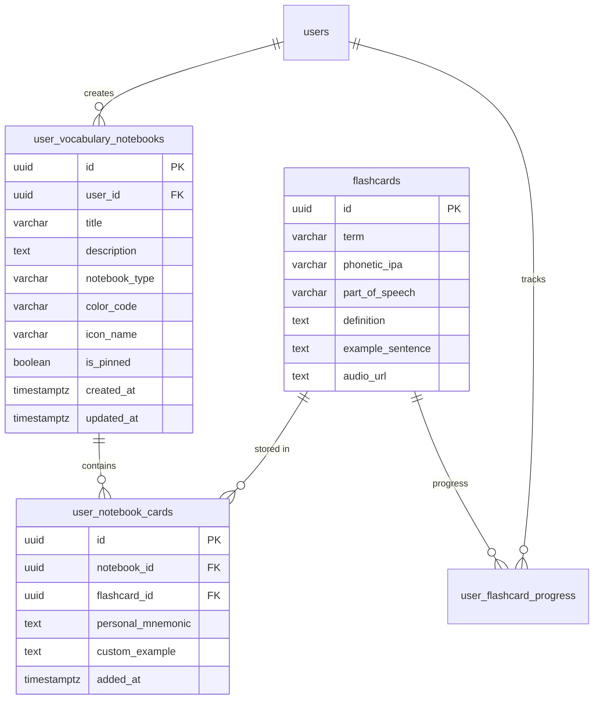

### ĐẶC TẢ CHI TIẾT CHỨC NĂNG (SPECIFICATION)
#### PHÂN HỆ HỌC TẬP CÁ NHÂN (MOD_STU)
##### MODULE: FNC_STU_05 — ĐÁNH DẤU TỪ YÊU THÍCH & TẠO SỔ TAY TỪ VỰNG KHÓ NHỚ

--------------------------------------------------------------------------------

#### 1. TỔNG QUAN CHỨC NĂNG (OVERVIEW)
##### 1.1. Thông tin chung
*   **Mã phân hệ:**  MOD_STU (Student Learning Module)
*   **Mã chức năng:**  FNC_STU_05
*   **Tên chức năng:**  Đánh dấu từ yêu thích và tạo sổ tay từ vựng khó nhớ (Vocabulary Notebooks & Bookmark Manager)
*   **Đối tượng sử dụng (Actors):**  Học viên (Student)
*   **Mục tiêu nghiệp vụ:**
    *  Cung cấp công cụ tổ chức, cá nhân hóa kho từ vựng học tập: Cho phép học viên tự do tạo nhiều sổ tay từ vựng chuyên đề (Custom Notebooks) như  *"Từ vựng bẫy TOEIC Part 7"* ,  *"Cụm Collocations dễ nhầm lẫn"* ,  *"Từ vựng chuyên ngành Tài chính"* ,... với màu sắc và biểu tượng nhận diện riêng.
    *  Hỗ trợ tính năng Đánh dấu sao nhanh (Quick Star / Bookmark) ngay trong quá trình lật thẻ 3D Flashcard hoặc khi làm bài thi thử TOEIC để gom từ vào Sổ tay Yêu thích mặc định.
    *  Tích hợp tính năng  **Sổ tay Thông minh tự động gom từ khó (Smart Troubled Words Notebook)** : Hệ thống tự động phân tích dữ liệu thuật toán SM-2 để lọc ra những từ học viên thường xuyên quên ($q < 3$ nhiều lần hoặc Hệ số Dễ nhớ $EF \le 1.70$) vào một danh sách cứu trợ riêng biệt.
    *  Cho phép học viên ghi chú ngữ cảnh cá nhân, mẹo ghi nhớ liên tưởng (Mnemonics) cho từng từ vựng trong sổ tay.
    *  Khởi tạo phiên luyện tập tương tác (Study from Notebook) trực tiếp từ bất kỳ sổ tay cá nhân nào theo thuật toán SM-2 hoặc Quick Quiz kiểm tra phản xạ.

--------------------------------------------------------------------------------

#### 2. THIẾT KẾ CƠ SỞ DỮ LIỆU (DATABASE SCHEMA - POSTGRESQL 16)
Hệ thống thiết kế mô hình cơ sở dữ liệu quan hệ chặt chẽ với bảng danh mục sổ tay user_vocabulary_notebooks và bảng liên kết nhiều-nhiều user_notebook_cards hỗ trợ ghi chú ngữ cảnh riêng cho từng từ.

##### 2.1. DDL Script PostgreSQL 16
```sql
-- 1. ENUM LOẠI SỔ TAY TỪ VỰNG
CREATE TYPE notebook_type_enum AS ENUM ('CUSTOM', 'STARRED', 'AUTO_DIFFICULT');

-- 2. BẢNG DANH MỤC SỔ TAY TỪ VỰNG CÁ NHÂN
CREATE TABLE IF NOT EXISTS user_vocabulary_notebooks (
    id UUID PRIMARY KEY DEFAULT uuid_generate_v4(),
    user_id UUID NOT NULL REFERENCES users(id) ON DELETE CASCADE,
    title VARCHAR(150) NOT NULL,
    description TEXT,
    notebook_type notebook_type_enum DEFAULT 'CUSTOM' NOT NULL,
    color_code VARCHAR(20) DEFAULT '#2563EB' NOT NULL, -- Mã màu HEX hiển thị (VD: #2563EB, #10B981, #F59E0B)
    icon_name VARCHAR(50) DEFAULT 'bookmark' NOT NULL,  -- Icon Lucide (book, star, alert-triangle, flame,...)
    is_pinned BOOLEAN DEFAULT false NOT NULL,           -- Ghim sổ tay lên đầu danh sách
    created_at TIMESTAMPTZ DEFAULT CURRENT_TIMESTAMP NOT NULL,
    updated_at TIMESTAMPTZ DEFAULT CURRENT_TIMESTAMP NOT NULL
);

-- 3. BẢNG LIÊN KẾT TỪ VỰNG VÀO SỔ TAY (KÈM GHI CHÚ MẸO NHỚ CÁ NHÂN)
CREATE TABLE IF NOT EXISTS user_notebook_cards (
    id UUID PRIMARY KEY DEFAULT uuid_generate_v4(),
    notebook_id UUID NOT NULL REFERENCES user_vocabulary_notebooks(id) ON DELETE CASCADE,
    flashcard_id UUID NOT NULL REFERENCES flashcards(id) ON DELETE CASCADE,
    personal_mnemonic TEXT,   -- Mẹo ghi nhớ / câu chuyện liên tưởng riêng của học viên
    custom_example TEXT,      -- Câu ví dụ cá nhân do học viên tự đặt
    added_at TIMESTAMPTZ DEFAULT CURRENT_TIMESTAMP NOT NULL,
    CONSTRAINT uq_notebook_flashcard UNIQUE(notebook_id, flashcard_id)
);

-- CHỈ MỤC TỐI ƯU TRUY VẤN
CREATE INDEX IF NOT EXISTS idx_notebooks_user ON user_vocabulary_notebooks(user_id, is_pinned DESC, updated_at DESC);
CREATE INDEX IF NOT EXISTS idx_notebook_cards_nb_id ON user_notebook_cards(notebook_id, added_at DESC);
CREATE INDEX IF NOT EXISTS idx_notebook_cards_card_id ON user_notebook_cards(flashcard_id);

```
##### 2.2. Khởi tạo Sổ tay Hệ thống Mặc định (Triggers / Event)
Khi một học viên đăng ký tài khoản mới thành công, hệ thống tự động sinh ra 2 sổ tay hệ thống mặc định:
1.  **Sổ tay Yêu thích (Starred Words)** : notebook_type = 'STARRED', icon star, màu vàng #F59E0B.
2.  **Sổ tay Từ khó cần ôn (Troubled Words)** : notebook_type = 'AUTO_DIFFICULT', icon alert-circle, màu đỏ #EF4444.

--------------------------------------------------------------------------------

#### 3. THIẾT KẾ BACKEND (NESTJS & RESTFUL APIS)
##### 3.1. Danh mục RESTful API Endpoints
| STT | Method | Endpoint URI | Phân quyền | Mô tả chức năng |
| ------ | ------ | ------ | ------ | ------ |
| 1 | GET | /api/v1/student/notebooks | Student | Lấy danh sách sổ tay cá nhân kèm số lượng từ vựng hiện có |
| 2 | POST | /api/v1/student/notebooks | Student | Tạo sổ tay từ vựng mới (Tùy chọn tiêu đề, màu sắc, icon) |
| 3 | PUT | /api/v1/student/notebooks/:id | Student | Cập nhật tên, mô tả, màu sắc hoặc ghim sổ tay |
| 4 | DELETE | /api/v1/student/notebooks/:id | Student | Xóa sổ tay cá nhân (Không áp dụng cho sổ tay hệ thống) |
| 5 | GET | /api/v1/student/notebooks/:id/cards | Student | Lấy danh sách từ trong sổ tay (kèm mẹo nhớ, phân trang, tìm kiếm) |
| 6 | POST | /api/v1/student/notebooks/:id/cards | Student | Thêm một hoặc nhiều từ vựng vào sổ tay kèm ghi chú |
| 7 | DELETE | /api/v1/student/notebooks/:id/cards/:cardId | Student | Xóa một từ vựng ra khỏi sổ tay cụ thể |
| 8 | PUT | /api/v1/student/notebooks/:id/cards/:cardId/mnemonic | Student | Cập nhật mẹo nhớ / câu ví dụ cá nhân cho từ vựng |
| 9 | POST | /api/v1/student/notebooks/quick-star/:cardId | Student | Đánh dấu sao nhanh / Bỏ sao (Toggle vào sổ tay Starred) |
| 10 | GET | /api/v1/student/notebooks/smart/troubled-words | Student | Lấy danh sách từ vựng hệ thống tự động đánh giá là khó ($EF \le 1.70$) |


--------------------------------------------------------------------------------

##### 3.2. Data Transfer Objects (DTOs) & Validation
```typescript
// src/modules/flashcards/dto/create-notebook.dto.ts
import { IsNotEmpty, IsString, MaxLength, Matches, IsOptional } from 'class-validator';
import { ApiProperty, ApiPropertyOptional } from '@nestjs/swagger';

export class CreateNotebookDto {
  @ApiProperty({ example: 'Từ vựng bẫy TOEIC Part 7', maxLength: 150 })
  @IsString()
  @IsNotEmpty({ message: 'Tiêu đề sổ tay không được để trống' })
  @MaxLength(150, { message: 'Tiêu đề sổ tay tối đa 150 ký tự' })
  title: string;

  @ApiPropertyOptional({ example: 'Tập hợp các từ đồng nghĩa và bẫy suy luận đoạn văn kép' })
  @IsOptional()
  @IsString()
  description?: string;

  @ApiPropertyOptional({ example: '#2563EB', description: 'Mã màu HEX hiển thị' })
  @IsOptional()
  @IsString()
  @Matches(/^#([A-Fa-f0-9]{6}|[A-Fa-f0-9]{3})$/, { message: 'Mã màu phải là định dạng HEX hợp lệ' })
  colorCode?: string;

  @ApiPropertyOptional({ example: 'book-open', description: 'Tên icon Lucide' })
  @IsOptional()
  @IsString()
  iconName?: string;
}

```
```typescript
// src/modules/flashcards/dto/add-card-to-notebook.dto.ts
import { IsUUID, IsOptional, IsString, MaxLength } from 'class-validator';
import { ApiProperty, ApiPropertyOptional } from '@nestjs/swagger';

export class AddCardToNotebookDto {
  @ApiProperty({ example: '9b1deb4d-3b7d-4bad-9bdd-2b0d7b3dcb6d' })
  @IsUUID('4', { message: 'flashcardId phải là định dạng UUID' })
  flashcardId: string;

  @ApiPropertyOptional({ example: 'Liên tưởng âm: nê-gô-ti-ây-sơn -> Đàm phán giá cả' })
  @IsOptional()
  @IsString()
  @MaxLength(500, { message: 'Mẹo nhớ tối đa 500 ký tự' })
  personalMnemonic?: string;

  @ApiPropertyOptional({ example: 'We entered negotiations with ABC Corp yesterday.' })
  @IsOptional()
  @IsString()
  @MaxLength(500, { message: 'Câu ví dụ cá nhân tối đa 500 ký tự' })
  customExample?: string;
}

```

--------------------------------------------------------------------------------

##### 3.3. Xử lý Nghiệp vụ Tầng Service (VocabularyNotebooksService)
```typescript
// src/modules/flashcards/services/vocabulary-notebooks.service.ts
import { Injectable, NotFoundException, BadRequestException } from '@nestjs/common';
import { InjectRepository } from '@nestjs/typeorm';
import { Repository, DataSource } from 'typeorm';
import { UserVocabularyNotebookEntity, NotebookType } from '../entities/user-vocabulary-notebook.entity';
import { UserNotebookCardEntity } from '../entities/user-notebook-card.entity';
import { CreateNotebookDto } from '../dto/create-notebook.dto';
import { AddCardToNotebookDto } from '../dto/add-card-to-notebook.dto';

@Injectable()
export class VocabularyNotebooksService {
  constructor(
    @InjectRepository(UserVocabularyNotebookEntity)
    private readonly notebookRepo: Repository<UserVocabularyNotebookEntity>,
    @InjectRepository(UserNotebookCardEntity)
    private readonly notebookCardRepo: Repository<UserNotebookCardEntity>,
    private readonly dataSource: DataSource,
  ) {}

  /**
   * Lấy danh sách sổ tay cá nhân của học viên kèm tổng số từ vựng trong mỗi sổ
   */
  async getUserNotebooks(userId: string) {
    const notebooks = await this.dataSource.query(
      `
      SELECT 
        nb.id,
        nb.title,
        nb.description,
        nb.notebook_type AS "notebookType",
        nb.color_code AS "colorCode",
        nb.icon_name AS "iconName",
        nb.is_pinned AS "isPinned",
        nb.created_at AS "createdAt",
        nb.updated_at AS "updatedAt",
        COUNT(nc.id)::int AS "totalCards"
      FROM user_vocabulary_notebooks nb
      LEFT JOIN user_notebook_cards nc ON nc.notebook_id = nb.id
      WHERE nb.user_id = $1
      GROUP BY nb.id
      ORDER BY nb.is_pinned DESC, nb.updated_at DESC
      `,
      [userId],
    );

    return notebooks;
  }

  /**
   * Tạo sổ tay từ vựng mới
   */
  async createNotebook(userId: string, dto: CreateNotebookDto) {
    // Giới hạn số lượng sổ tay tối đa tránh spam
    const currentCount = await this.notebookRepo.count({ where: { userId } });
    if (currentCount >= 30) {
      throw new BadRequestException({ errorCode: 'ERR_VAL_001', message: 'Bạn đã đạt giới hạn tối đa 30 sổ tay từ vựng' });
    }

    const notebook = this.notebookRepo.create({
      userId,
      title: dto.title,
      description: dto.description,
      colorCode: dto.colorCode || '#2563EB',
      iconName: dto.iconName || 'bookmark',
      notebookType: NotebookType.CUSTOM,
    });

    return this.notebookRepo.save(notebook);
  }

  /**
   * Thêm từ vựng vào sổ tay kèm ghi chú mẹo nhớ
   */
  async addCardToNotebook(userId: string, notebookId: string, dto: AddCardToNotebookDto) {
    const notebook = await this.notebookRepo.findOne({
      where: { id: notebookId, userId },
    });
    if (!notebook) throw new NotFoundException({ errorCode: 'ERR_NOT_FOUND', message: 'Sổ tay không tồn tại hoặc không thuộc quyền sở hữu' });

    // Kiểm tra từ đã tồn tại trong sổ tay chưa
    const existing = await this.notebookCardRepo.findOne({
      where: { notebookId, flashcardId: dto.flashcardId },
    });
    if (existing) {
      throw new BadRequestException({ errorCode: 'ERR_VAL_001', message: 'Từ vựng này đã có trong sổ tay của bạn' });
    }

    const newEntry = this.notebookCardRepo.create({
      notebookId,
      flashcardId: dto.flashcardId,
      personalMnemonic: dto.personalMnemonic,
      customExample: dto.customExample,
    });

    await this.notebookCardRepo.save(newEntry);

    // Cập nhật mốc thời gian sửa đổi của sổ tay
    await this.notebookRepo.update(notebookId, { updatedAt: new Date() });

    return { success: true, message: 'Đã thêm từ vựng vào sổ tay thành công' };
  }

  /**
   * Đánh dấu sao nhanh (Quick Star Toggle)
   * Tự động thêm hoặc xóa khỏi Sổ tay Starred mặc định
   */
  async toggleQuickStar(userId: string, cardId: string): Promise<{ isStarred: boolean }> {
    // 1. Tìm hoặc khởi tạo sổ tay Starred mặc định
    let starredNotebook = awai
```
```typescript
t this.notebookRepo.findOne({
      where: { userId, notebookType: NotebookType.STARRED },
    });

    if (!starredNotebook) {
      starredNotebook = await this.notebookRepo.save(
        this.notebookRepo.create({
          userId,
          title: 'Từ vựng yêu thích',
          description: 'Danh sách các từ vựng đã đánh dấu sao',
          notebookType: NotebookType.STARRED,
          colorCode: '#F59E0B',
          iconName: 'star',
          isPinned: true,
        }),
      );
    }

    // 2. Kiểm tra từ đã có trong sổ tay Starred chưa
    const existingCard = await this.notebookCardRepo.findOne({
      where: { notebookId: starredNotebook.id, flashcardId: cardId },
    });

    if (existingCard) {
      await this.notebookCardRepo.remove(existingCard);
      return { isStarred: false };
    } else {
      const newCard = this.notebookCardRepo.create({
        notebookId: starredNotebook.id,
        flashcardId: cardId,
      });
      await this.notebookCardRepo.save(newCard);
      return { isStarred: true };
    }
  }

  /**
   * Lấy danh sách từ trong sổ tay (kèm mẹo nhớ cá nhân và dữ liệu từ vựng)
   */
  async getCardsInNotebook(userId: string, notebookId: string, page: number = 1, limit: number = 20) {
    const notebook = await this.notebookRepo.findOne({
      where: { id: notebookId, userId },
    });
    if (!notebook) throw new NotFoundException({ errorCode: 'ERR_NOT_FOUND', message: 'Sổ tay không tồn tại' });

    const offset = (page - 1) * limit;

    const cards = await this.dataSource.query(
      `
      SELECT 
        nc.id AS "entryItemId",
        c.id AS "flashcardId",
        c.term,
        c.phonetic_ipa AS "phoneticIpa",
        c.part_of_speech AS "partOfSpeech",
        c.definition,
        c.example_sentence AS "exampleSentence",
        c.audio_url AS "audioUrl",
        nc.personal_mnemonic AS "personalMnemonic",
        nc.custom_example AS "customExample",
        nc.added_at AS "addedAt",
        COALESCE(prog.ease_factor, 2.50) AS "easeFactor",
        COALESCE(prog.interval_days, 0) AS "intervalDays"
      FROM user_notebook_cards nc
      INNER JOIN flashcards c ON c.id = nc.flashcard_id
      LEFT JOIN user_flashcard_progress prog 
        ON prog.flashcard_id = c.id AND prog.user_id = $1
      WHERE nc.notebook_id = $2
      ORDER BY nc.added_at DESC
      LIMIT $3 OFFSET $4
      `,
      [userId, notebookId, limit, offset],
    );

    const totalCount = await this.notebookCardRepo.count({ where: { notebookId } });

    return {
      notebook: {
        id: notebook.id,
        title: notebook.title,
        colorCode: notebook.colorCode,
        iconName: notebook.iconName,
        notebookType: notebook.notebookType,
      },
      cards,
      total: totalCount,
      page,
      limit,
    };
  }
}

```

--------------------------------------------------------------------------------

#### 4. THIẾT KẾ FRONTEND (REACT NATIVE / EXPO SDK 51)
##### 4.1. Cây màn hình Phân hệ Sổ tay Từ vựng (Screen Hierarchy)
```text
Notebook Stack Navigation
├── NotebookListScreen.tsx       # Danh sách các sổ tay cá nhân (Grid 2 cột)
├── NotebookDetailScreen.tsx     # Chi tiết sổ tay, danh sách từ, mẹo nhớ
├── CreateNotebookModal.tsx      # Modal tạo/sửa sổ tay (Color picker, icon)
├── AddToNotebookSheet.tsx       # BottomSheet chọn sổ tay khi đang học Flashcard
└── NotebookStudyScreen.tsx      # Chế độ học Flashcard 3D dành riêng cho sổ tay

```

--------------------------------------------------------------------------------

##### 4.2. Bố cục Giao diện Danh sách Sổ tay (NotebookListScreen)
```text
+-------------------------------------------------------------+
| SỔ TAY TỪ VỰNG CÁ NHÂN                          [ + Tạo mới ]|
+-------------------------------------------------------------+
| [ SỔ TAY HỆ THỐNG MẶC ĐỊNH ]                                |
| +---------------------------+  +--------------------------+ |
| | [ ⭐ ] Từ vựng Yêu thích  |  | [ ⚠️ ] Từ khó cần cứu trợ| |
| | 38 từ vựng đã lưu         |  | 14 từ (EF <= 1.70)       | |
| | Màu: Vàng hổ phách        |  | Màu: Đỏ cảnh báo         | |
| +---------------------------+  +--------------------------+ |
|                                                             |
| [ SỔ TAY CÁ NHÂN TỰ TẠO ] (4 sổ tay)                        |
| +---------------------------+  +--------------------------+ |
| | [ 📁 ] Bẫy TOEIC Part 7   |  | [ 💼 ] Tài chính & Kế toán| |
| | 25 từ vựng                |  | 52 từ vựng               | |
| | Màu: Xanh dương           |  | Màu: Xanh ngọc lục bảo   | |
| +---------------------------+  +--------------------------+ |
| +---------------------------+  +--------------------------+ |
| | [ ✈️ ] Du lịch & Nhà hàng |  | [ 📝 ] Động từ bất quy tắc| |
| | 18 từ vựng                |  | 60 từ vựng               | |
| | Màu: Tím Pastel           |  | Màu: Cam hoàng hôn       | |
| +---------------------------+  +--------------------------+ |
+-------------------------------------------------------------+

```

--------------------------------------------------------------------------------

##### 4.3. Mã Nguồn Mẫu Component Quản Lý Sổ Tay (NotebookListScreen.tsx)
```tsx
import React, { useState } from 'react';
import { View, Text, FlatList, Pressable, RefreshControl, ActivityIndicator } from 'react-native';
import { useQuery } from '@tanstack/react-query';
import { Plus, Star, AlertCircle, Bookmark, Folder, Pin, ChevronRight } from 'lucide-react-native';
import { CreateNotebookModal } from './components/CreateNotebookModal';
import axios from 'axios';

export const NotebookListScreen = ({ navigation }: unknown) => {
  const [isCreateModalVisible, setCreateModalVisible] = useState(false);

  // 1. Tải danh sách sổ tay từ API
  const { data: notebooks, isLoading, refetch, isRefetching } = useQuery({
    queryKey: ['user-vocabulary-notebooks'],
    queryFn: async () => {
      const res = await axios.get('/api/v1/student/notebooks');
      return res.data;
    },
  });

  const renderIcon = (iconName: string, color: string) => {
    switch (iconName) {
      case 'star':
        return <Star size={22} color={color} fill={color} />;
      case 'alert-circle':
        return <AlertCircle size={22} color={color} />;
      default:
        return <Bookmark size={22} color={color} />;
    }
  };

  const renderNotebookItem = ({ item }: { item: { id: string; term: string } }) => {
    return (
      <Pressable
        onPress={() => navigation.navigate('NotebookDetailScreen', { notebookId: item.id })}
        className="bg-white rounded-2xl p-4 mb-3 border border-slate-200 shadow-sm flex-row items-center justify-between active:bg-slate-50"
      >
        <View className="flex-row items-center flex-1 mr-3">
          {/* Khối biểu tượng sổ tay */}
          <View
            style={{ backgroundColor: `${item.colorCode}15` }}
            className="w-12 h-12 rounded-xl items-center justify-center mr-3"
          >
            {renderIcon(item.iconName, item.colorCode)}
          </View>

          {/* Chi tiết sổ tay */}
          <View className="flex-1">
            <View className="flex-row items-center gap-1.5">
              <Text className="text-base font-bold text-slate-800" numberOfLines={1}>
                {item.title}
              </Text>
              {item.isPinned && <Pin size={12} color="#2563eb" fill="#2563eb" />}
            </View>
            <Text className="text-xs text-slate-400 mt-0.5">
              {item.totalCards} từ vựng đã lưu
            </Text>
          </View>
        </View>

        <ChevronRight size={18} color="#94a3b8" />
      </Pressable>
    );
  };

  return (
    <View className="flex-1 bg-slate-50 px-4 pt-3">
      {/* HEADER QUẢN LÝ */}
      <View className="flex-row items-center justify-between py-3 mb-2">
        <View>
          <Text className="text-xl font-extrabold text-slate-900">Sổ tay từ vựng</Text>
          <Text className="text-xs text-slate-500">Tổ chức kho từ khó và ghi chú cá nhân</Text>
        </View>
        <Pressable
          onPress={() => setCreateModalVisible(true)}
          className="bg-blue-600 flex-row items-center px-3.5 py-2 rounded-xl gap-1 active:bg-blue-700"
        >
          <Plus size={16} color="white" />
          <Text className="text-white font-bold text-xs">Tạo mới</Text>
        </Pressable>
      </View>

      {/* DANH SÁCH SỔ TAY */}
      {isLoading ? (
        <View className="flex-1 items-center justify-center">
          <ActivityIndicator size="large" color="#2563eb" />
        </View>
      ) : (
        <FlatList
          data={notebooks || []}
          keyExtractor={(item) => item.id}
          renderItem={renderNotebookItem}
          showsVerticalScrollIndicator={false}
          contentContainerStyle={{ paddingBottom: 30 }}
          refreshControl={<RefreshControl refreshing={isRefetching} onRefresh={refetch} />}
          ListEmptyComponent={
            <View className="items-center justify-center py-16">
              <Folder size={48} color="#cbd5e1" />
              <Text className="text-sm font-bold text-slate-700 mt-3">Chưa có sổ tay nào</Text>
              <
```
```tsx
Text className="text-xs text-slate-400 text-center mt-1">
                Bấm nút "Tạo mới" ở góc trên để tạo sổ tay từ vựng đầu tiên của bạn.
              </Text>
            </View>
          }
        />
      )}

      {/* MODAL TẠO SỔ TAY */}
      <CreateNotebookModal
        visible={isCreateModalVisible}
        onClose={() => setCreateModalVisible(false)}
        onSuccess={() => {
          setCreateModalVisible(false);
          refetch();
        }}
      />
    </View>
  );
};

```

--------------------------------------------------------------------------------

#### 5. QUY TẮC NGHIỆP VỤ & TÍNH TOÀN VẸN (BUSINESS RULES)
1.  **Bảo toàn dữ liệu gốc khi xóa sổ tay** :
    *  Khi học viên thực hiện xóa một sổ tay (DELETE /notebooks/:id), hệ thống chỉ xóa các bản ghi liên kết trong bảng user_notebook_cards.
    *  Thẻ từ gốc trong bảng flashcards và lịch sử tiến trình học tập user_flashcard_progress hoàn toàn  **không bị ảnh hưởng** .
2.  **Quy tắc bảo vệ Sổ tay Hệ thống (Protected System Notebooks)** :
    *  Hai sổ tay mặc định gồm STARRED (Từ yêu thích) và AUTO_DIFFICULT (Từ khó tự động)  **không thể bị xóa** . Học viên chỉ có thể đổi màu sắc hoặc ẩn bớt hiển thị.
3.  **Thuật toán Tự động phát hiện Từ khó (Troubled Words Detection Engine)** :
    *  Một từ vựng được tự động xếp vào sổ tay "Từ khó cần cứu trợ" khi thỏa mãn ít nhất một trong hai điều kiện:
*  Hệ số Dễ nhớ $EF \le 1.70$ (thấp hơn nhiều so với mốc xuất phát chuẩn 2.50).
    *  Học viên có ít nhất 2 lần bấm $q = 1$ (Quên) hoặc $q = 2$ (Khó) trong vòng 14 ngày gần nhất.
4.  **Giới hạn số lượng (Anti-Spam Limits)** :
    *  Mỗi tài khoản học viên được tạo tối đa  **30 sổ tay cá nhân** .
    *  Mỗi sổ tay chứa tối đa  **500 từ vựng**  để đảm bảo thời gian tải dữ liệu trang và hiệu năng phiên học mượt mà dưới 50ms.
