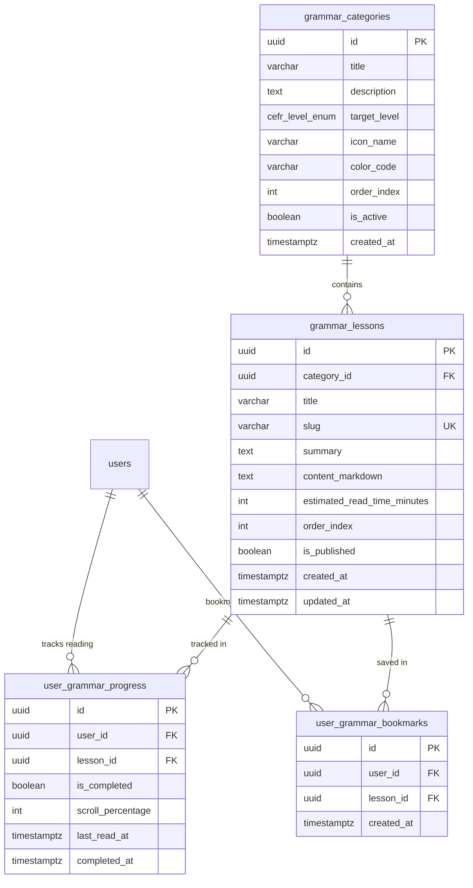

### ĐẶC TẢ CHI TIẾT CHỨC NĂNG (SPECIFICATION)
#### PHÂN HỆ HỌC TẬP CÁ NHÂN (MOD_STU)
##### MODULE: FNC_STU_06 — HỌC LÝ THUYẾT NGỮ PHÁP CHUYÊN ĐỀ (ĐỊNH DẠNG MARKDOWN TRỰC QUAN)

--------------------------------------------------------------------------------

#### 1. TỔNG QUAN CHỨC NĂNG (OVERVIEW)
##### 1.1. Thông tin chung
*   **Mã phân hệ:**  MOD_STU (Student Learning Module)
*   **Mã chức năng:**  FNC_STU_06
*   **Tên chức năng:**  Học lý thuyết ngữ pháp chuyên đề định dạng Markdown trực quan (Structured Grammar Theory & Markdown Interactive Reader)
*   **Đối tượng sử dụng (Actors):**  Khách vãng lai (Guest - Xem thử bài 1), Học viên (Student - Học toàn bộ)
*   **Mục tiêu nghiệp vụ:**
    *  Cung cấp kho tàng lý thuyết ngữ pháp tiếng Anh bài bản, chuẩn hóa từ cơ bản đến nâng cao theo khung CEFR (A1 - C2) và trọng tâm đề thi TOEIC (12 thì động từ, Mệnh đề quan hệ, Câu điều kiện, Thể bị động, Đảo ngữ, Mệnh đề danh từ, Giả định thức, Rút gọn mệnh đề phân từ, Hòa hợp chủ - vị, Giới từ & Liên từ...).
    *  Trình bày bài giảng dưới định dạng  **Markdown mở rộng (GitHub Flavored Markdown - GFM)**  kết hợp các thành phần trực quan chuyên biệt (Rich Interactive Callouts):
        *   **Khung công thức (Formula Callout)** : Đóng khung cấu trúc ngữ pháp khẳng định/phủ định/nghi vấn rõ ràng.
        *   **Cảnh báo bẫy đề thi TOEIC (Warning & Trap Box)** : Chỉ rõ các lỗi sai kinh điển thí sinh hay gặp trong Part 5 & Part 6.
        *   **Mẹo làm bài nhanh (Exam Tips & Shortcuts)** : Dấu hiệu nhận biết thì, mẹo loại trừ phương án sai trong 3 giây.
        *   **Bảng so sánh trực quan (Comparison Table)** : Đối chiếu các cặp ngữ pháp dễ nhầm lẫn (VD: Quá khứ đơn vs. Hiện tại hoàn thành).
        *   **Âm thanh ví dụ minh họa (Inline Audio Player)** : Nhúng phát âm câu ví dụ ngữ cảnh giúp người học vừa đọc vừa nghe.
    *  Tích hợp các tính năng hỗ trợ trải nghiệm đọc tối đa (Reading Experience Enhancements):
        *   **Mục lục động (Dynamic Table of Contents - TOC)** : Tự động trích xuất các tiêu đề H1, H2, H3 để nhảy nhanh đến phần cần đọc.
        *   **Thanh đo tiến độ đọc (Reading Progress Bar)** : Đo lường % cuộn trang theo thời gian thực.
        *   **Chế độ đọc tập trung (Focus Reader)** : Tùy chỉnh cỡ chữ (A- / A+), chuyển đổi Theme Sáng/Tối (Light/Dark Mode).
        *   **Đánh dấu đã hoàn thành lý thuyết & Cầu nối liền mạch sang Quiz** : Học viên sau khi đọc xong có thể bấm chuyển trực tiếp sang làm bài kiểm tra củng cố (FNC_STU_07).

--------------------------------------------------------------------------------

#### 2. THIẾT KẾ CƠ SỞ DỮ LIỆU (DATABASE SCHEMA - POSTGRESQL 16)
Hệ thống phân tách bảng danh mục chuyên đề grammar_categories, bảng chi tiết bài học grammar_lessons, bảng theo dõi tiến độ đọc user_grammar_progress và bảng lưu bài học yêu thích user_grammar_bookmarks.

##### 2.1. DDL Script PostgreSQL 16
```sql
-- 1. BẢNG DANH MỤC CHUYÊN ĐỀ NGỮ PHÁP (GRAMMAR CATEGORIES)
CREATE TABLE IF NOT EXISTS grammar_categories (
    id UUID PRIMARY KEY DEFAULT uuid_generate_v4(),
    title VARCHAR(150) NOT NULL,
    description TEXT,
    target_level cefr_level_enum DEFAULT 'A2' NOT NULL, -- A1..C2 hoặc mục tiêu TOEIC
    icon_name VARCHAR(50) DEFAULT 'book' NOT NULL,      -- Tên icon Lucide
    color_code VARCHAR(20) DEFAULT '#2563EB' NOT NULL,  -- Màu sắc nhận diện
    order_index INT DEFAULT 0 NOT NULL,                 -- Thứ tự giáo trình
    is_active BOOLEAN DEFAULT true NOT NULL,
    created_at TIMESTAMPTZ DEFAULT CURRENT_TIMESTAMP NOT NULL
);

-- 2. BẢNG CHI TIẾT BÀI HỌC NGỮ PHÁP (NỘI DUNG MARKDOWN GFM)
CREATE TABLE IF NOT EXISTS grammar_lessons (
    id UUID PRIMARY KEY DEFAULT uuid_generate_v4(),
    category_id UUID NOT NULL REFERENCES grammar_categories(id) ON DELETE CASCADE,
    title VARCHAR(255) NOT NULL,
    slug VARCHAR(255) UNIQUE NOT NULL,                  -- Đường dẫn thân thiện SEO (VD: hien-tai-hoan-thanh-present-perfect)
    summary TEXT NOT NULL,                              -- Tóm tắt ngắn nội dung bài học
    content_markdown TEXT NOT NULL,                     -- Toàn bộ bài giảng Markdown chuẩn GFM
    estimated_read_time_minutes INT DEFAULT 10 NOT NULL,-- Thời gian đọc ước tính
    order_index INT DEFAULT 0 NOT NULL,
    is_published BOOLEAN DEFAULT true NOT NULL,
    created_at TIMESTAMPTZ DEFAULT CURRENT_TIMESTAMP NOT NULL,
    updated_at TIMESTAMPTZ DEFAULT CURRENT_TIMESTAMP NOT NULL
);

-- 3. BẢNG THEO DÕI TIẾN ĐỘ ĐỌC & HOÀN THÀNH BÀI HỌC CỦA HỌC VIÊN
CREATE TABLE IF NOT EXISTS user_grammar_progress (
    id UUID PRIMARY KEY DEFAULT uuid_generate_v4(),
    user_id UUID NOT NULL REFERENCES users(id) ON DELETE CASCADE,
    lesson_id UUID NOT NULL REFERENCES grammar_lessons(id) ON DELETE CASCADE,
    is_completed BOOLEAN DEFAULT false NOT NULL,        -- Đã đọc xong (scroll >= 80% hoặc xác nhận)
    scroll_percentage INT DEFAULT 0 NOT NULL CHECK (scroll_percentage BETWEEN 0 AND 100),
    last_read_at TIMESTAMPTZ DEFAULT CURRENT_TIMESTAMP NOT NULL,
    completed_at TIMESTAMPTZ,
    CONSTRAINT uq_user_grammar_progress UNIQUE(user_id, lesson_id)
);

-- 4. BẢNG ĐÁNH DẤU BÀI HỌC YÊU THÍCH (BOOKMARKS)
CREATE TABLE IF NOT EXISTS user_grammar_bookmarks (
    id UUID PRIMARY KEY DEFAULT uuid_generate_v4(),
    user_id UUID NOT NULL REFERENCES users(id) ON DELETE CASCADE,
    lesson_id UUID NOT NULL REFERENCES grammar_lessons(id) ON DELETE CASCADE,
    created_at TIMESTAMPTZ DEFAULT CURRENT_TIMESTAMP NOT NULL,
    CONSTRAINT uq_user_grammar_bookmark UNIQUE(user_id, lesson_id)
);

-- CHỈ MỤC TỐI ƯU TRUY VẤN
CREATE INDEX IF NOT EXISTS idx_grammar_lessons_cat ON grammar_lessons(category_id, order_index ASC);
CREATE INDEX IF NOT EXISTS idx_grammar_lessons_slug ON grammar_lessons(slug);
CREATE INDEX IF NOT EXISTS idx_grammar_progress_user ON user_grammar_progress(user_id, is_completed);
CREATE INDEX IF NOT EXISTS idx_grammar_bookmarks_user ON user_grammar_bookmarks(user_id);

```

--------------------------------------------------------------------------------

#### 3. THIẾT KẾ BACKEND (NESTJS & RESTFUL APIS)
##### 3.1. Danh mục RESTful API Endpoints
| STT | Method | Endpoint URI | Phân quyền | Mô tả chức năng |
| ------ | ------ | ------ | ------ | ------ |
| 1 | GET | /api/v1/student/grammar/categories | Public/Student | Lấy danh mục các chuyên đề ngữ pháp kèm tiến độ học (% và số bài xong) |
| 2 | GET | /api/v1/student/grammar/categories/:id/lessons | Public/Student | Lấy danh sách bài học thuộc chuyên đề (kèm trạng thái đã học / chưa học) |
| 3 | GET | /api/v1/student/grammar/lessons/:id | Public/Student | Lấy nội dung chi tiết bài giảng Markdown, mục lục TOC, bài trước/sau |
| 4 | POST | /api/v1/student/grammar/lessons/:id/progress | Student | Cập nhật % cuộn trang đọc và đánh dấu hoàn thành bài học |
| 5 | POST | /api/v1/student/grammar/lessons/:id/bookmark | Student | Đánh dấu yêu thích / Bỏ đánh dấu bài giảng ngữ pháp (Toggle) |
| 6 | GET | /api/v1/student/grammar/recent | Student | Lấy danh sách các bài học ngữ pháp vừa đọc gần đây |


--------------------------------------------------------------------------------

##### 3.2. Data Transfer Objects (DTOs) & Validation
```typescript
// src/modules/grammar/dto/update-reading-progress.dto.ts
import { IsInt, Min, Max, IsBoolean, IsOptional } from 'class-validator';
import { ApiProperty, ApiPropertyOptional } from '@nestjs/swagger';

export class UpdateReadingProgressDto {
  @ApiProperty({ description: 'Phần trăm cuộn trang hiện tại (0 - 100)', example: 85 })
  @IsInt()
  @Min(0)
  @Max(100)
  scrollPercentage: number;

  @ApiPropertyOptional({ description: 'Chủ động bấm xác nhận hoàn thành bài học', example: true })
  @IsOptional()
  @IsBoolean()
  markAsCompleted?: boolean;
}

```
```typescript
// src/modules/grammar/dto/grammar-lesson-detail.dto.ts
export class TableOfContentItemDto {
  id: string;      // Anchor slug (VD: cong-thuc-thi-hien-tai-hoan-thanh)
  title: string;   // Tiêu đề
  level: number;   // 1 (H1), 2 (H2), 3 (H3)
}

export class GrammarLessonDetailResponseDto {
  id: string;
  categoryId: string;
  categoryTitle: string;
  title: string;
  summary: string;
  contentMarkdown: string;
  estimatedReadTimeMinutes: number;
  tableOfContents: TableOfContentItemDto[];
  previousLessonId: string | null;
  nextLessonId: string | null;
  isCompleted: boolean;
  scrollPercentage: number;
  isBookmarked: boolean;
  hasQuiz: boolean; // Có quiz củng cố (FNC_STU_07) hay không
  quizCount: number;
}

```

--------------------------------------------------------------------------------

##### 3.3. Xử lý Nghiệp vụ Tầng Service (GrammarLessonsService)
```typescript
// src/modules/grammar/services/grammar-lessons.service.ts
import { Injectable, NotFoundException, Logger } from '@nestjs/common';
import { InjectRepository } from '@nestjs/typeorm';
import { Repository, DataSource } from 'typeorm';
import { GrammarCategoryEntity } from '../entities/grammar-category.entity';
import { GrammarLessonEntity } from '../entities/grammar-lesson.entity';
import { UserGrammarProgressEntity } from '../entities/user-grammar-progress.entity';
import { UserStreakEntity } from '../../users/entities/user-streak.entity';
import { UpdateReadingProgressDto } from '../dto/update-reading-progress.dto';
import { TableOfContentItemDto } from '../dto/grammar-lesson-detail.dto';

@Injectable()
export class GrammarLessonsService {
  private readonly logger = new Logger(GrammarLessonsService.name);

  constructor(
    @InjectRepository(GrammarCategoryEntity)
    private readonly categoryRepo: Repository<GrammarCategoryEntity>,
    @InjectRepository(GrammarLessonEntity)
    private readonly lessonRepo: Repository<GrammarLessonEntity>,
    @InjectRepository(UserGrammarProgressEntity)
    private readonly progressRepo: Repository<UserGrammarProgressEntity>,
    private readonly dataSource: DataSource,
  ) {}

  /**
   * Lấy danh mục chuyên đề ngữ pháp kèm % hoàn thành của học viên
   */
  async getCategoriesWithProgress(userId: string | null) {
    const safeUserId = userId || '00000000-0000-0000-0000-000000000000';

    const categories = await this.dataSource.query(
      `
      SELECT 
        c.id,
        c.title,
        c.description,
        c.target_level AS "targetLevel",
        c.icon_name AS "iconName",
        c.color_code AS "colorCode",
        c.order_index AS "orderIndex",
        COUNT(l.id)::int AS "totalLessons",
        COUNT(CASE WHEN p.is_completed = true THEN 1 END)::int AS "completedLessons"
      FROM grammar_categories c
      LEFT JOIN grammar_lessons l ON l.category_id = c.id AND l.is_published = true
      LEFT JOIN user_grammar_progress p ON p.lesson_id = l.id AND p.user_id = $1
      WHERE c.is_active = true
      GROUP BY c.id
      ORDER BY c.order_index ASC
      `,
      [safeUserId],
    );

    return categories.map((cat: { id: string; name: string }) => ({
      ...cat,
      progressPercentage:
        cat.totalLessons > 0 ? Math.round((cat.completedLessons / cat.totalLessons) * 100) : 0,
    }));
  }

  /**
   * Lấy chi tiết bài học Markdown và trích xuất động mục lục TOC
   */
  async getLessonDetail(userId: string | null, lessonId: string) {
    const lesson = await this.lessonRepo.findOne({
      where: { id: lessonId, isPublished: true },
      relations: ['category'],
    });
    if (!lesson) throw new NotFoundException({ errorCode: 'ERR_NOT_FOUND', message: 'Bài học ngữ pháp không tồn tại' });

    const safeUserId = userId || '00000000-0000-0000-0000-000000000000';

    // 1. Trích xuất mục lục động (Table of Contents) từ Markdown Headings
    const tableOfContents = this.extractTOCFromMarkdown(lesson.contentMarkdown);

    // 2. Tìm bài học trước và bài học sau theo thứ tự
    const siblingLessons = await this.lessonRepo.find({
      where: { categoryId: lesson.categoryId, isPublished: true },
      select: ['id', 'orderIndex'],
      order: { orderIndex: 'ASC' },
    });

    const currentIndex = siblingLessons.findIndex((l) => l.id === lessonId);
    const previousLessonId = currentIndex > 0 ? siblingLessons[currentIndex - 1].id : null;
    const nextLessonId =
      currentIndex < siblingLessons.length - 1 ? siblingLessons[currentIndex + 1].id : null;

    // 3. Lấy tiến độ đọc và trạng thái bookmark
    const [progress, bookmark, quizCountRaw] = await Promise.all([
      this.progressRepo.findOne({ where: { userId: safeUserId, lessonId } }),
      this.dataSource.query(
        `SELECT id FROM user_grammar_bookmarks WHERE user_id = $1 AND lesson_id = $2`,
        [safeUserId, lessonId],
      ),
      this.dataSource.query(
        `SELECT COUNT
```
```typescript
(id)::int as count FROM grammar_quiz_questions WHERE lesson_id = $1`,
        [lessonId],
      ).catch(() => [{ count: 0 }]),
    ]);

    const quizCount = quizCountRaw[0]?.count || 0;

    return {
      id: lesson.id,
      categoryId: lesson.categoryId,
      categoryTitle: lesson.category.title,
      title: lesson.title,
      summary: lesson.summary,
      contentMarkdown: lesson.contentMarkdown,
      estimatedReadTimeMinutes: lesson.estimatedReadTimeMinutes,
      tableOfContents,
      previousLessonId,
      nextLessonId,
      isCompleted: progress?.isCompleted || false,
      scrollPercentage: progress?.scrollPercentage || 0,
      isBookmarked: bookmark.length > 0,
      hasQuiz: quizCount > 0,
      quizCount,
    };
  }

  /**
   * Cập nhật tiến độ đọc và hoàn thành bài học
   */
  async updateProgress(userId: string, lessonId: string, dto: UpdateReadingProgressDto) {
    return this.dataSource.transaction(async (manager) => {
      let progress = await manager.findOne(UserGrammarProgressEntity, {
        where: { userId, lessonId },
      });

      if (!progress) {
        progress = manager.create(UserGrammarProgressEntity, {
          userId,
          lessonId,
        });
      }

      // Đánh dấu hoàn thành nếu cuộn >= 80% hoặc bấm xác nhận
      const shouldComplete =
        progress.isCompleted || dto.markAsCompleted || dto.scrollPercentage >= 80;

      if (!progress.isCompleted && shouldComplete) {
        progress.isCompleted = true;
        progress.completedAt = new Date();

        // Kích hoạt cập nhật chuỗi chuyên cần học tập (Streak)
        await this.touchUserStreak(manager, userId);
      }

      progress.scrollPercentage = Math.max(progress.scrollPercentage, dto.scrollPercentage);
      progress.lastReadAt = new Date();

      await manager.save(progress);

      return {
        isCompleted: progress.isCompleted,
        scrollPercentage: progress.scrollPercentage,
      };
    });
  }

  /**
   * Trích xuất Heading (#, ##, ###) từ Markdown thành cây mục lục
   */
  private extractTOCFromMarkdown(markdown: string): TableOfContentItemDto[] {
    const headingRegex = /^(#{1,3})\s+(.+)$/gm;
    const toc: TableOfContentItemDto[] = [];
    let match;

    while ((match = headingRegex.exec(markdown)) !== null) {
      const level = match[1].length;
      const title = match[2].trim();
      const id = title
        .toLowerCase()
        .replace(/[^\w\s-]/g, '')
        .replace(/\s+/g, '-');

      toc.push({ id, title, level });
    }

    return toc;
  }

  /**
   * Ghi nhận ngày học vào Streak
   */
  private async touchUserStreak(manager: EntityManager, userId: string) {
    const today = new Date().toISOString().split('T')[0];
    let streak = await manager.findOne(UserStreakEntity, { where: { userId } });

    if (!streak) {
      streak = manager.create(UserStreakEntity, {
        userId,
        currentStreak: 1,
        longestStreak: 1,
        lastActivityDate: today,
      });
      return manager.save(streak);
    }

    if (streak.lastActivityDate === today) return;

    const diffDays = Math.floor(
      (new Date(today).getTime() - new Date(streak.lastActivityDate).getTime()) / (1000 * 3600 * 24),
    );

    if (diffDays === 1) {
      streak.currentStreak += 1;
      if (streak.currentStreak > streak.longestStreak) {
        streak.longestStreak = streak.currentStreak;
      }
    } else {
      streak.currentStreak = 1;
    }

    streak.lastActivityDate = today;
    await manager.save(streak);
  }
}

```

--------------------------------------------------------------------------------

#### 4. QUY CHUẨN ĐỊNH DẠNG BÀI GIẢNG MARKDOWN TRỰC QUAN (MARKDOWN GFM SPEC)
Để bài học hiển thị đẹp mắt và chuẩn hóa như sách giáo trình quốc tế, nội dung content_markdown tuân thủ cú pháp Callout chuẩn:
```markdown
# THÌ HIỆN TẠI HOÀN THÀNH (PRESENT PERFECT TENSE)

## 1. Cấu trúc ngữ pháp trọng tâm

> [!FORMULA]
> **Khẳng định (+):** `S + have / has + V3/ed + (O)`  
> **Phủ định (-):** `S + have / has + not + V3/ed + (O)`  
> **Nghi vấn (?):** `Have / Has + S + V3/ed + (O)?`  
> *Lưu ý:* `He/She/It` đi với `has`, `I/You/We/They` đi với `have`.

## 2. Dấu hiệu nhận biết trong đề thi TOEIC

> [!TIP]
> Gặp các trạng từ sau trong Part 5 $
ightarrow$ Chọn ngay thì Hiện tại hoàn thành:
> - `since` (+ mốc thời gian), `for` (+ khoảng thời gian)
> - `already`, `yet`, `just`, `recently`, `lately`
> - `so far`, `up to now`, `until now`

## 3. Bẫy đề thi TOEIC kinh điển cần tránh

> [!WARNING]
> **Bẫy `Since` trong câu ghép:**  
> Mệnh đề sau `since` luôn chia ở thì **Quá khứ đơn (Past Simple)**, trong khi mệnh đề chính chia ở **Hiện tại hoàn thành**.  
> ❌ *Sai:* She has worked here since she has graduated.  
> ✅ *Đúng:* She has worked here since she **graduated**.

## 4. Bảng so sánh Hiện tại hoàn thành vs. Quá khứ đơn

| Tiêu chí so sánh | Quá khứ đơn (Past Simple) | Hiện tại hoàn thành (Present Perfect) |
| :--- | :--- | :--- |
| **Bản chất hành động** | Đã chấm dứt hoàn toàn trong quá khứ, không còn liên quan hiện tại | Bắt đầu trong quá khứ, còn kéo dài hoặc để lại kết quả ở hiện tại |
| **Mốc thời gian** | Xác định rõ ràng (`yesterday`, `in 2020`, `2 days ago`) | Không xác định hoặc kéo dài (`so far`, `recently`, `for 3 years`) |
| **Ví dụ minh họa** | *I lived in Tokyo for 2 years (bây giờ không còn ở nữa).* | *I have lived in Tokyo for 2 years (bây giờ vẫn đang ở).* |

```

--------------------------------------------------------------------------------

#### 5. THIẾT KẾ FRONTEND (REACT NATIVE / EXPO SDK 51)
##### 5.1. Bố cục Màn hình Đọc lý thuyết (GrammarLessonDetailScreen)
```text
+-------------------------------------------------------------+
| [< Trở lại]       Hiện tại hoàn thành        [ 🔖 ] [ 📑 Mục lục ]|
| Tiến độ đọc: [======================--------] 75%           |
+-------------------------------------------------------------+
|                                                             |
|   # THÌ HIỆN TẠI HOÀN THÀNH (PRESENT PERFECT)               |
|                                                             |
|   +-----------------------------------------------------+   |
|   | 📌 CẤU TRÚC NGỮ PHÁP (FORMULA BOX)                  |   |
|   | (+) S + have / has + V3/ed                          |   |
|   | (-) S + haven't / hasn't + V3/ed                    |   |
|   +-----------------------------------------------------+   |
|                                                             |
|   > Ví dụ ngữ cảnh:                                         |
|   "Ms. Laura has worked at ABC Corp for five years."        |
|   [ (🔊) Nghe phát âm câu ví dụ ]                           |
|                                                             |
|   +-----------------------------------------------------+   |
|   | ⚠️ BẪY ĐỀ THI TOEIC PART 5 (EXAM TRAP)              |   |
|   | Cấu trúc: S + have/has V3/ed + SINCE + S + V2/ed    |   |
|   +-----------------------------------------------------+   |
|                                                             |
|   📊 Bảng so sánh: Past Simple vs. Present Perfect...       |
|                                                             |
+-------------------------------------------------------------+
| [✓ Đã hiểu lý thuyết]    ──>    [ Làm bài tập củng cố (10 câu) ➔ ]|
+-------------------------------------------------------------+

```

--------------------------------------------------------------------------------

##### 5.2. Mã Nguồn Mẫu Component Đọc Markdown (GrammarLessonDetailScreen.tsx)
```tsx
import React, { useState, useRef } from 'react';
import { View, Text, ScrollView, Pressable, ActivityIndicator, NativeSyntheticEvent, NativeScrollEvent } from 'react-native';
import Markdown, { RenderRules } from 'react-native-markdown-display';
import { useQuery, useMutation, useQueryClient } from '@tanstack/react-query';
import { ArrowLeft, Bookmark, List, CheckCircle, ArrowRight, AlertTriangle, Lightbulb, Info } from 'lucide-react-native';
import axios from 'axios';

export const GrammarLessonDetailScreen = ({ route, navigation }: unknown) => {
  const { lessonId } = route.params;
  const queryClient = useQueryClient();
  const scrollViewRef = useRef<ScrollView>(null);
  const [scrollPercent, setScrollPercent] = useState(0);

  // 1. Tải chi tiết bài học
  const { data: lesson, isLoading } = useQuery({
    queryKey: ['grammar-lesson-detail', lessonId],
    queryFn: async () => {
      const res = await axios.get(`/api/v1/student/grammar/lessons/${lessonId}`);
      return res.data;
    },
  });

  // 2. Mutation cập nhật tiến độ đọc
  const progressMutation = useMutation({
    mutationFn: async (payload: { scrollPercentage: number; markAsCompleted?: boolean }) => {
      await axios.post(`/api/v1/student/grammar/lessons/${lessonId}/progress`, payload);
    },
    onSuccess: () => {
      queryClient.invalidateQueries({ queryKey: ['grammar-categories-overview'] });
    },
  });

  // Xử lý sự kiện cuộn trang
  const handleScroll = (event: NativeSyntheticEvent<NativeScrollEvent>) => {
    const { layoutMeasurement, contentOffset, contentSize } = event.nativeEvent;
    const currentScroll = contentOffset.y;
    const totalScrollable = contentSize.height - layoutMeasurement.height;

    if (totalScrollable > 0) {
      const percentage = Math.min(100, Math.round((currentScroll / totalScrollable) * 100));
      setScrollPercent(percentage);

      // Tự động gửi cập nhật khi đạt mốc 80%
      if (percentage >= 80 && !lesson?.isCompleted) {
        progressMutation.mutate({ scrollPercentage: percentage, markAsCompleted: true });
      }
    }
  };

  // Custom quy tắc Render cho Callout Blocks
  const markdownRules: RenderRules = {
    blockquote: (node, children) => {
      const content = node.children[0]?.children[0]?.content || '';

      if (content.includes('[!FORMULA]')) {
        return (
          <View key={node.key} className="bg-blue-50 border-l-4 border-blue-600 p-4 rounded-r-xl my-3">
            <View className="flex-row items-center gap-1.5 mb-1">
              <Info size={16} color="#2563eb" />
              <Text className="text-xs font-bold text-blue-700 uppercase">Công thức trọng tâm</Text>
            </View>
            {children}
          </View>
        );
      }

      if (content.includes('[!WARNING]')) {
        return (
          <View key={node.key} className="bg-rose-50 border-l-4 border-rose-500 p-4 rounded-r-xl my-3">
            <View className="flex-row items-center gap-1.5 mb-1">
              <AlertTriangle size={16} color="#e11d48" />
              <Text className="text-xs font-bold text-rose-700 uppercase">Cảnh báo bẫy đề thi</Text>
            </View>
            {children}
          </View>
        );
      }

      if (content.includes('[!TIP]')) {
        return (
          <View key={node.key} className="bg-amber-50 border-l-4 border-amber-500 p-4 rounded-r-xl my-3">
            <View className="flex-row items-center gap-1.5 mb-1">
              <Lightbulb size={16} color="#d97706" />
              <Text className="text-xs font-bold text-amber-700 uppercase">Mẹo nhận biết nhanh</Text>
            </View>
            {children}
          </View>
        );
      }

      return (
        <View key={node.key} className="bg-slate-100 border-l-4 border-slate-400 p-3 my-2 rounded-r-lg">
          {children}
        </View>
      );
    },
  };

  if (isLoading || !lesson) {
    return (
      <View className="flex-1 items-center 
```
```tsx
justify-center bg-white">
        <ActivityIndicator size="large" color="#2563eb" />
        <Text className="text-xs text-slate-400 mt-2">Đang tải bài giảng ngữ pháp...</Text>
      </View>
    );
  }

  return (
    <View className="flex-1 bg-white">
      {/* 1. HEADER CỐ ĐỊNH & THANH TIẾN ĐỘ ĐỌC */}
      <View className="bg-white border-b border-slate-200 px-4 pt-3 pb-2">
        <View className="flex-row items-center justify-between">
          <Pressable onPress={() => navigation.goBack()} className="p-1">
            <ArrowLeft size={22} color="#1e293b" />
          </Pressable>
          <Text className="text-sm font-bold text-slate-800 flex-1 text-center mx-2" numberOfLines={1}>
            {lesson.title}
          </Text>
          <Pressable className="p-1">
            <Bookmark size={20} color={lesson.isBookmarked ? '#2563eb' : '#94a3b8'} />
          </Pressable>
        </View>

        {/* Thanh tiến độ đọc */}
        <View className="w-full bg-slate-100 h-1.5 rounded-full overflow-hidden mt-2">
          <View style={{ width: `${scrollPercent}%` }} className="bg-blue-600 h-full rounded-full" />
        </View>
      </View>

      {/* 2. KHUNG NỘI DUNG MARKDOWN GFM */}
      <ScrollView
        ref={scrollViewRef}
        onScroll={handleScroll}
        scrollEventThrottle={64}
        className="flex-1 px-5 pt-4"
      >
        <Text className="text-xs font-bold text-blue-600 uppercase mb-1">{lesson.categoryTitle}</Text>
        <Text className="text-2xl font-extrabold text-slate-900 mb-2">{lesson.title}</Text>
        <Text className="text-sm text-slate-500 italic mb-4">{lesson.summary}</Text>

        <Markdown rules={markdownRules} style={markdownStyles}>
          {lesson.contentMarkdown}
        </Markdown>

        <View className="h-16" />
      </ScrollView>

      {/* 3. FOOTER ĐIỀU HƯỚNG SANG QUIZ CỦNG CỐ */}
      <View className="p-4 border-t border-slate-200 bg-white flex-row items-center justify-between gap-3">
        <Pressable
          onPress={() => progressMutation.mutate({ scrollPercentage: 100, markAsCompleted: true })}
          className="flex-1 py-3 bg-slate-100 rounded-xl items-center flex-row justify-center gap-1.5"
        >
          <CheckCircle size={18} color="#10b981" />
          <Text className="text-slate-700 font-bold text-xs">Đã hiểu bài</Text>
        </Pressable>

        {lesson.hasQuiz && (
          <Pressable
            onPress={() => navigation.navigate('GrammarQuizScreen', { lessonId: lesson.id })}
            className="flex-1 py-3 bg-blue-600 rounded-xl items-center flex-row justify-center gap-1.5 shadow-sm"
          >
            <Text className="text-white font-bold text-xs">Làm Quiz ({lesson.quizCount} câu)</Text>
            <ArrowRight size={16} color="white" />
          </Pressable>
        )}
      </View>
    </View>
  );
};

const markdownStyles = {
  heading1: { fontSize: 20, fontWeight: '800', color: '#0f172a', marginVertical: 12 },
  heading2: { fontSize: 16, fontWeight: '700', color: '#1e293b', marginVertical: 8 },
  heading3: { fontSize: 14, fontWeight: '700', color: '#334155', marginVertical: 6 },
  body: { fontSize: 14, lineHeight: 22, color: '#334155' },
  code_inline: { backgroundColor: '#f1f5f9', color: '#0f172a', borderRadius: 4, paddingHorizontal: 4 },
  table: { borderWidth: 1, borderColor: '#cbd5e1', borderRadius: 8, marginVertical: 8 },
  th: { backgroundColor: '#f8fafc', fontWeight: 'bold', padding: 8, color: '#0f172a' },
  td: { padding: 8, borderTopWidth: 1, borderColor: '#e2e8f0', color: '#334155' },
};

```

--------------------------------------------------------------------------------

#### 6. QUY TẮC NGHIỆP VỤ & KIỂM TRA HỢP LỆ (BUSINESS RULES)
1.  **Điều kiện công nhận hoàn thành bài học lý thuyết** :
    *  Học viên cuộn đọc từ trên xuống dưới đạt $\ge 80%$ chiều dài trang văn bản, HOẶC
    *  Học viên bấm nút  *"Đã hiểu bài"*  tại thanh công cụ dưới cùng trang.
    *  Khi thỏa mãn, hệ thống tự động gán is_completed = true, ghi nhận mốc thời gian completed_at và kích hoạt cộng chuỗi ngày học chuyên cần ( **Streak Engine** ).
2.  **Quy tắc phân quyền Khách vãng lai (Guest Access)** :
    *  Khách chưa đăng nhập chỉ được đọc miễn phí Bài học số 1 của Chuyên đề 1 (Thì Hiện tại đơn).
    *  Từ bài học số 2 trở đi hoặc khi bấm lưu Bookmark, hệ thống hiển thị Dialog chuyển hướng yêu cầu Đăng ký / Đăng nhập tài khoản.
3.  **Cơ chế trích xuất mục lục tĩnh & Anchor Scroll** :
    *  Khi bài học được tải lên hoặc chỉnh sửa bởi Admin, backend hoặc client tự động phân tích cú pháp regex để bóc tách tiêu đề #, ## thành danh sách anchors, cho phép người học bấm vào mục lục để cuộn tức thì đến phần mong muốn.
