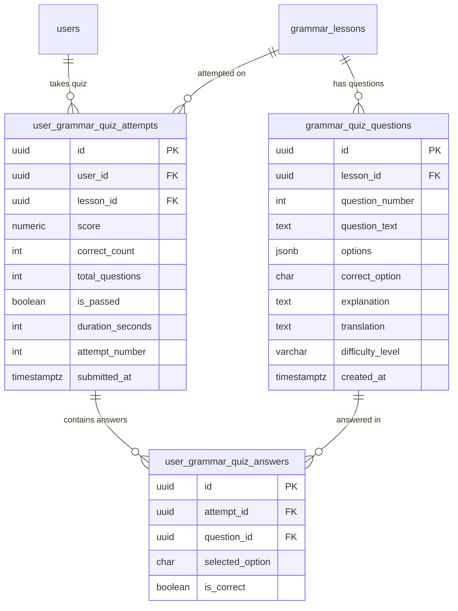

### ĐẶC TẢ CHI TIẾT CHỨC NĂNG (SPECIFICATION)
#### PHÂN HỆ HỌC TẬP CÁ NHÂN (MOD_STU)
##### MODULE: FNC_STU_07 — LÀM QUIZ TRẮC NGHIỆM CỦNG CỐ KIẾN THỨC NGỮ PHÁP

--------------------------------------------------------------------------------

#### 1. TỔNG QUAN CHỨC NĂNG (OVERVIEW)
##### 1.1. Thông tin chung
*   **Mã phân hệ:**  MOD_STU (Student Learning Module)
*   **Mã chức năng:**  FNC_STU_07
*   **Tên chức năng:**  Làm Quiz trắc nghiệm củng cố ngữ pháp (Grammar Practice Quiz & Instant Feedback)
*   **Đối tượng sử dụng (Actors):**  Học viên (Student)
*   **Mục tiêu nghiệp vụ:**
    *  Kiểm tra và củng cố ngay lập tức mức độ nắm vững lý thuyết ngữ pháp của học viên sau khi hoàn thành bài đọc (FNC_STU_06).
    *  Cung cấp bộ câu hỏi trắc nghiệm ngắn (5 – 15 câu) bám sát trọng tâm đề thi TOEIC Part 5 và Part 6 liên quan trực tiếp đến bài học (VD: Bài học về  *Thì Hiện tại hoàn thành*  sẽ gồm các câu hỏi phân biệt since/for, dấu hiệu nhận biết already/yet, bẫy mốc thời gian quá khứ).
    *  Cơ chế  **Phản hồi tức thì (Instant Feedback & Deep Explanation)** :
        *  Giải thích rõ ràng tại sao phương án đúng lại chính xác kèm công thức ngữ pháp áp dụng.
        *  Chỉ ra bẫy ngữ pháp của từng phương án gây nhiễu (Distractors).
        *  Dịch nghĩa toàn bộ câu hỏi và cung cấp từ vựng mới xuất hiện trong câu.
    *  Cơ chế đánh giá năng lực & Cấp chứng nhận hoàn thành:
        *  Đạt chuẩn hoàn thành bài học (Mastery Pass): Số câu đúng $\ge 80%$ (VD: đạt $\ge 8/10$ câu).
        *  Nếu đạt chuẩn: Hệ thống tự động ghi nhận bài học ngữ pháp vào danh sách "Đã thành thạo", kích hoạt tích điểm và cập nhật chuỗi chuyên cần (Streak).
        *  Cho phép học viên làm lại không giới hạn số lần (Retake Quiz) để cải thiện điểm số và lưu lịch sử các lần thi.

--------------------------------------------------------------------------------

#### 2. THIẾT KẾ CƠ SỞ DỮ LIỆU (DATABASE SCHEMA - POSTGRESQL 16)
Hệ thống thiết kế bảng lưu ngân hàng câu hỏi quiz ngữ pháp grammar_quiz_questions, bảng phiên làm bài user_grammar_quiz_attempts và chi tiết từng câu trả lời user_grammar_quiz_answers.

##### 2.1. DDL Script PostgreSQL 16
```sql
-- 1. BẢNG NGÂN HÀNG CÂU HỎI QUIZ CỦNG CỐ THEO BÀI HỌC
CREATE TABLE IF NOT EXISTS grammar_quiz_questions (
    id UUID PRIMARY KEY DEFAULT uuid_generate_v4(),
    lesson_id UUID NOT NULL REFERENCES grammar_lessons(id) ON DELETE CASCADE,
    question_number INT NOT NULL,                        -- Số thứ tự câu hỏi trong quiz (1, 2, 3...)
    question_text TEXT NOT NULL,                         -- Nội dung câu hỏi có chỗ trống (VD: "Ms. Laura _____ here since 2020.")
    options JSONB NOT NULL,                              -- 4 phương án: {"A": "works", "B": "worked", "C": "has worked", "D": "is working"}
    correct_option CHAR(1) NOT NULL CHECK (correct_option IN ('A', 'B', 'C', 'D')),
    explanation TEXT NOT NULL,                           -- Lời giải chi tiết và phân tích bẫy ngữ pháp
    translation TEXT,                                    -- Bản dịch tiếng Việt câu hỏi
    difficulty_level VARCHAR(10) DEFAULT 'MEDIUM' NOT NULL, -- EASY, MEDIUM, HARD
    created_at TIMESTAMPTZ DEFAULT CURRENT_TIMESTAMP NOT NULL
);

-- 2. BẢNG LƯỢT LÀM BÀI QUIZ CỦA HỌC VIÊN (ATTEMPTS)
CREATE TABLE IF NOT EXISTS user_grammar_quiz_attempts (
    id UUID PRIMARY KEY DEFAULT uuid_generate_v4(),
    user_id UUID NOT NULL REFERENCES users(id) ON DELETE CASCADE,
    lesson_id UUID NOT NULL REFERENCES grammar_lessons(id) ON DELETE CASCADE,
    score NUMERIC(5, 2) NOT NULL,                        -- Điểm số thang 100 (VD: 80.00)
    correct_count INT NOT NULL,                          -- Số câu làm đúng (VD: 8)
    total_questions INT NOT NULL,                        -- Tổng số câu trong bài (VD: 10)
    is_passed BOOLEAN DEFAULT false NOT NULL,            -- Đạt chuẩn hoàn thành (score >= 80)
    duration_seconds INT DEFAULT 0 NOT NULL,             -- Thời gian làm bài tính bằng giây
    attempt_number INT DEFAULT 1 NOT NULL,               -- Lần làm bài thứ mấy
    submitted_at TIMESTAMPTZ DEFAULT CURRENT_TIMESTAMP NOT NULL
);

-- 3. BẢNG CHI TIẾT CÂU TRẢ LỜI CỦA TỪNG LƯỢT THI
CREATE TABLE IF NOT EXISTS user_grammar_quiz_answers (
    id UUID PRIMARY KEY DEFAULT uuid_generate_v4(),
    attempt_id UUID NOT NULL REFERENCES user_grammar_quiz_attempts(id) ON DELETE CASCADE,
    question_id UUID NOT NULL REFERENCES grammar_quiz_questions(id) ON DELETE CASCADE,
    selected_option CHAR(1),                             -- Lựa chọn của học viên ('A', 'B', 'C', 'D' hoặc null)
    is_correct BOOLEAN NOT NULL
);

-- CHỈ MỤC TỐI ƯU TRUY VẤN
CREATE INDEX IF NOT EXISTS idx_quiz_questions_lesson ON grammar_quiz_questions(lesson_id, question_number ASC);
CREATE INDEX IF NOT EXISTS idx_quiz_attempts_user_lesson ON user_grammar_quiz_attempts(user_id, lesson_id, submitted_at DESC);
CREATE INDEX IF NOT EXISTS idx_quiz_answers_attempt ON user_grammar_quiz_answers(attempt_id);

```

--------------------------------------------------------------------------------

#### 3. THIẾT KẾ BACKEND (NESTJS & RESTFUL APIS)
##### 3.1. Danh mục RESTful API Endpoints
| STT | Method | Endpoint URI | Phân quyền | Mô tả chức năng |
| ------ | ------ | ------ | ------ | ------ |
| 1 | GET | /api/v1/student/grammar/lessons/:id/quiz | Student | Lấy bộ câu hỏi quiz (Ẩn đáp án đúng và lời giải khi đang làm bài) |
| 2 | POST | /api/v1/student/grammar/lessons/:id/quiz/submit | Student | Nộp bài quiz, so khớp đáp án, tính điểm, ghi log và trả về giải thích |
| 3 | GET | /api/v1/student/grammar/lessons/:id/quiz/history | Student | Lấy danh sách lịch sử các lần thi quiz của bài học kèm điểm cao nhất |
| 4 | GET | /api/v1/student/grammar/quiz/attempts/:attemptId | Student | Xem lại chi tiết từng câu làm đúng/sai của một lần thi cụ thể |


--------------------------------------------------------------------------------

##### 3.2. Data Transfer Objects (DTOs) & Validation
```typescript
// src/modules/grammar/dto/submit-grammar-quiz.dto.ts
import { IsArray, ValidateNested, IsUUID, IsIn, IsInt, Min, IsOptional } from 'class-validator';
import { Type } from 'class-transformer';
import { ApiProperty, ApiPropertyOptional } from '@nestjs/swagger';

export class QuizAnswerItemDto {
  @ApiProperty({ example: '9b1deb4d-3b7d-4bad-9bdd-2b0d7b3dcb6d' })
  @IsUUID('4')
  questionId: string;

  @ApiPropertyOptional({ example: 'C', enum: ['A', 'B', 'C', 'D'] })
  @IsOptional()
  @IsIn(['A', 'B', 'C', 'D'], { message: 'Đáp án chọn phải là A, B, C hoặc D' })
  selectedOption?: string;
}

export class SubmitGrammarQuizDto {
  @ApiProperty({ type: [QuizAnswerItemDto] })
  @IsArray()
  @ValidateNested({ each: true })
  @Type(() => QuizAnswerItemDto)
  answers: QuizAnswerItemDto[];

  @ApiProperty({ example: 120, description: 'Thời gian hoàn thành tính bằng giây' })
  @IsInt()
  @Min(0)
  durationSeconds: number;
}

```
```typescript
// src/modules/grammar/dto/quiz-result-response.dto.ts
export class QuestionReviewItemDto {
  questionId: string;
  questionNumber: number;
  questionText: string;
  options: Record<string, string>;
  selectedOption: string | null;
  correctOption: string;
  isCorrect: boolean;
  explanation: string;
  translation: string;
}

export class QuizResultResponseDto {
  attemptId: string;
  lessonId: string;
  score: number;
  correctCount: number;
  totalQuestions: number;
  isPassed: boolean;
  attemptNumber: number;
  durationSeconds: number;
  submittedAt: string;
  questions: QuestionReviewItemDto[];
}

```

--------------------------------------------------------------------------------

##### 3.3. Xử lý Nghiệp vụ Tầng Service (GrammarQuizService)
```typescript
// src/modules/grammar/services/grammar-quiz.service.ts
import { Injectable, NotFoundException, BadRequestException } from '@nestjs/common';
import { InjectRepository } from '@nestjs/typeorm';
import { Repository, DataSource } from 'typeorm';
import { GrammarQuizQuestionEntity } from '../entities/grammar-quiz-question.entity';
import { UserGrammarQuizAttemptEntity } from '../entities/user-grammar-quiz-attempt.entity';
import { UserGrammarQuizAnswerEntity } from '../entities/user-grammar-quiz-answer.entity';
import { UserGrammarProgressEntity } from '../entities/user-grammar-progress.entity';
import { UserStreakEntity } from '../../users/entities/user-streak.entity';
import { SubmitGrammarQuizDto } from '../dto/submit-grammar-quiz.dto';
import { QuizResultResponseDto } from '../dto/quiz-result-response.dto';

@Injectable()
export class GrammarQuizService {
  constructor(
    @InjectRepository(GrammarQuizQuestionEntity)
    private readonly questionRepo: Repository<GrammarQuizQuestionEntity>,
    @InjectRepository(UserGrammarQuizAttemptEntity)
    private readonly attemptRepo: Repository<UserGrammarQuizAttemptEntity>,
    @InjectRepository(UserGrammarProgressEntity)
    private readonly progressRepo: Repository<UserGrammarProgressEntity>,
    private readonly dataSource: DataSource,
  ) {}

  /**
   * 1. Lấy danh sách câu hỏi cho học viên làm bài (ẨN ĐÁP ÁN ĐÚNG VÀ LỜI GIẢI)
   */
  async getQuizQuestionsForStudent(lessonId: string) {
    const questions = await this.questionRepo.find({
      where: { lessonId },
      order: { questionNumber: 'ASC' },
      select: ['id', 'lessonId', 'questionNumber', 'questionText', 'options', 'difficultyLevel'],
    });

    if (questions.length === 0) {
      throw new NotFoundException({ errorCode: 'ERR_NOT_FOUND', message: 'Bài học này chưa có câu hỏi trắc nghiệm củng cố' });
    }

    return {
      lessonId,
      totalQuestions: questions.length,
      questions,
    };
  }

  /**
   * 2. Nộp bài Quiz, chấm điểm tự động, ghi nhận tiến trình và trả về lời giải chi tiết
   */
  async submitQuiz(
    userId: string,
    lessonId: string,
    dto: SubmitGrammarQuizDto,
  ): Promise<QuizResultResponseDto> {
    const questions = await this.questionRepo.find({
      where: { lessonId },
      order: { questionNumber: 'ASC' },
    });

    if (questions.length === 0) {
      throw new NotFoundException({ errorCode: 'ERR_NOT_FOUND', message: 'Không tìm thấy câu hỏi của bài học' });
    }

    return this.dataSource.transaction(async (manager) => {
      // 1. Tính toán lần thi (attempt number)
      const previousAttemptsCount = await manager.count(UserGrammarQuizAttemptEntity, {
        where: { userId, lessonId },
      });
      const attemptNumber = previousAttemptsCount + 1;

      // 2. Chấm điểm chi tiết từng câu
      let correctCount = 0;
      const questionReviewList = [];
      const answersToInsert: Partial<UserGrammarQuizAnswerEntity>[] = [];

      for (const question of questions) {
        const userAns = dto.answers.find((a) => a.questionId === question.id);
        const selectedOpt = userAns?.selectedOption || null;
        const isCorrect = selectedOpt === question.correctOption;

        if (isCorrect) correctCount++;

        answersToInsert.push({
          questionId: question.id,
          selectedOption: selectedOpt,
          isCorrect,
        });

        questionReviewList.push({
          questionId: question.id,
          questionNumber: question.questionNumber,
          questionText: question.questionText,
          options: question.options,
          selectedOption: selectedOpt,
          correctOption: question.correctOption,
          isCorrect,
          explanation: question.explanation,
          translation: question.translation,
        });
      }

      const totalQuestions = questions.length;
      const score = Number(((correctCount / totalQuestions) * 100).toFixed(2));
      const isPassed = score >= 80.0; // Tiêu chuẩn đạt >=
```
```typescript
 80%

      // 3. Lưu bản ghi Attempt
      const attempt = manager.create(UserGrammarQuizAttemptEntity, {
        userId,
        lessonId,
        score,
        correctCount,
        totalQuestions,
        isPassed,
        durationSeconds: dto.durationSeconds,
        attemptNumber,
      });
      const savedAttempt = await manager.save(attempt);

      // 4. Lưu danh sách chi tiết các câu trả lời
      const finalAnswers = answersToInsert.map((ans) => ({
        ...ans,
        attemptId: savedAttempt.id,
      }));
      await manager.save(UserGrammarQuizAnswerEntity, finalAnswers);

      // 5. Cập nhật bảng tiến trình học tập nếu ĐẠT
      if (isPassed) {
        let progress = await manager.findOne(UserGrammarProgressEntity, {
          where: { userId, lessonId },
        });
        if (!progress) {
          progress = manager.create(UserGrammarProgressEntity, { userId, lessonId });
        }
        progress.isCompleted = true;
        progress.scrollPercentage = 100;
        progress.completedAt = new Date();
        await manager.save(progress);

        // Kích hoạt cộng chuỗi Streak chuyên cần
        await this.touchUserStreak(manager, userId);
      }

      return {
        attemptId: savedAttempt.id,
        lessonId,
        score,
        correctCount,
        totalQuestions,
        isPassed,
        attemptNumber,
        durationSeconds: dto.durationSeconds,
        submittedAt: savedAttempt.submittedAt.toISOString(),
        questions: questionReviewList,
      };
    });
  }

  /**
   * Cập nhật chuỗi Streak học tập
   */
  private async touchUserStreak(manager: EntityManager, userId: string) {
    const today = new Date().toISOString().split('T')[0];
    let streak = await manager.findOne(UserStreakEntity, { where: { userId } });

    if (!streak) {
      streak = manager.create(UserStreakEntity, {
        userId,
        currentStreak: 1,
        longestStreak: 1,
        lastActivityDate: today,
      });
      return manager.save(streak);
    }

    if (streak.lastActivityDate === today) return;

    const diffDays = Math.floor(
      (new Date(today).getTime() - new Date(streak.lastActivityDate).getTime()) / (1000 * 3600 * 24),
    );

    if (diffDays === 1) {
      streak.currentStreak += 1;
      if (streak.currentStreak > streak.longestStreak) {
        streak.longestStreak = streak.currentStreak;
      }
    } else {
      streak.currentStreak = 1;
    }

    streak.lastActivityDate = today;
    await manager.save(streak);
  }
}

```

--------------------------------------------------------------------------------

#### 4. THIẾT KẾ FRONTEND (REACT NATIVE / EXPO SDK 51)
##### 4.1. Bố cục Màn hình Làm bài Quiz (GrammarQuizScreen)
```text
+-------------------------------------------------------------+
| [X Đóng]       Bài tập củng cố: Hiện tại hoàn thành         |
| Câu hỏi: 04 / 10     [████████░░░░░░░░░░░░]     Thời gian: 01:45|
+-------------------------------------------------------------+
|                                                             |
|   CÂU HỎI 4:                                                |
|   "Ms. Laura _______ at ABC Corp since she graduated."      |
|                                                             |
|   (A) works                                                 |
|   (B) is working                                            |
|   (C) has worked            <-- Học viên chọn C             |
|   (D) worked                                                |
|                                                             |
|   [ < Câu trước ]                             [ Câu tiếp > ]|
+-------------------------------------------------------------+
|                     [ NỘP BÀI KIỂM TRA ]                    |
+-------------------------------------------------------------+

===============================================================
[ MODAL BÁO CÁO KẾT QUẢ & LỜI GIẢI CHI TIẾT (QUIZ RESULT MODAL) ]
+-------------------------------------------------------------+
|  🎉 XUẤT SẮC! BẠN ĐÃ VƯỢT QUA BÀI KIỂM TRA (PASS: 90/100)   |
|  Đúng: 9 / 10 câu  |  Thời gian: 2 phút 15 giây  |  Lần thi: 1 |
+-------------------------------------------------------------+
| CHI TIẾT CÂU TRẢ LỜI:                                       |
|                                                             |
| Câu 4: ✅ Đúng (Bạn chọn: C | Đáp án đúng: C)                |
| "Ms. Laura has worked at ABC Corp since she graduated."     |
|                                                             |
| 💡 GIẢI THÍCH CHI TIẾT & BẪY ĐỀ THI:                        |
| - Mệnh đề có liên từ "since" đi với mốc thời gian trong quá |
|   khứ ("graduated" - V2).                                   |
| - Mệnh đề chính bắt buộc chia ở THÌ HIỆN TẠI HOÀN THÀNH      |
|   (S + have/has + V3/ed) -> Chọn (C) has worked.            |
| ❌ Phương án (A), (B) sai thì. (D) thiếu tính liên tục.     |
| 🇻🇳 Dịch: Cô Laura đã làm việc tại ABC Corp từ khi tốt nghiệp.|
+-------------------------------------------------------------+
|     [ Làm lại để đạt 100% ]       [ Tiếp tục bài tiếp theo ➔ ]|
+-------------------------------------------------------------+

```

--------------------------------------------------------------------------------

##### 4.2. Mã Nguồn Component Làm bài Quiz (GrammarQuizScreen.tsx)
```tsx
import React, { useState, useEffect } from 'react';
import { View, Text, Pressable, ScrollView, ActivityIndicator, Alert, Modal } from 'react-native';
import { useQuery, useMutation } from '@tanstack/react-query';
import { X, CheckCircle2, XCircle, Award, RotateCcw, ArrowRight, HelpCircle, ChevronRight, ChevronLeft } from 'lucide-react-native';
import axios from 'axios';

export const GrammarQuizScreen = ({ route, navigation }: unknown) => {
  const { lessonId } = route.params;
  const [currentIndex, setCurrentIndex] = useState(0);
  const [selectedAnswers, setSelectedAnswers] = useState<Record<string, string>>({});
  const [seconds, setSeconds] = useState(0);
  const [resultData, setResultData] = useState<any | null>(null);

  // 1. Đếm giờ làm bài
  useEffect(() => {
    const timer = setInterval(() => setSeconds((s) => s + 1), 1000);
    return () => clearInterval(timer);
  }, []);

  // 2. Tải câu hỏi từ Backend (đã ẩn đáp án)
  const { data, isLoading } = useQuery({
    queryKey: ['grammar-quiz-questions', lessonId],
    queryFn: async () => {
      const res = await axios.get(`/api/v1/student/grammar/lessons/${lessonId}/quiz`);
      return res.data;
    },
  });

  // 3. Mutation nộp bài thi
  const submitMutation = useMutation({
    mutationFn: async () => {
      const payload = {
        answers: Object.entries(selectedAnswers).map(([questionId, selectedOption]) => ({
          questionId,
          selectedOption,
        })),
        durationSeconds: seconds,
      };
      const res = await axios.post(`/api/v1/student/grammar/lessons/${lessonId}/quiz/submit`, payload);
      return res.data;
    },
    onSuccess: (data) => {
      setResultData(data);
    },
    onError: () => {
      Alert.alert('Lỗi', 'Không thể nộp bài thi. Vui lòng thử lại.');
    },
  });

  if (isLoading || !data) {
    return (
      <View className="flex-1 bg-white items-center justify-center">
        <ActivityIndicator size="large" color="#2563eb" />
        <Text className="text-xs text-slate-400 mt-2">Đang tải bài tập củng cố...</Text>
      </View>
    );
  }

  const questions = data.questions;
  const currentQ = questions[currentIndex];
  const progressPercent = Math.round(((currentIndex + 1) / questions.length) * 100);

  const handleSelectOption = (opt: string) => {
    setSelectedAnswers({
      ...selectedAnswers,
      [currentQ.id]: opt,
    });
  };

  const handleConfirmSubmit = () => {
    const answeredCount = Object.keys(selectedAnswers).length;
    if (answeredCount < questions.length) {
      Alert.alert(
        'Chưa làm hết câu hỏi',
        `Bạn mới làm ${answeredCount}/${questions.length} câu. Bạn có chắc muốn nộp bài?`,
        [
          { text: 'Làm tiếp', style: 'cancel' },
          { text: 'Nộp luôn', onPress: () => submitMutation.mutate() },
        ],
      );
    } else {
      submitMutation.mutate();
    }
  };

  return (
    <View className="flex-1 bg-slate-50">
      {/* 1. HEADER CỐ ĐỊNH */}
      <View className="bg-white px-4 pt-3 pb-2 border-b border-slate-200">
        <View className="flex-row items-center justify-between">
          <Pressable onPress={() => navigation.goBack()} className="p-1">
            <X size={22} color="#475569" />
          </Pressable>
          <Text className="text-sm font-bold text-slate-800">
            Câu {currentIndex + 1} / {questions.length}
          </Text>
          <Text className="font-mono text-xs font-bold text-slate-500">
            {Math.floor(seconds / 60)}:{(seconds % 60).toString().padStart(2, '0')}
          </Text>
        </View>

        {/* Thanh tiến độ làm bài */}
        <View className="w-full bg-slate-100 h-1.5 rounded-full overflow-hidden mt-2">
          <View style={{ width: `${progressPercent}%` }} className="bg-blue-600 h-full rounded-full" />
        </View>
      </View>

      {/* 2. NỘI DUNG CÂU HỎI */}
      <ScrollView className="flex-1
```
```tsx
 p-5">
        <View className="bg-white p-5 rounded-2xl border border-slate-200 shadow-sm mb-5">
          <Text className="text-xs font-bold text-blue-600 uppercase mb-2">
            Độ khó: {currentQ.difficultyLevel}
          </Text>
          <Text className="text-lg font-bold text-slate-800 leading-7">
            {currentQ.questionText}
          </Text>
        </View>

        {/* 4 PHƯƠNG ÁN LỰA CHỌN */}
        <View className="space-y-3">
          {Object.entries(currentQ.options).map(([key, value]) => {
            const isSelected = selectedAnswers[currentQ.id] === key;
            return (
              <Pressable
                key={key}
                onPress={() => handleSelectOption(key)}
                className={`p-4 rounded-xl flex-row items-center border ${
                  isSelected ? 'bg-blue-50 border-blue-600' : 'bg-white border-slate-200'
                }`}
              >
                <View
                  className={`w-8 h-8 rounded-full items-center justify-center mr-3 ${
                    isSelected ? 'bg-blue-600' : 'bg-slate-100'
                  }`}
                >
                  <Text className={`font-bold ${isSelected ? 'text-white' : 'text-slate-700'}`}>
                    {key}
                  </Text>
                </View>
                <Text className="text-sm font-medium text-slate-800 flex-1">{value as string}</Text>
              </Pressable>
            );
          })}
        </View>
      </ScrollView>

      {/* 3. FOOTER ĐIỀU HƯỚNG CÂU HỎI & NÚT NỘP BÀI */}
      <View className="p-4 bg-white border-t border-slate-200 flex-row justify-between items-center gap-3">
        <Pressable
          disabled={currentIndex === 0}
          onPress={() => setCurrentIndex((i) => Math.max(0, i - 1))}
          className={`p-3 rounded-xl border flex-row items-center gap-1 ${
            currentIndex === 0 ? 'border-slate-100 opacity-40' : 'border-slate-200 bg-white'
          }`}
        >
          <ChevronLeft size={18} color="#475569" />
          <Text className="text-xs font-bold text-slate-700">Câu trước</Text>
        </Pressable>

        {currentIndex === questions.length - 1 ? (
          <Pressable
            disabled={submitMutation.isPending}
            onPress={handleConfirmSubmit}
            className="flex-1 py-3 bg-emerald-600 rounded-xl items-center justify-center shadow-sm"
          >
            {submitMutation.isPending ? (
              <ActivityIndicator color="white" />
            ) : (
              <Text className="text-white font-bold text-sm">Nộp bài kiểm tra</Text>
            )}
          </Pressable>
        ) : (
          <Pressable
            onPress={() => setCurrentIndex((i) => Math.min(questions.length - 1, i + 1))}
            className="flex-1 py-3 bg-blue-600 rounded-xl flex-row items-center justify-center gap-1"
          >
            <Text className="text-white font-bold text-xs">Câu tiếp theo</Text>
            <ChevronRight size={18} color="white" />
          </Pressable>
        )}
      </View>

      {/* 4. MODAL KẾT QUẢ VÀ LỜI GIẢI CHI TIẾT */}
      {resultData && (
        <Modal visible={true} animationType="slide">
          <View className="flex-1 bg-slate-50">
            {/* Header Modal */}
            <View className="bg-white p-6 items-center border-b border-slate-200">
              <View
                className={`w-20 h-20 rounded-full items-center justify-center mb-3 ${
                  resultData.isPassed ? 'bg-emerald-100' : 'bg-rose-100'
                }`}
              >
                <Award size={40} color={resultData.isPassed ? '#10b981' : '#f43f5e'} />
              </View>
              <Text className="text-2xl font-black text-slate-900">
                {resultData.isPassed ? 'VƯỢT QUA BÀI QUIZ!' : 'CHƯA ĐẠT CHUẨN'}
              </Text>
              <Text className="text-slate-500 text-sm mt-1">
                Điểm s
```
```tsx
ố: <Text className="font-bold text-blue-600">{resultData.score}/100</Text> ({resultData.correctCount}/{resultData.totalQuestions} câu đúng)
              </Text>
            </View>

            {/* Danh sách lời giải chi tiết */}
            <ScrollView className="flex-1 p-4">
              <Text className="text-sm font-bold text-slate-700 uppercase mb-3">Giải thích chi tiết từng câu:</Text>
              {resultData.questions.map((item: QuestionReviewItemDto) => (
                <View key={item.questionId} className="bg-white p-4 rounded-xl border border-slate-200 mb-3">
                  <View className="flex-row items-center gap-1.5 mb-2">
                    {item.isCorrect ? (
                      <CheckCircle2 size={18} color="#10b981" />
                    ) : (
                      <XCircle size={18} color="#f43f5e" />
                    )}
                    <Text className="text-sm font-bold text-slate-800">Câu {item.questionNumber}:</Text>
                    <Text className={`text-xs font-bold ${item.isCorrect ? 'text-emerald-600' : 'text-rose-600'}`}>
                      {item.isCorrect ? 'Chính xác' : `Sai (Bạn chọn: ${item.selectedOption || 'Bỏ trống'})`}
                    </Text>
                  </View>

                  <Text className="text-sm text-slate-800 mb-2">{item.questionText}</Text>
                  <Text className="text-xs text-blue-700 font-bold mb-2">
                    Đáp án đúng: {item.correctOption} ({item.options[item.correctOption]})
                  </Text>

                  {/* Lời giải & Bẫy */}
                  <View className="bg-slate-50 p-3 rounded-lg border border-slate-100">
                    <Text className="text-xs text-slate-700 leading-5">{item.explanation}</Text>
                    {item.translation && (
                      <Text className="text-xs text-slate-500 italic mt-1.5">👉 Dịch: {item.translation}</Text>
                    )}
                  </View>
                </View>
              ))}
            </ScrollView>

            {/* Footer Modal */}
            <View className="p-4 bg-white border-t border-slate-200 flex-row gap-3">
              <Pressable
                onPress={() => {
                  setResultData(null);
                  setSelectedAnswers({});
                  setCurrentIndex(0);
                  setSeconds(0);
                }}
                className="flex-1 py-3 bg-slate-100 rounded-xl items-center flex-row justify-center gap-1.5"
              >
                <RotateCcw size={16} color="#475569" />
                <Text className="text-slate-700 font-bold text-xs">Làm lại</Text>
              </Pressable>

              <Pressable
                onPress={() => navigation.goBack()}
                className="flex-1 py-3 bg-blue-600 rounded-xl items-center flex-row justify-center gap-1.5"
              >
                <Text className="text-white font-bold text-xs">Hoàn thành</Text>
                <ArrowRight size={16} color="white" />
              </Pressable>
            </View>
          </View>
        </Modal>
      )}
    </View>
  );
};

```

--------------------------------------------------------------------------------

#### 5. QUY TẮC NGHIỆP VỤ & KIỂM TRA HỢP LỆ (BUSINESS RULES)
1.  **Chuẩn đạt bài học (Mastery Passing Score)** :
    *  Điểm hoàn thành bài Quiz bắt buộc phải đạt  **$\ge 80.00%$**  (Ví dụ: đúng ít nhất 8/10 câu hoặc 4/5 câu).
    *  Khi đạt chuẩn $\ge 80%$, bài học tại user_grammar_progress được cập nhật is_completed = true và hệ thống tự động cộng ngày học vào  **Streak Engine**  nếu đây là hoạt động hợp lệ đầu tiên trong ngày.
2.  **Ẩn đáp án phía Client trong lúc làm bài (Anti-Cheat Guarantee)** :
    *  Endpoint GET /lessons/:id/quiz chỉ trả về id, question_number, question_text, options.
    *  Trường correct_option và explanation tuyệt đối  **không được gửi về client**  trước khi nộp bài để ngăn chặn việc học sinh soi mã nguồn (Inspect / Network tab) lấy đáp án.
3.  **Tính toán lịch sử làm bài (Retake Policy)** :
    *  Học viên có thể làm lại bài Quiz không giới hạn số lần.
    *  Tất cả các lần làm bài đều được lưu vào user_grammar_quiz_attempts với attempt_number tăng dần để phục vụ biểu đồ theo dõi sự tiến bộ của học viên.
