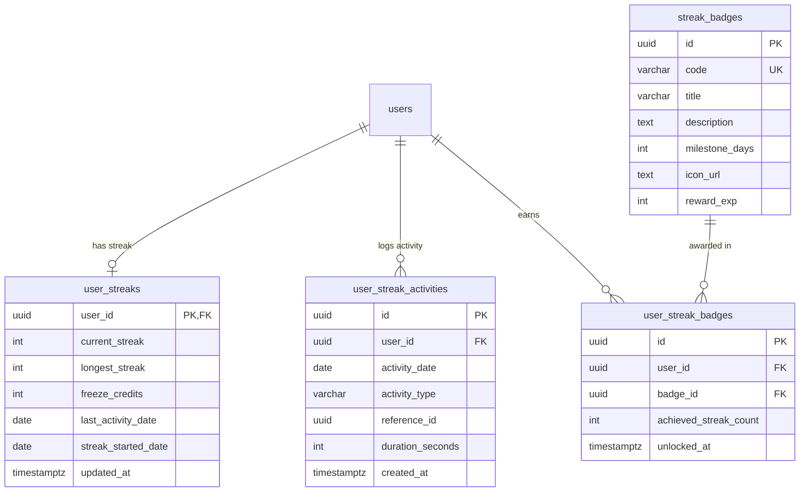

### ĐẶC TẢ CHI TIẾT CHỨC NĂNG (SPECIFICATION)
#### PHÂN HỆ HỌC TẬP CÁ NHÂN (MOD_STU)
##### MODULE: FNC_STU_08 — THEO DÕI CHUỖI NGÀY HỌC CHUYÊN CẦN LIÊN TỤC (STREAK ENGINE)

--------------------------------------------------------------------------------

#### 1. TỔNG QUAN CHỨC NĂNG (OVERVIEW)
##### 1.1. Thông tin chung
*   **Mã phân hệ:**  MOD_STU (Student Learning Module)
*   **Mã chức năng:**  FNC_STU_08
*   **Tên chức năng:**  Động cơ Chuỗi ngày học Chuyên cần (Streak Gamification & Habit-Forming Engine)
*   **Đối tượng sử dụng (Actors):**  Học viên (Student)
*   **Mục tiêu nghiệp vụ:**
    *  Xây dựng thói quen học tập tiếng Anh bền vững hàng ngày thông qua cơ chế Gamification  **Chuỗi ngày học liên tục (Streak)**  lấy cảm hứng từ mô hình ngọn lửa Duolingo.
    *  Định nghĩa rõ ràng các  **Hành vi học tập hợp lệ (Valid Learning Activities)**  để kích hoạt và duy trì Streak trong ngày:
        1. Hoàn thành ôn tập tối thiểu 5 thẻ từ vựng Flashcard (FNC_STU_04).
        2. Đọc xong 1 bài lý thuyết ngữ pháp đạt $\ge 80%$ cuộn trang (FNC_STU_06).
        3. Đạt chuẩn $\ge 80%$ bài Quiz trắc nghiệm củng cố (FNC_STU_07).
        4. Nộp bài tập Writing hoặc bài nói Speaking được giao (FNC_TSK_06).
        5. Hoàn thành 1 bài thi thử TOEIC Mini-Test hoặc Full Test (FNC_EXM_05).
    *  Trang bị cơ chế  **Vé bảo lưu chuỗi (Streak Freeze)** : Cho phép học viên bảo vệ chuỗi ngày học không bị đứt đoạn khi gặp sự cố đột xuất hoặc ốm đau (Tối đa 2 vé/tháng).
    *  Hệ thống  **Huy hiệu Thành tựu Chuyên cần (Milestone Badges)** : Trao thưởng huy hiệu và điểm thưởng khi học viên cán mốc 3 ngày, 7 ngày, 14 ngày, 30 ngày, 60 ngày, 100 ngày, và 365 ngày liên tục.
    *  Cung cấp  **Ma trận lịch chuyên cần (Activity Heatmap Calendar)**  tương tự GitHub Contribution Graph giúp học viên quan sát tần suất học tập trong suốt 365 ngày qua.

--------------------------------------------------------------------------------

#### 2. THIẾT KẾ CƠ SỞ DỮ LIỆU (DATABASE SCHEMA - POSTGRESQL 16)
Hệ thống mở rộng bảng user_streaks, thêm bảng nhật ký hoạt động user_streak_activities, danh mục huy hiệu streak_badges và bảng sở hữu huy hiệu user_streak_badges.

##### 2.1. DDL Script PostgreSQL 16
```sql
-- 1. BẢNG QUẢN LÝ CHUỖI STREAK CHÍNH CỦA HỌC VIÊN
CREATE TABLE IF NOT EXISTS user_streaks (
    user_id UUID PRIMARY KEY REFERENCES users(id) ON DELETE CASCADE,
    current_streak INT DEFAULT 0 NOT NULL CHECK (current_streak >= 0),
    longest_streak INT DEFAULT 0 NOT NULL CHECK (longest_streak >= 0),
    freeze_credits INT DEFAULT 2 NOT NULL CHECK (freeze_credits >= 0), -- Số lượt bảo lưu chuỗi còn lại (mặc định 2)
    last_activity_date DATE DEFAULT CURRENT_DATE NOT NULL,
    streak_started_date DATE DEFAULT CURRENT_DATE NOT NULL,
    updated_at TIMESTAMPTZ DEFAULT CURRENT_TIMESTAMP NOT NULL
);

-- 2. BẢNG NHẬT KÝ CÁC HOẠT ĐỘNG DUY TRÌ STREAK
CREATE TABLE IF NOT EXISTS user_streak_activities (
    id UUID PRIMARY KEY DEFAULT uuid_generate_v4(),
    user_id UUID NOT NULL REFERENCES users(id) ON DELETE CASCADE,
    activity_date DATE DEFAULT CURRENT_DATE NOT NULL,
    activity_type VARCHAR(50) NOT NULL, -- 'FLASHCARD_SM2', 'GRAMMAR_READING', 'GRAMMAR_QUIZ', 'ASSIGNMENT_SUBMIT', 'TOEIC_EXAM'
    reference_id UUID,                  -- ID bài học, đề thi, hoặc bộ thẻ liên kết
    duration_seconds INT DEFAULT 0,
    created_at TIMESTAMPTZ DEFAULT CURRENT_TIMESTAMP NOT NULL
);

-- 3. BẢNG DANH MỤC HUY HIỆU MỐC CHUYÊN CẦN
CREATE TABLE IF NOT EXISTS streak_badges (
    id UUID PRIMARY KEY DEFAULT uuid_generate_v4(),
    code VARCHAR(50) UNIQUE NOT NULL,    -- 'STREAK_3_DAYS', 'STREAK_7_DAYS', 'STREAK_30_DAYS',...
    title VARCHAR(100) NOT NULL,
    description TEXT NOT NULL,
    milestone_days INT NOT NULL UNIQUE,  -- 3, 7, 14, 30, 60, 100, 365
    icon_url TEXT NOT NULL,
    reward_exp INT DEFAULT 50 NOT NULL   -- Điểm kinh nghiệm thưởng
);

-- 4. BẢNG HỌC VIÊN ĐÃ MỞ KHÓA HUY HIỆU
CREATE TABLE IF NOT EXISTS user_streak_badges (
    id UUID PRIMARY KEY DEFAULT uuid_generate_v4(),
    user_id UUID NOT NULL REFERENCES users(id) ON DELETE CASCADE,
    badge_id UUID NOT NULL REFERENCES streak_badges(id) ON DELETE CASCADE,
    achieved_streak_count INT NOT NULL,
    unlocked_at TIMESTAMPTZ DEFAULT CURRENT_TIMESTAMP NOT NULL,
    CONSTRAINT uq_user_streak_badge UNIQUE(user_id, badge_id)
);

-- CHỈ MỤC TỐI ƯU TRUY VẤN
CREATE INDEX IF NOT EXISTS idx_streak_activities_user_date ON user_streak_activities(user_id, activity_date DESC);
CREATE INDEX IF NOT EXISTS idx_streak_badges_milestone ON streak_badges(milestone_days ASC);

```
##### 2.2. Seed Data Các Mốc Huy Hiệu Mẫu
```sql
INSERT INTO streak_badges (id, code, title, description, milestone_days, icon_url, reward_exp)
VALUES 
  (uuid_generate_v4(), 'STREAK_3', 'Mồi Lửa Đầu Tiên', 'Học liên tục 3 ngày', 3, 'badges/streak_3.png', 50),
  (uuid_generate_v4(), 'STREAK_7', 'Ngọn Lửa Kiên Trì', 'Học liên tục 7 ngày (1 tuần)', 7, 'badges/streak_7.png', 100),
  (uuid_generate_v4(), 'STREAK_14', 'Thói Quen Bền Vững', 'Học liên tục 14 ngày (2 tuần)', 14, 'badges/streak_14.png', 200),
  (uuid_generate_v4(), 'STREAK_30', 'Chiến Binh Bất Bại', 'Học liên tục 30 ngày (1 tháng)', 30, 'badges/streak_30.png', 500),
  (uuid_generate_v4(), 'STREAK_100', 'Bậc Thầy Kỷ Luật', 'Học liên tục 100 ngày', 100, 'badges/streak_100.png', 2000),
  (uuid_generate_v4(), 'STREAK_365', 'Huyền Thoại Chuyên Cần', 'Học liên tục trọn vẹn 365 ngày', 365, 'badges/streak_365.png', 10000)
ON CONFLICT (code) DO NOTHING;

```

--------------------------------------------------------------------------------

#### 3. THIẾT KẾ BACKEND (NESTJS & RESTFUL APIS)
##### 3.1. Danh mục RESTful API Endpoints
| STT | Method | Endpoint URI | Phân quyền | Mô tả chức năng |
| ------ | ------ | ------ | ------ | ------ |
| 1 | GET | /api/v1/student/streak/status | Student | Lấy trạng thái Streak hôm nay (Đã hoàn thành chưa, chuỗi hiện tại, kỷ lục) |
| 2 | GET | /api/v1/student/streak/calendar | Student | Lấy ma trận lịch học 365 ngày qua (Heatmap ngày học) |
| 3 | POST | /api/v1/student/streak/freeze | Student | Kích hoạt sử dụng 1 vé bảo lưu chuỗi (Streak Freeze) |
| 4 | GET | /api/v1/student/streak/badges | Student | Lấy danh sách huy hiệu chuyên cần (đã mở khóa & sắp mở khóa) |


--------------------------------------------------------------------------------

##### 3.2. Data Transfer Objects (DTOs)
```typescript
// src/modules/analytics/dto/streak-status-response.dto.ts
export class StreakBadgeItemDto {
  code: string;
  title: string;
  description: string;
  milestoneDays: number;
  iconUrl: string;
  isUnlocked: boolean;
  unlockedAt: string | null;
}

export class StreakStatusResponseDto {
  currentStreak: number;
  longestStreak: number;
  isCompletedToday: boolean;
  freezeCreditsRemaining: number;
  lastActivityDate: string;
  streakStartedDate: string;
  daysToNextMilestone: number;
  nextMilestoneBadge: StreakBadgeItemDto | null;
}

```
```typescript
// src/modules/analytics/dto/streak-calendar-response.dto.ts
export class DayActivityItemDto {
  date: string;       // YYYY-MM-DD
  count: number;      // Số hoạt động học trong ngày
  level: number;      // 0 (Không học), 1 (1 hoạt động), 2 (2-3 hoạt động), 3 (4+ hoạt động)
  isFrozen: boolean;  // Có áp dụng vé Streak Freeze không
}

export class StreakCalendarResponseDto {
  totalActiveDays: number;
  activities: DayActivityItemDto[];
}

```

--------------------------------------------------------------------------------

##### 3.3. Động cơ Xử lý Thuật toán Chuyên cần (StreakEngineService)
```typescript
// src/modules/analytics/services/streak-engine.service.ts
import { Injectable, Logger } from '@nestjs/common';
import { InjectRepository } from '@nestjs/typeorm';
import { Repository, DataSource } from 'typeorm';
import { UserStreakEntity } from '../../users/entities/user-streak.entity';
import { UserStreakActivityEntity } from '../entities/user-streak-activity.entity';
import { StreakBadgeEntity } from '../entities/streak-badge.entity';
import { UserStreakBadgeEntity } from '../entities/user-streak-badge.entity';

export interface TouchActivityPayload {
  userId: string;
  activityType: 'FLASHCARD_SM2' | 'GRAMMAR_READING' | 'GRAMMAR_QUIZ' | 'ASSIGNMENT_SUBMIT' | 'TOEIC_EXAM';
  referenceId?: string;
  durationSeconds?: number;
  clientTimezone?: string; // Múi giờ địa phương, mặc định Asia/Ho_Chi_Minh (+07:00)
}

@Injectable()
export class StreakEngineService {
  private readonly logger = new Logger(StreakEngineService.name);

  constructor(
    @InjectRepository(UserStreakEntity)
    private readonly streakRepo: Repository<UserStreakEntity>,
    @InjectRepository(StreakBadgeEntity)
    private readonly badgeRepo: Repository<StreakBadgeEntity>,
    private readonly dataSource: DataSource,
  ) {}

  /**
   * Kích hoạt ghi nhận hành vi học tập hợp lệ và tính toán chuỗi Streak
   */
  async recordValidActivity(payload: TouchActivityPayload): Promise<{ isStreakIncreased: boolean; currentStreak: number; unlockedBadge: StreakBadgeEntity | null }> {
    const { userId, activityType, referenceId, durationSeconds } = payload;
    const today = this.getCurrentDateInUserTimezone(payload.clientTimezone);

    return this.dataSource.transaction(async (manager) => {
      // 1. Ghi log hoạt động học tập
      const activityLog = manager.create(UserStreakActivityEntity, {
        userId,
        activityDate: today,
        activityType,
        referenceId,
        durationSeconds: durationSeconds || 0,
      });
      await manager.save(activityLog);

      // 2. Lấy thông tin Streak hiện tại của người dùng
      let streak = await manager.findOne(UserStreakEntity, { where: { userId } });
      if (!streak) {
        streak = manager.create(UserStreakEntity, {
          userId,
          currentStreak: 1,
          longestStreak: 1,
          freezeCredits: 2,
          lastActivityDate: today,
          streakStartedDate: today,
        });
        await manager.save(streak);
        const badge = await this.checkAndAwardBadges(manager, userId, 1);
        return { streakIncreased: true, currentStreak: 1, unlockedBadge: badge };
      }

      // 3. Kiểm tra tính liên tục theo ngày
      const lastDate = streak.lastActivityDate;
      if (lastDate === today) {
        // Đã học hôm nay rồi -> Giữ nguyên chuỗi, không tăng thêm
        return { streakIncreased: false, currentStreak: streak.currentStreak, unlockedBadge: null };
      }

      const diffDays = this.calculateDaysDifference(lastDate, today);
      let streakIncreased = false;

      if (diffDays === 1) {
        // Học liên tiếp đúng ngày hôm sau -> Tăng chuỗi Streak
        streak.currentStreak += 1;
        if (streak.currentStreak > streak.longestStreak) {
          streak.longestStreak = streak.currentStreak;
        }
        streak.lastActivityDate = today;
        streakIncreased = true;
      } else if (diffDays === 2 && streak.freezeCredits > 0) {
        // Bỏ lỡ 1 ngày nhưng còn vé bảo lưu (Streak Freeze)
        streak.freezeCredits -= 1;
        streak.currentStreak += 1; // Cứu chuỗi thành công
        streak.lastActivityDate = today;
        streakIncreased = true;
        this.logger.log(`User ${userId} đã tự động sử dụng 1 vé Streak Freeze để bảo vệ chuỗi.`);
      } else {
        // Đứt chuỗi hoàn toàn -> Reset về 1
        streak.currentStreak = 1;
        streak.streakStartedDate = today;
        streak.lastActivityDate = to
```
```typescript
day;
        streakIncreased = true;
      }

      await manager.save(streak);

      // 4. Kiểm tra mở khóa huy hiệu mốc chuyên cần
      const unlockedBadge = await this.checkAndAwardBadges(manager, userId, streak.currentStreak);

      return {
        isStreakIncreased: streakIncreased,
        currentStreak: streak.currentStreak,
        unlockedBadge,
      };
    });
  }

  /**
   * Kiểm tra mở khóa huy hiệu (Milestone Badges)
   */
  private async checkAndAwardBadges(manager: EntityManager, userId: string, currentStreak: number): Promise<StreakBadgeEntity | null> {
    const eligibleBadge = await manager.findOne(StreakBadgeEntity, {
      where: { milestoneDays: currentStreak },
    });

    if (!eligibleBadge) return null;

    const existingAward = await manager.findOne(UserStreakBadgeEntity, {
      where: { userId, badgeId: eligibleBadge.id },
    });

    if (!existingAward) {
      const award = manager.create(UserStreakBadgeEntity, {
        userId,
        badgeId: eligibleBadge.id,
        achievedStreakCount: currentStreak,
      });
      await manager.save(award);
      return eligibleBadge;
    }

    return null;
  }

  private getCurrentDateInUserTimezone(timezone: string = 'Asia/Ho_Chi_Minh'): string {
    const now = new Date();
    return new Intl.DateTimeFormat('en-CA', { timeZone: timezone }).format(now); // Format YYYY-MM-DD
  }

  private calculateDaysDifference(dateStr1: string, dateStr2: string): number {
    const d1 = new Date(dateStr1).getTime();
    const d2 = new Date(dateStr2).getTime();
    return Math.floor((d2 - d1) / (1000 * 3600 * 24));
  }
}

```

--------------------------------------------------------------------------------

#### 4. THIẾT KẾ FRONTEND (REACT NATIVE / LOTTIE / SVG HEATMAP)
##### 4.1. Bố cục Giao diện Ngọn lửa Chuyên cần & Lịch Chấm công (StreakModal)
```text
+-------------------------------------------------------------+
|                     TRẠNG THÁI CHUYÊN CẦN                   |
+-------------------------------------------------------------+
|                                                             |
|                    ( 🔥 NGỌN LỬA RỰC CHÁY )                  |
|                   CHUỖI 14 NGÀY LIÊN TIẾP                   |
|          "Bạn học rất chăm chỉ! Chỉ còn 16 ngày nữa         |
|             để đạt huy hiệu Chiến Binh 30 Ngày"             |
|                                                             |
|   +-----------------------------------------------------+   |
|   |  🛡️ Vé Bảo Lưu (Freeze): 2 lượt còn lại             |   |
|   |  Tự động kích hoạt khi bạn bận đột xuất 1 ngày      |   |
|   +-----------------------------------------------------+   |
|                                                             |
|   LỊCH HOẠT ĐỘNG THÁNG 10/2026:                             |
|   T2   T3   T4   T5   T6   T7   CN                          |
|   [•]  [•]  [•]  [•]  [•]  [•]  [•]   <- Tuần 1 (Đã học 🔥)  |
|   [•]  [•]  [•]  [•]  [•]  [•]  [•]   <- Tuần 2 (Đã học 🔥)  |
|   [•]  [•]  [ ]  [ ]  [ ]  [ ]  [ ]   <- Hôm nay: Đã học ✅  |
|                                                             |
|   HUY HIỆU THÀNH TỰU:                                       |
|   [ 🏆 3 Ngày ]  [ 🏆 7 Ngày ]  [ 🏆 14 Ngày ]  [ 🔒 30 Ngày]|
+-------------------------------------------------------------+
|                       [ TUYỆT VỜI! ĐÓNG ]                   |
+-------------------------------------------------------------+

```

--------------------------------------------------------------------------------

##### 4.2. Mã Nguồn Header Widget Ngọn Lửa (StreakFlameHeader.tsx)
```tsx
import React, { useState } from 'react';
import { View, Text, Pressable, Modal } from 'react-native';
import { Flame, ShieldCheck, Award } from 'lucide-react-native';
import { useQuery } from '@tanstack/react-query';
import axios from 'axios';

export const StreakFlameHeader = () => {
  const [modalVisible, setModalVisible] = useState(false);

  // Tải trạng thái Streak từ Backend
  const { data: streak } = useQuery({
    queryKey: ['student-streak-status'],
    queryFn: async () => {
      const res = await axios.get('/api/v1/student/streak/status');
      return res.data;
    },
    refetchInterval: 60000, // Cập nhật mỗi phút
  });

  const count = streak?.currentStreak || 0;
  const isDoneToday = streak?.isCompletedToday || false;

  return (
    <>
      <Pressable
        onPress={() => setModalVisible(true)}
        className={`flex-row items-center px-3 py-1.5 rounded-full border ${
          isDoneToday ? 'bg-amber-50 border-amber-300' : 'bg-slate-100 border-slate-200'
        }`}
      >
        <Flame
          size={18}
          color={isDoneToday ? '#f59e0b' : '#94a3b8'}
          fill={isDoneToday ? '#f59e0b' : 'transparent'}
        />
        <Text
          className={`font-black text-xs ml-1 ${
            isDoneToday ? 'text-amber-700' : 'text-slate-500'
          }`}
        >
          {count}
        </Text>
      </Pressable>

      {/* POPUP CHI TIẾT STREAK & LỊCH HỌC */}
      <Modal visible={modalVisible} transparent animationType="fade">
        <View className="flex-1 bg-black/50 justify-center items-center px-6">
          <View className="bg-white w-full rounded-3xl p-6 items-center shadow-xl">
            {/* Animation Icon Ngọn lửa */}
            <View className="w-20 h-20 bg-amber-100 rounded-full items-center justify-center mb-3">
              <Flame size={48} color="#f59e0b" fill="#f59e0b" />
            </View>

            <Text className="text-2xl font-black text-slate-800">
              Chuỗi {count} ngày chuyên cần!
            </Text>
            <Text className="text-xs text-slate-500 text-center mt-1">
              {isDoneToday
                ? 'Hôm nay bạn đã hoàn thành bài học để giữ lửa 🔥'
                : 'Hãy học ít nhất 1 bài học để duy trì chuỗi hôm nay nhé!'}
            </Text>

            {/* Thông tin vé bảo lưu */}
            <View className="bg-blue-50 w-full p-3.5 rounded-2xl flex-row items-center gap-3 mt-4 border border-blue-100">
              <ShieldCheck size={24} color="#2563eb" />
              <View className="flex-1">
                <Text className="text-xs font-bold text-blue-900">
                  {streak?.freezeCreditsRemaining || 0} Vé Bảo Lưu (Streak Freeze)
                </Text>
                <Text className="text-[11px] text-blue-700">
                  Tự động bảo vệ chuỗi khi bạn lỡ quên học 1 ngày.
                </Text>
              </View>
            </View>

            {/* Nút đóng */}
            <Pressable
              onPress={() => setModalVisible(false)}
              className="w-full bg-blue-600 py-3.5 rounded-2xl items-center mt-6"
            >
              <Text className="text-white font-bold text-sm">Tuyệt vời, tiếp tục học!</Text>
            </Pressable>
          </View>
        </View>
      </Modal>
    </>
  );
};

```

--------------------------------------------------------------------------------

#### 5. QUY TẮC NGHIỆP VỤ & KIỂM TRA HỢP LỆ (BUSINESS RULES)
1.  **Quy tắc Thời điểm Sang ngày Mới (Cutoff Time by Timezone)** :
    *  Điểm mốc tính ngày mới là  **00:00:00 theo múi giờ tài khoản học viên**  (Mặc định Asia/Ho_Chi_Minh UTC+7).
    *  Mọi hoạt động học thực hiện trong khoảng 00:00:00 đến 23:59:59 đều được tính vào ngày hôm đó.
2.  **Quy tắc Sử dụng Vé Bảo Lưu (Streak Freeze)** :
    *  Mỗi tài khoản được cấp tối đa  **2 vé bảo lưu / tháng** .
    *  Nếu học viên quên học ngày hôm qua ($diffDays = 2$) và còn ít nhất 1 vé, hệ thống tự động trừ 1 vé và duy trì chuỗi tiếp tục mà không reset về 1.
3.  **Quy tắc Mở khóa Huy hiệu Chuyên cần (Milestone Idempotency)** :
    *  Mỗi mốc huy hiệu (3, 7, 14, 30, 100, 365 ngày) chỉ được nhận thưởng EXP một lần duy nhất cho mỗi học viên, tránh việc cố tình làm đứt chuỗi để "cày" lại phần thưởng.
