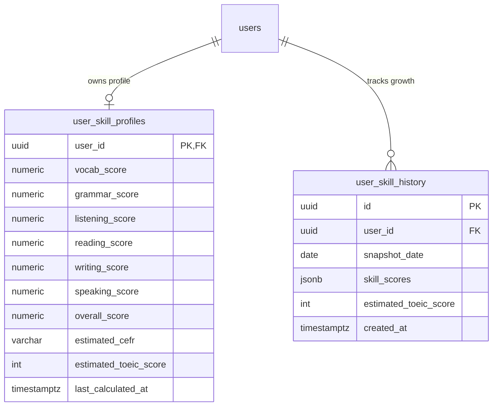

### ĐẶC TẢ CHI TIẾT CHỨC NĂNG (SPECIFICATION)
#### PHÂN HỆ HỌC TẬP CÁ NHÂN (MOD_STU)
##### MODULE: FNC_STU_09 — BẢNG PHÂN TÍCH NĂNG LỰC CÁ NHÂN QUA RADAR 6 KỸ NĂNG

--------------------------------------------------------------------------------

#### 1. TỔNG QUAN CHỨC NĂNG (OVERVIEW)
##### 1.1. Thông tin chung
*   **Mã phân hệ:**  MOD_STU (Student Learning Module)
*   **Mã chức năng:**  FNC_STU_09
*   **Tên chức năng:**  Bảng phân tích năng lực cá nhân qua Radar 6 kỹ năng (Comprehensive Skill Analytics & Hexagon Radar Chart)
*   **Đối tượng sử dụng (Actors):**  Học viên (Student)
*   **Mục tiêu nghiệp vụ:**
    *  Cung cấp bức tranh toàn cảnh, đa chiều và chính xác về trình độ tiếng Anh của học viên thông qua  **Biểu đồ mạng nhện 6 trục (Hexagon Radar Chart)**  được chuẩn hóa trên thang điểm 100:
        1.  **Từ vựng (Vocabulary)** : Dựa trên số từ SM-2 đã thuộc, cấp độ CEFR cao nhất đạt được, tỷ lệ phản xạ chính xác.
        2.  **Ngữ pháp (Grammar)** : Dựa trên tỷ lệ hoàn thành các chuyên đề và điểm trung bình bài Quiz củng cố.
        3.  **Nghe hiểu TOEIC (Listening)** : Dựa trên điểm quy đổi Part 1–4 trong các bài thi thử TOEIC chuẩn ETS.
        4.  **Đọc hiểu TOEIC (Reading)** : Dựa trên điểm quy đổi Part 5–7 trong các bài thi thử TOEIC chuẩn ETS.
        5.  **Viết luận (Writing)** : Dựa trên điểm trung bình 4 tiêu chí rubric (Task, Cohesion, Lexical, Grammar) do giảng viên chấm.
        6.  **Nói & Giao tiếp (Speaking)** : Dựa trên điểm phát âm, độ trôi chảy, ngữ điệu do giảng viên đánh giá trên sóng âm.
    *  Tích hợp công cụ  **Chẩn đoán điểm yếu tự động (Weakness Diagnosis Engine)** : Hệ thống tự động so sánh 6 kỹ năng để chỉ ra 2–3 "lỗ hổng kiến thức" lớn nhất và đưa ra gợi ý lộ trình khắc phục (Actionable Recommendations) dẫn thẳng tới bài học tương ứng.
    *  Dự đoán điểm thi TOEIC tổng thể ($10 - 990$) và cấp độ CEFR tương đương (A1, A2, B1, B2, C1, C2) theo thời gian thực.
    *  Cho phép quan sát tiến trình tăng trưởng năng lực theo thời gian (Historical Snapshots: So sánh tháng này vs. tháng trước).

--------------------------------------------------------------------------------

#### 2. THIẾT KẾ CƠ SỞ DỮ LIỆU (DATABASE SCHEMA - POSTGRESQL 16)
Hệ thống lưu hồ sơ điểm số 6 kỹ năng hiện tại trong user_skill_profiles và lưu các ảnh chụp lịch sử định kỳ trong user_skill_history.

##### 2.1. DDL Script PostgreSQL 16
```sql
-- 1. BẢNG HỒ SƠ NĂNG LỰC 6 KỸ NĂNG HIỆN TẠI
CREATE TABLE IF NOT EXISTS user_skill_profiles (
    user_id UUID PRIMARY KEY REFERENCES users(id) ON DELETE CASCADE,
    vocab_score NUMERIC(5, 2) DEFAULT 0.00 NOT NULL CHECK (vocab_score BETWEEN 0 AND 100),
    grammar_score NUMERIC(5, 2) DEFAULT 0.00 NOT NULL CHECK (grammar_score BETWEEN 0 AND 100),
    listening_score NUMERIC(5, 2) DEFAULT 0.00 NOT NULL CHECK (listening_score BETWEEN 0 AND 100),
    reading_score NUMERIC(5, 2) DEFAULT 0.00 NOT NULL CHECK (reading_score BETWEEN 0 AND 100),
    writing_score NUMERIC(5, 2) DEFAULT 0.00 NOT NULL CHECK (writing_score BETWEEN 0 AND 100),
    speaking_score NUMERIC(5, 2) DEFAULT 0.00 NOT NULL CHECK (speaking_score BETWEEN 0 AND 100),
    overall_score NUMERIC(5, 2) DEFAULT 0.00 NOT NULL CHECK (overall_score BETWEEN 0 AND 100),
    estimated_cefr VARCHAR(10) DEFAULT 'A1' NOT NULL,    -- A1, A2, B1, B2, C1, C2
    estimated_toeic_score INT DEFAULT 200 NOT NULL CHECK (estimated_toeic_score BETWEEN 10 AND 990),
    last_calculated_at TIMESTAMPTZ DEFAULT CURRENT_TIMESTAMP NOT NULL
);

-- 2. BẢNG LƯU ẢNH CHỤP LỊCH SỬ NĂNG LỰC THEO THỜI GIAN (SNAPSHOTS)
CREATE TABLE IF NOT EXISTS user_skill_history (
    id UUID PRIMARY KEY DEFAULT uuid_generate_v4(),
    user_id UUID NOT NULL REFERENCES users(id) ON DELETE CASCADE,
    snapshot_date DATE DEFAULT CURRENT_DATE NOT NULL,
    skill_scores JSONB NOT NULL,                         -- {"vocab": 65, "grammar": 80, "listening": 70, "reading": 60, "writing": 55, "speaking": 50}
    estimated_toeic_score INT NOT NULL,
    created_at TIMESTAMPTZ DEFAULT CURRENT_TIMESTAMP NOT NULL
);

-- CHỈ MỤC TỐI ƯU TRUY VẤN
CREATE INDEX IF NOT EXISTS idx_skill_history_user_date ON user_skill_history(user_id, snapshot_date DESC);

```

--------------------------------------------------------------------------------

#### 3. THUẬT TOÁN CHUẨN HÓA ĐIỂM SỐ 6 TRỤC (SCORING FORMULA)
Để đưa các loại hình bài thi và bài tập khác nhau về  **thang điểm 100 thống nhất** :
1.  **Điểm Từ vựng ($S_{	ext{vocab}}$)** : $$S_{	ext{vocab}} = \min\left(100,, \left(rac{	ext{Từ thành thạo}}{300} 	imes 60 ight) + \left(rac{	ext{Từ đang học}}{150} 	imes 40 ight) ight)$$
2.  **Điểm Ngữ pháp ($S_{	ext{grammar}}$)** :  $$S_{	ext{grammar}} = (0.4 	imes \% 	ext{ chuyên đề đã học}) + (0.6 	imes 	ext{Điểm TB Quiz củng cố})$$
3.  **Điểm Nghe TOEIC ($S_{	ext{listening}}$)** :  $$S_{	ext{listening}} = rac{	ext{Điểm Listening TOEIC gần nhất (5-495)}}{495} 	imes 100$$
4.  **Điểm Đọc TOEIC ($S_{	ext{reading}}$)** :  $$S_{	ext{reading}} = rac{	ext{Điểm Reading TOEIC gần nhất (5-495)}}{495} 	imes 100$$
5.  **Điểm Viết ($S_{	ext{writing}}$)** :  $$S_{	ext{writing}} = 	ext{Điểm trung bình các bài luận Writing được chấm (thang 100)}$$
6.  **Điểm Nói ($S_{	ext{speaking}}$)** :  $$S_{	ext{speaking}} = 	ext{Điểm trung bình các bài thu âm Speaking được chấm (thang 100)}$$

--------------------------------------------------------------------------------

#### 4. THIẾT KẾ BACKEND (NESTJS & RESTFUL APIS)
##### 4.1. Danh mục RESTful API Endpoints
| STT | Method | Endpoint URI | Phân quyền | Mô tả chức năng |
| ------ | ------ | ------ | ------ | ------ |
| 1 | GET | /api/v1/student/analytics/radar | Student | Lấy dữ liệu 6 kỹ năng hiện tại, dự đoán TOEIC & CEFR |
| 2 | GET | /api/v1/student/analytics/weaknesses | Student | Lấy danh sách 2 kỹ năng yếu nhất kèm gợi ý bài học khắc phục |
| 3 | GET | /api/v1/student/analytics/history | Student | Lấy dữ liệu tăng trưởng năng lực qua các tuần/tháng |
| 4 | POST | /api/v1/student/analytics/recalculate | Student | Kích hoạt tính toán lại toàn bộ chỉ số năng lực theo dữ liệu mới nhất |


--------------------------------------------------------------------------------

##### 4.2. Data Transfer Objects (DTOs)
```typescript
// src/modules/analytics/dto/radar-analytics-response.dto.ts
export class SkillMetricDto {
  key: string;        // 'vocab', 'grammar', 'listening', 'reading', 'writing', 'speaking'
  label: string;      // 'Từ vựng', 'Ngữ pháp', 'Nghe hiểu', 'Đọc hiểu', 'Viết', 'Nói'
  score: number;      // 0 - 100
  benchmark: number;  // Điểm trung bình của cộng đồng học viên cùng level
}

export class WeaknessActionItemDto {
  skillKey: string;
  skillLabel: string;
  currentScore: number;
  recommendationTitle: string;
  recommendationType: 'FLASHCARD' | 'GRAMMAR' | 'TOEIC_PART' | 'WRITING_PRACTICE';
  targetReferenceId: string; // Link đến bài học cụ thể
}

export class RadarAnalyticsResponseDto {
  metrics: SkillMetricDto[];
  overallScore: number;
  estimatedToeicScore: number;
  estimatedCefr: string;
  weaknesses: WeaknessActionItemDto[];
  lastCalculatedAt: string;
}

```

--------------------------------------------------------------------------------

##### 4.3. Dịch vụ Xử lý Năng lực (SkillAnalyticsService)
```typescript
// src/modules/analytics/services/skill-analytics.service.ts
import { Injectable } from '@nestjs/common';
import { InjectRepository } from '@nestjs/typeorm';
import { Repository, DataSource } from 'typeorm';
import { UserSkillProfileEntity } from '../entities/user-skill-profile.entity';
import { RadarAnalyticsResponseDto } from '../dto/radar-analytics-response.dto';

@Injectable()
export class SkillAnalyticsService {
  constructor(
    @InjectRepository(UserSkillProfileEntity)
    private readonly profileRepo: Repository<UserSkillProfileEntity>,
    private readonly dataSource: DataSource,
  ) {}

  /**
   * Tính toán lại và trả về dữ liệu Radar 6 kỹ năng của học viên
   */
  async getOrRecalculateRadar(userId: string): Promise<RadarAnalyticsResponseDto> {
    // 1. Tính điểm Từ vựng
    const vocabData = await this.dataSource.query(
      `
      SELECT 
        COUNT(CASE WHEN interval_days > 21 THEN 1 END)::int AS mastered,
        COUNT(CASE WHEN interval_days <= 21 AND repetition_count > 0 THEN 1 END)::int AS learning
      FROM user_flashcard_progress
      WHERE user_id = $1
      `,
      [userId],
    );
    const mastered = vocabData[0]?.mastered || 0;
    const learning = vocabData[0]?.learning || 0;
    const vocabScore = Math.min(100, Math.round((mastered / 300) * 60 + (learning / 150) * 40));

    // 2. Tính điểm Ngữ pháp
    const grammarData = await this.dataSource.query(
      `
      SELECT 
        COALESCE(AVG(score), 0)::numeric(5,2) AS avg_quiz_score,
        COUNT(CASE WHEN is_passed = true THEN 1 END)::int AS passed_quizzes
      FROM user_grammar_quiz_attempts
      WHERE user_id = $1
      `,
      [userId],
    );
    const avgQuiz = Number(grammarData[0]?.avg_quiz_score) || 0;
    const passedQuizzes = grammarData[0]?.passed_quizzes || 0;
    const grammarScore = Math.min(100, Math.round(0.4 * Math.min(100, passedQuizzes * 10) + 0.6 * avgQuiz));

    // 3. Tính điểm Nghe & Đọc TOEIC từ lượt thi gần nhất
    const toeicAttempt = await this.dataSource.query(
      `
      SELECT listening_scale_score, reading_scale_score, total_score
      FROM toeic_exam_attempts
      WHERE user_id = $1 AND status = 'COMPLETED'
      ORDER BY submitted_at DESC
      LIMIT 1
      `,
      [userId],
    );
    const listeningScore = toeicAttempt[0]
      ? Math.round((toeicAttempt[0].listening_scale_score / 495) * 100)
      : 30;
    const readingScore = toeicAttempt[0]
      ? Math.round((toeicAttempt[0].reading_scale_score / 495) * 100)
      : 30;
    const estimatedToeic = toeicAttempt[0]?.total_score || Math.round((listeningScore + readingScore) * 4.95);

    // 4. Tính điểm Writing & Speaking từ bài nộp đã được chấm
    const assignmentScores = await this.dataSource.query(
      `
      SELECT a.type, COALESCE(AVG(r.total_score), 0)::numeric(5,2) AS avg_score
      FROM submission_reviews r
      INNER JOIN assignment_submissions s ON s.id = r.submission_id
      INNER JOIN assignments a ON a.id = s.assignment_id
      WHERE s.student_id = $1
      GROUP BY a.type
      `,
      [userId],
    );
    const writingScore = Number(assignmentScores.find((r: { type: string; avg_score: number }) => r.type === 'WRITING')?.avg_score) || 40;
    const speakingScore = Number(assignmentScores.find((r: { type: string; avg_score: number }) => r.type === 'SPEAKING')?.avg_score) || 40;

    // 5. Tính điểm tổng và cấp độ CEFR ước tính
    const overallScore = Math.round(
      (vocabScore + grammarScore + listeningScore + readingScore + writingScore + speakingScore) / 6,
    );
    const estimatedCefr = this.mapScoreToCefr(overallScore);

    // 6. Cập nhật hồ sơ vào CSDL
    let profile = await this.profileRepo.findOne({ where: { userId } });
    if (!profile) {
      profile = this.profileRepo.create({ userId });
    }
    profile.vocabScore = vocabScore;
    profile.grammarScore = grammarScore;
    profile.listeningScore = listeningScore;
    profile.readingScore = readingScore;
    profile.wri
```
```typescript
tingScore = writingScore;
    profile.speakingScore = speakingScore;
    profile.overallScore = overallScore;
    profile.estimatedCefr = estimatedCefr;
    profile.estimatedToeicScore = estimatedToeic;
    profile.lastCalculatedAt = new Date();
    await this.profileRepo.save(profile);

    // 7. Tạo danh sách gợi ý điểm yếu
    const metrics = [
      { key: 'vocab', label: 'Từ vựng', score: vocabScore, benchmark: 60 },
      { key: 'grammar', label: 'Ngữ pháp', score: grammarScore, benchmark: 65 },
      { key: 'listening', label: 'Nghe TOEIC', score: listeningScore, benchmark: 55 },
      { key: 'reading', label: 'Đọc TOEIC', score: readingScore, benchmark: 50 },
      { key: 'writing', label: 'Viết luận', score: writingScore, benchmark: 45 },
      { key: 'speaking', label: 'Nói', score: speakingScore, benchmark: 45 },
    ];

    const sortedByWeakness = [...metrics].sort((a, b) => a.score - b.score);
    const weaknesses = sortedByWeakness.slice(0, 2).map((item) => ({
      skillKey: item.key,
      skillLabel: item.label,
      currentScore: item.score,
      recommendationTitle: `Củng cố kỹ năng ${item.label} đang ở mức ${item.score}/100`,
      recommendationType: item.key === 'vocab' ? 'FLASHCARD' : item.key === 'grammar' ? 'GRAMMAR' : 'TOEIC_PART',
      targetReferenceId: '',
    }));

    return {
      metrics,
      overallScore,
      estimatedToeicScore: estimatedToeic,
      estimatedCefr,
      weaknesses,
      lastCalculatedAt: profile.lastCalculatedAt.toISOString(),
    };
  }

  private mapScoreToCefr(score: number): string {
    if (score >= 85) return 'C1';
    if (score >= 70) return 'B2';
    if (score >= 50) return 'B1';
    if (score >= 35) return 'A2';
    return 'A1';
  }
}

```

--------------------------------------------------------------------------------

#### 5. THIẾT KẾ FRONTEND (REACT NATIVE / SVG RADAR)
##### 5.1. Bố cục Giao diện Radar & Điểm Yếu (SkillRadarScreen)
```text
+-------------------------------------------------------------+
| BÁO CÁO NĂNG LỰC TOÀN DIỆN (RADAR 6 KỸ NĂNG)               |
+-------------------------------------------------------------+
|                                                             |
|                       [ TỪ VỰNG ] (75)                      |
|                            /     \                          |
|         [ NÓI ] (55)     /         \     [ NGỮ PHÁP ] (80)  |
|               \        /   ▲▲▲▲▲     \        /             |
|                 \    /    ▲▲▲▲▲▲▲      \    /               |
|                   ●------▲▲▲▲▲▲▲▲-------●                   |
|                 /    \    ▲▲▲▲▲▲▲      /    \               |
|               /        \   ▲▲▲▲▲     /        \             |
|        [ VIẾT ] (45)     \         /   [ NGHE TOEIC ] (65)  |
|                            \     /                          |
|                       [ ĐỌC TOEIC ] (50)                    |
|                                                             |
|   ƯỚC TÍNH NĂNG LỰC:                                        |
|   ⭐ Điểm TOEIC dự đoán: 620 / 990  |  Cấp độ CEFR: B1+     |
+-------------------------------------------------------------+
| ⚠️ CHẨN ĐOÁN 2 ĐIỂM YẾU CẦN CẢI THIỆN:                      |
|                                                             |
| 1. Kỹ năng Viết (Writing): 45 / 100 điểm                    |
|    👉 Đề xuất: Thực hành bài viết luận Opinion Essay Part 2 |
|                                                             |
| 2. Kỹ năng Đọc hiểu (Reading): 50 / 100 điểm                |
|    👉 Đề xuất: Luyện bẫy suy luận đoạn văn kép TOEIC Part 7 |
+-------------------------------------------------------------+

```

--------------------------------------------------------------------------------

##### 5.2. Component Vẽ Biểu Đồ Mạng Nhện SVG (HexagonRadarChart.tsx)
```tsx
import React from 'react';
import { View, Text } from 'react-native';
import Svg, { Polygon, Line, Circle, Text as SvgText } from 'react-native-svg';

interface Metric {
  key: string;
  label: string;
  score: number; // 0 - 100
}

interface Props {
  metrics: Metric[];
  size?: number;
}

export const HexagonRadarChart: React.FC<Props> = ({ metrics, size = 300 }) => {
  const center = size / 2;
  const radius = (size - 70) / 2;
  const numAxes = 6;
  const angleStep = (Math.PI * 2) / numAxes;

  // Tính tọa độ trên đa giác
  const getCoordinates = (value: number, index: number) => {
    const r = (value / 100) * radius;
    const angle = index * angleStep - Math.PI / 2;
    return {
      x: center + r * Math.cos(angle),
      y: center + r * Math.sin(angle),
    };
  };

  // Chuỗi tọa độ của dữ liệu người dùng
  const userPoints = metrics
    .map((m, i) => {
      const { x, y } = getCoordinates(m.score, i);
      return `${x},${y}`;
    })
    .join(' ');

  // Mạng lưới các vòng tròn đồng tâm 20%, 40%, 60%, 80%, 100%
  const webLevels = [20, 40, 60, 80, 100];

  return (
    <View className="items-center justify-center">
      <Svg width={size} height={size}>
        {/* 1. VẼ MẠNG LƯỚI ĐỒNG TÂM */}
        {webLevels.map((level) => {
          const points = Array.from({ length: numAxes })
            .map((_, i) => {
              const { x, y } = getCoordinates(level, i);
              return `${x},${y}`;
            })
            .join(' ');

          return (
            <Polygon
              key={level}
              points={points}
              stroke="#e2e8f0"
              strokeWidth={1}
              fill={level === 100 ? '#f8fafc' : 'none'}
            />
          );
        })}

        {/* 2. VẼ 6 TRỤC TỌA ĐỘ TỪ TÂM */}
        {Array.from({ length: numAxes }).map((_, i) => {
          const { x, y } = getCoordinates(100, i);
          return (
            <Line
              key={i}
              x1={center}
              y1={center}
              x2={x}
              y2={y}
              stroke="#cbd5e1"
              strokeWidth={1}
            />
          );
        })}

        {/* 3. VẼ ĐA GIÁC ĐIỂM CỦA HỌC VIÊN */}
        <Polygon
          points={userPoints}
          stroke="#2563eb"
          strokeWidth={2.5}
          fill="rgba(37, 99, 235, 0.25)"
        />

        {/* 4. ĐIỂM CHẤM VÀ NHÃN TRÊN 6 ĐỈNH */}
        {metrics.map((m, i) => {
          const { x, y } = getCoordinates(m.score, i);
          const labelCoord = getCoordinates(118, i);

          return (
            <React.Fragment key={m.key}>
              <Circle cx={x} cy={y} r={4} fill="#2563eb" />
              <SvgText
                x={labelCoord.x}
                y={labelCoord.y + 4}
                fontSize={10}
                fontWeight="bold"
                fill="#334155"
                textAnchor="middle"
              >
                {`${m.label} (${m.score})`}
              </SvgText>
            </React.Fragment>
          );
        })}
      </Svg>
    </View>
  );
};

```

--------------------------------------------------------------------------------

#### 6. QUY TẮC NGHIỆP VỤ & TÍNH TOÁN (BUSINESS RULES)
1.  **Chu kỳ Cập nhật Chỉ số Năng lực (Calculation Trigger)** :
    *  Hồ sơ năng lực được tự động tính toán lại bất kỳ khi nào phát sinh một trong các sự kiện:
*  Học viên nộp bài thi TOEIC hoàn chỉnh.
    *  Giáo viên hoàn tất chấm điểm bài luận Writing hoặc bài nói Speaking.
    *  Học viên tích lũy thêm 20 từ vựng Mastered trong Flashcard.
2.  **Trọng số Suy giảm theo Thời gian (Time-decay Weighting)** :
    *  Kết quả các bài tập và bài thi trong  **30 ngày gần nhất**  được áp dụng  **trọng số 70%** .
    *  Kết quả cũ hơn 30 ngày có trọng số 30%, đảm bảo biểu đồ luôn phản ánh phong độ và năng lực thực tế hiện tại của người học.
3.  **Cơ chế Gợi ý Khắc phục Lỗ hổng (Prescriptive Recommendation)** :
    *  Hai kỹ năng có điểm thấp nhất trong 6 trục sẽ được hệ thống phân tích sâu để đưa ra 1 bài học lý thuyết ngữ pháp hoặc 1 đề luyện thi chuyên sâu nhằm giúp học viên cải thiện điểm số mục tiêu TOEIC nhanh nhất.
