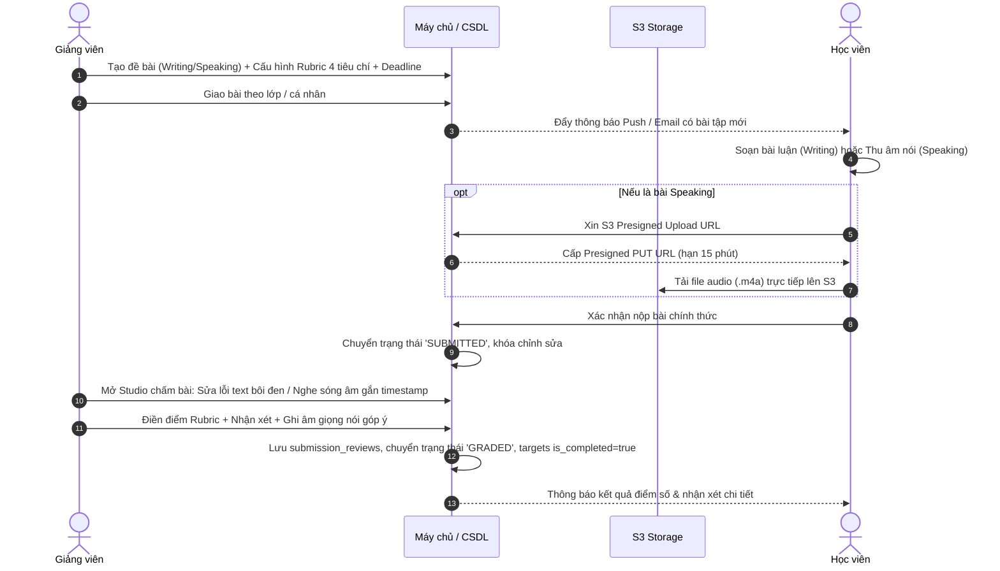

### TÀI LIỆU ĐẶC TẢ YÊU CẦU HỆ THỐNG & THIẾT KẾ CHI TIẾT (SRS & SDD)
#### DỰ ÁN: HỆ THỐNG HỌC TIẾNG ANH & LUYỆN THI TOEIC TRỰC TUYẾN
*   **Mã dự án / Tài liệu:**  SRS_SDD_ENG_TOEIC_2026_V1
*   **Phiên bản:**  1.0.0
*   **Ngày phát hành:**  12/10/2026
*   **Hệ quản trị CSDL:**  PostgreSQL 16 |  **Backend:**  NestJS (Node.js) |  **Frontend:**  React Native / Next.js
*   **Trạng thái tài liệu:**  Đã phê duyệt (Approved)

--------------------------------------------------------------------------------

#### MỤC LỤC
1. [TỔNG QUAN HỆ THỐNG & KIẾN TRÚC KỸ THUẬT](#1-tổng-quan-hệ-thống--kiến-trúc-kỹ-thuật)
2. [CÂY PHÂN RÃ CHỨC NĂNG (FUNCTIONAL BREAKDOWN)](#2-cây-phân-rã-chức-năng-functional-breakdown)
3. [MA TRẬN PHÂN QUYỀN TRUY CẬP (RBAC MATRIX)](#3-ma-trận-phân-quyền-truy-cập-rbac-matrix)
4. [THIẾT KẾ CƠ SỞ DỮ LIỆU CHI TIẾT (POSTGRESQL 16 DDL)](#4-thiết-kế-cơ-sở-dữ-liệu-chi-tiết-postgresql-16-ddl)
5. [CÁC QUY TRÌNH NGHIỆP VỤ CỐT LÕI (WORKFLOWS)](#5-các-quy-trình-nghiệp-vụ-cốt-lõi-workflows)
6. [QUY TẮC LOGIC & THUẬT TOÁN HỆ THỐNG](#6-quy-tắc-logic--thuật-toán-hệ-thống)
7. [ĐẶC TẢ CHI TIẾT MÀN HÌNH CHẤM BÀI (ADM0301)](#7-đặc-tả-chi-tiết-màn-hình-chấm-bài-adm0301)
8. [DANH MỤC GIAO DIỆN TÍCH HỢP RESTFUL API](#8-danh-mục-giao-diện-tích-hợp-restful-api)

--------------------------------------------------------------------------------

#### 1. TỔNG QUAN HỆ THỐNG & KIẾN TRÚC KỸ THUẬT
##### 1.1. Mục tiêu hệ thống
Xây dựng nền tảng học tiếng Anh trực tuyến toàn diện, tích hợp:
*  Tự học từ vựng thông minh theo thuật toán  **Lặp lại ngắt quãng SM-2 (Spaced Repetition System)** .
*  Học ngữ pháp theo giáo trình chuyên đề kèm bài tập Quiz củng cố tức thì.
*  Phòng thi thử  **TOEIC chuẩn format ETS**  200 câu trong 120 phút, tự động quy đổi điểm chuẩn (10 - 990).
*  Hệ thống quản lý đào tạo (LMS) cho phép Giảng viên tạo đề, giao bài tập, chấm điểm tự luận  **Writing**  (sửa lỗi văn bản trực tiếp) và vấn đáp  **Speaking**  (chấm trên sóng âm thanh và phản hồi bằng giọng nói).
##### 1.2. Kiến trúc giải pháp kỹ thuật (High-Level Architecture)
```
[ User Client: Mobile App (React Native / Flutter) ]  [ Admin Client: Web Portal (Next.js 14) ]
                               │                                       │
                               └───────────────────┬───────────────────┘
                                                   │ HTTPS / WebSocket / RESTful API
                                                   ▼
                                  [ API Gateway & Load Balancer ]
                                                   │
                                                   ▼
                        [ Backend Application Layer: NestJS (TypeScript) ]
                     ┌─────────────────────────────┼─────────────────────────────┐
                     ▼                             ▼                             ▼
         [ PostgreSQL 16 Cluster ]       [ Redis 7 In-Memory ]         [ Cloud Storage: S3 / R2 ]
        - Lưu trữ dữ liệu quan hệ       - Cache phiên làm bài thi       - File Audio TOEIC Part 1-4
        - JSONB Rubric & Inline fix     - Rate limiting & Timer 120m    - File ghi âm Speaking (.m4a)
        - Full-text search (pg_trgm)    - Hàng đợi ngầm BullMQ          - Ảnh minh họa đề thi & từ vựng

```

--------------------------------------------------------------------------------

#### 2. CÂY PHÂN RÃ CHỨC NĂNG (FUNCTIONAL BREAKDOWN)
Hệ thống được chia thành 4 phân hệ chính với 36 chức năng nghiệp vụ chuẩn hóa:
##### 2.1. Phân hệ Quản trị & Giảng dạy (MOD_ADM)
*   **FNC_ADM_01:**  Đăng nhập & Xác thực vai trò Admin / Giảng viên (RBAC).
*   **FNC_ADM_02:**  Tạo & Quản lý ngân hàng câu hỏi Quiz trắc nghiệm / Ngữ pháp.
*   **FNC_ADM_03:**  Tạo đề bài luận Writing & Cấu hình Rubric 4 tiêu chí chấm điểm.
*   **FNC_ADM_04:**  Tạo đề luyện nói Speaking kèm Audio phát âm mẫu bản xứ.
*   **FNC_ADM_05:**  Giao bài tập theo lớp học hoặc cá nhân học viên kèm Deadline.
*   **FNC_ADM_06:**  Quản lý, tìm kiếm và lọc danh sách bài nộp của học viên.
*   **FNC_ADM_07:**  Studio chấm bài Writing (Giao diện chia đôi, bôi đen highlight sửa lỗi).
*   **FNC_ADM_08:**  Studio chấm bài Speaking (WaveSurfer hiển thị sóng âm, gắn comment theo mốc giây).
*   **FNC_ADM_09:**  Thu âm phản hồi bằng giọng nói trực tiếp của Giảng viên gửi học viên.
*   **FNC_ADM_10:**  Báo cáo & Dashboard giám sát tiến độ đào tạo của lớp học.
*   **FNC_ADM_11:**  Cảnh báo tự động học viên nộp muộn, chưa làm bài hoặc điểm tụt dốc.
*   **FNC_ADM_12:**  Quản lý kho bộ thẻ Flashcard dùng chung và nhập đề thi TOEIC từ Excel.
##### 2.2. Phân hệ Học tập Cá nhân (MOD_STU)
*   **FNC_STU_01:**  Đăng ký, đăng nhập và quản lý hồ sơ mục tiêu điểm số.
*   **FNC_STU_02:**  Duyệt danh mục bộ thẻ từ vựng phân loại theo khung CEFR (A1 - C2).
*   **FNC_STU_03:**  Học từ vựng tương tác qua thẻ lật 3D (Phiên âm IPA, Audio, Ngữ cảnh).
*   **FNC_STU_04:**  Luyện tập thông minh theo thuật toán Spaced Repetition SM-2.
*   **FNC_STU_05:**  Đánh dấu từ yêu thích và tạo sổ tay từ vựng khó nhớ.
*   **FNC_STU_06:**  Học lý thuyết ngữ pháp chuyên đề (Định dạng Markdown trực quan).
*   **FNC_STU_07:**  Làm Quiz trắc nghiệm củng cố kiến thức ngữ pháp vừa học.
*   **FNC_STU_08:**  Theo dõi chuỗi ngày học chuyên cần liên tục (Streak Engine).
*   **FNC_STU_09:**  Bảng phân tích năng lực cá nhân qua Radar 6 kỹ năng.
##### 2.3. Phân hệ Động cơ Thi thử TOEIC (MOD_EXM)
*   **FNC_EXM_01:**  Chọn đề thi Full Test (200 câu) hoặc Mini-Test theo từng Part (Part 1 - 7).
*   **FNC_EXM_02:**  Phòng thi mô phỏng chuẩn ETS (Đồng hồ đếm ngược 120 phút, ma trận 200 câu).
*   **FNC_EXM_03:**  Audio Player phát tuần tự Part 1-4, khóa tua lùi ở chế độ thi chuẩn.
*   **FNC_EXM_04:**  Công cụ gắn cờ (Flag) câu hỏi phân vân và tự động lưu nháp mỗi 15 giây.
*   **FNC_EXM_05:**  Tự động khóa và thu bài khi hết giờ (hoặc nộp bài chủ động).
*   **FNC_EXM_06:**  Động cơ chấm tự động và tra cứu bảng quy đổi điểm chuẩn ETS (10 - 990).
*   **FNC_EXM_07:**  Báo cáo phân tích điểm số, số câu đúng/sai theo từng Part và dự đoán band điểm.
*   **FNC_EXM_08:**  Mở khóa Transcript bài nghe và phân tích bẫy ngữ pháp chi tiết sau khi nộp.
##### 2.4. Phân hệ Làm bài tập được giao (MOD_TSK)
*   **FNC_TSK_01:**  Dashboard danh sách bài tập được giao, phân loại theo trạng thái và Deadline.
*   **FNC_TSK_02:**  Làm bài Quiz bài tập về nhà và nhận kết quả tức thì.
*   **FNC_TSK_03:**  Soạn thảo bài luận Writing trong Rich Text Editor kèm bộ đếm số từ.
*   **FNC_TSK_04:**  Thu âm bài nói Speaking trực tiếp trên ứng dụng và nghe lại trước khi nộp.
*   **FNC_TSK_05:**  Tải file ghi âm trực tiếp lên S3 Storage qua Presigned PUT URL bảo mật.
*   **FNC_TSK_06:**  Xác nhận nộp bài chính thức và khóa quyền chỉnh sửa.
*   **FNC_TSK_07:**  Xem chi tiết bảng điểm Rubric, highlight sửa lỗi và nghe audio nhận xét của GV.

--------------------------------------------------------------------------------

#### 3. MA TRẬN PHÂN QUYỀN TRUY CẬP (RBAC MATRIX)
*Quy ước: ○ Toàn quyền | △ Quyền giới hạn trong lớp/cá nhân | × Không có quyền (Chặn 403)*
| Nhóm nghiệp vụ | Tên chức năng | Khách (Guest) | Học viên (Student) | Giáo viên (Teacher) | Quản trị (Admin) |
| ------ | ------ | ------ | ------ | ------ | ------ |
| **Xác thực** | Đăng nhập / Đăng ký tài khoản | ○ | ○ | ○ | ○ |
| **Giảng dạy** | Tạo đề bài (Writing, Speaking, Quiz) | × | × | ○ (Lớp mình) | ○ (Toàn bộ) |
|  | Giao bài tập & Đặt Deadline | × | × | ○ (Lớp mình) | ○ (Toàn bộ) |
|  | Lọc & Xem danh sách bài nộp | × | × | △ (Lớp mình) | ○ (Toàn trường) |
|  | Chấm bài Writing & Bôi đen sửa lỗi | × | × | ○ (Lớp mình) | ○ (Toàn quyền) |
|  | Chấm Speaking trên sóng âm | × | × | ○ (Lớp mình) | ○ (Toàn quyền) |
|  | Thu âm nhận xét giọng nói của GV | × | × | ○ (Lớp mình) | ○ (Toàn quyền) |
|  | Báo cáo tiến độ lớp học | × | × | △ (Lớp mình) | ○ (Toàn trường) |
|  | Quản lý kho đề TOEIC & Flashcard chung | × | × | △ (Đóng góp) | ○ (Toàn quyền) |
| **Học tập** | Học Flashcard tương tác (SRS SM-2) | △ (Demo 5 từ) | ○ (Không giới hạn) | ○ | ○ |
|  | Học ngữ pháp lý thuyết & Làm quiz | △ (Demo bài 1) | ○ (Toàn bộ) | ○ | ○ |
|  | Chuỗi chuyên cần (Streak) | × | ○ (Cá nhân) | △ (Xem lớp) | ○ (Xem toàn bộ) |
|  | Radar 6 kỹ năng | × | ○ (Cá nhân) | △ (Xem lớp) | ○ (Xem toàn bộ) |
| **Thi TOEIC** | Thi Full Test 200 câu / Mini-Test | △ (Xem mục lục) | ○ (Làm bài) | ○ (Thi thử) | ○ (Quản trị) |
|  | Nhận điểm quy đổi ETS (10-990) | × | ○ (Bài của mình) | △ (Xem lớp) | ○ (Xem toàn bộ) |
|  | Xem Transcript & Lời giải chi tiết | × | ○ (Sau khi nộp) | ○ | ○ |
| **Làm bài** | Soạn bài Writing & Thu âm Speaking | × | ○ (Nộp bài) | × | × |
|  | Upload Audio qua S3 Presigned URL | × | ○ (Nộp bài) | × | ○ |
|  | Xem nhận xét & Nghe audio của GV | × | ○ (Bài của mình) | ○ (Sửa lời phê) | ○ (Toàn quyền) |


--------------------------------------------------------------------------------

#### 4. THIẾT KẾ CƠ SỞ DỮ LIỆU CHI TIẾT (POSTGRESQL 16 DDL)

# Đặc tả Chi tiết Cơ sở Dữ liệu PostgreSQL 16 (DDL & Schema) - v12.0
## Dự án: Hệ thống Học Tiếng Anh & Luyện thi TOEIC Trực tuyến

Tài liệu này cung cấp toàn bộ thiết kế DDL (Data Definition Language) chi tiết cho cơ sở dữ liệu **PostgreSQL 16** (Phiên bản v12.0 - Hoàn thiện 35 Bảng DDL Chuẩn hóa Toàn diện bao gồm Bảng Cảnh báo Rủi ro Học tập `student_academic_alerts`, Độc lập Deadline, Submissions Filtering & Assignment Questions), bao gồm Extensions, Enums, 35 Bảng dữ liệu quan hệ, Ràng buộc (Constraints), Khóa ngoại (Foreign Keys), và Chỉ mục (Indexes) tối ưu hóa hiệu năng.

---

### NHẬT KÝ THAY ĐỔI PHIÊN BẢN (CHANGELOG V12.0)
1. **Bổ sung Bảng Cảnh báo Rủi ro Học tập `student_academic_alerts` (Cụm 1):**
   * Bổ sung bảng  và 2 kiểu Enum  và  phục vụ hệ thống cảnh báo học viên nộp muộn, đứt chuỗi và tụt dốc điểm số tự động (FNC_ADM_11).
2. **Sửa Mô hình Deadline Bài tập (Cụm 4):**
   * Xóa cột `due_date` khỏi bảng `assignments` (đề bài gốc đóng vai trò template re-usable).
   * Bổ sung cột `due_date` và `class_id` vào bảng `assignment_targets`.
3. **Khắc phục Lỗi Nhân bản Bản ghi khi Lọc Bài nộp (Cụm 4):**
   * Bổ sung `target_id` và `class_id` trực tiếp vào bảng `assignment_submissions`, cho phép JOIN trực tiếp qua `s.class_id` mà không bị nhân bản dòng khi học viên thuộc nhiều lớp.
4. **Bổ sung Bảng `assignment_questions` (Cụm 4):**
   * Tạo bảng liên kết `assignment_questions (assignment_id, question_id, order_index)` để liên kết các bài tập dạng Quiz với ngân hàng câu hỏi.
5. **Hợp nhất Bảng Token Phiên đăng nhập (Cụm 1):**
   * Bỏ bảng dư thừa `admin_refresh_tokens`, dùng chung `user_refresh_tokens` cho cả 3 vai trò (ADMIN, TEACHER, STUDENT).
6. **Tổng số bảng DDL chuẩn hóa:** **35 Bảng DDL hoàn chỉnh không lỗi**.

---

### 1. Tổng quan Cấu trúc Cơ sở Dữ liệu

Cơ sở dữ liệu bao gồm **35 bảng** được chia thành 4 cụm nghiệp vụ chính:
1. **Tài khoản, Lớp học, Cảnh báo, Streak Engine & Skill Radar (12 bảng):** `users`, `user_goals`, `user_refresh_tokens`, `classes`, `class_enrollments`, `user_streaks`, `user_streak_activities`, `streak_badges`, `user_streak_badges`, `user_skill_profiles`, `user_skill_history`, `student_academic_alerts`
2. **Học Từ vựng, Sổ tay & Ngữ pháp + Quiz (14 bảng):** `flashcard_decks`, `user_favorite_decks`, `flashcards`, `user_vocabulary_notebooks`, `user_notebook_cards`, `user_flashcard_progress`, `flashcard_study_logs`, `grammar_categories`, `grammar_lessons`, `user_grammar_progress`, `user_grammar_bookmarks`, `grammar_quiz_questions`, `user_grammar_quiz_attempts`, `user_grammar_quiz_answers`
3. **Động cơ Thi thử TOEIC (4 bảng):** `toeic_exams`, `toeic_questions`, `toeic_exam_attempts`, `toeic_attempt_answers`
4. **Quản lý Bài tập & Chấm điểm Writing/Speaking/Quiz (5 bảng):** `assignments`, `assignment_questions`, `assignment_targets`, `assignment_submissions`, `submission_reviews`

---

### 2. Kích hoạt Extension & Định nghĩa Enums

```sql
-- 1. Kích hoạt Extension hỗ trợ UUID v4 và Tìm kiếm chuỗi (Trigram)
CREATE EXTENSION IF NOT EXISTS "uuid-ossp";
CREATE EXTENSION IF NOT EXISTS "pg_trgm";

-- 2. Định nghĩa các kiểu dữ liệu Enum
CREATE TYPE user_role_enum AS ENUM ('ADMIN', 'TEACHER', 'STUDENT');
CREATE TYPE cefr_level_enum AS ENUM ('A1', 'A2', 'B1', 'B2', 'C1', 'C2');
CREATE TYPE assignment_type_enum AS ENUM ('QUIZ', 'WRITING', 'SPEAKING');
CREATE TYPE submission_status_enum AS ENUM ('SUBMITTED', 'GRADING', 'GRADED', 'REJECTED');
CREATE TYPE notebook_type_enum AS ENUM ('CUSTOM', 'STARRED');
CREATE TYPE flashcard_status_enum AS ENUM ('NEW', 'LEARNING', 'MASTERED');
CREATE TYPE alert_type_enum AS ENUM ('OVERDUE_TASK', 'STREAK_AT_RISK', 'PERFORMANCE_DROP', 'ABSENTEEISM');
CREATE TYPE alert_severity_enum AS ENUM ('INFO', 'WARNING', 'CRITICAL');
```

---

### 3. Mã nguồn SQL DDL Chi tiết (35 Bảng)

```sql
-- =============================================================================
-- CỤM 1: QUẢN LÝ TÀI KHOẢN, MỤC TIÊU, LỚP HỌC, STREAK, SKILL RADAR & CẢNH BÁO (12 BẢNG)
-- =============================================================================

CREATE TABLE users (
    id UUID PRIMARY KEY DEFAULT uuid_generate_v4(),
    email VARCHAR(255) UNIQUE NOT NULL,
    password_hash VARCHAR(255) NOT NULL,
    full_name VARCHAR(150) NOT NULL,
    role user_role_enum DEFAULT 'STUDENT' NOT NULL,
    avatar_url TEXT,
    created_at TIMESTAMPTZ DEFAULT CURRENT_TIMESTAMP NOT NULL,
    updated_at TIMESTAMPTZ DEFAULT CURRENT_TIMESTAMP NOT NULL
);

CREATE TABLE user_goals (
    id UUID PRIMARY KEY DEFAULT uuid_generate_v4(),
    user_id UUID UNIQUE NOT NULL REFERENCES users(id) ON DELETE CASCADE,
    target_score INT NOT NULL CHECK (target_score BETWEEN 10 AND 990 AND target_score % 5 = 0),
    target_exam_date DATE CHECK (target_exam_date >= CURRENT_DATE),
    starting_score INT DEFAULT 0 CHECK (starting_score BETWEEN 0 AND 990),
    daily_study_minutes INT DEFAULT 30 CHECK (daily_study_minutes BETWEEN 10 AND 360),
    created_at TIMESTAMPTZ DEFAULT CURRENT_TIMESTAMP NOT NULL,
    updated_at TIMESTAMPTZ DEFAULT CURRENT_TIMESTAMP NOT NULL
);

CREATE TABLE user_refresh_tokens (
    id UUID PRIMARY KEY DEFAULT uuid_generate_v4(),
    user_id UUID NOT NULL REFERENCES users(id) ON DELETE CASCADE,
    token_hash VARCHAR(255) NOT NULL,
    ip_address VARCHAR(45),
    user_agent TEXT,
    is_revoked BOOLEAN DEFAULT false NOT NULL,
    expires_at TIMESTAMPTZ NOT NULL,
    created_at TIMESTAMPTZ DEFAULT CURRENT_TIMESTAMP NOT NULL
);

CREATE TABLE classes (
    id UUID PRIMARY KEY DEFAULT uuid_generate_v4(),
    code VARCHAR(50) UNIQUE NOT NULL,
    name VARCHAR(150) NOT NULL,
    teacher_id UUID NOT NULL REFERENCES users(id) ON DELETE RESTRICT,
    academic_year VARCHAR(20) DEFAULT '2026' NOT NULL,
    is_active BOOLEAN DEFAULT true NOT NULL,
    created_at TIMESTAMPTZ DEFAULT CURRENT_TIMESTAMP NOT NULL
);

CREATE TABLE class_enrollments (
    id UUID PRIMARY KEY DEFAULT uuid_generate_v4(),
    class_id UUID NOT NULL REFERENCES classes(id) ON DELETE CASCADE,
    student_id UUID NOT NULL REFERENCES users(id) ON DELETE CASCADE,
    enrolled_at TIMESTAMPTZ DEFAULT CURRENT_TIMESTAMP NOT NULL,
    CONSTRAINT uq_class_student UNIQUE(class_id, student_id)
);

CREATE TABLE user_streaks (
    user_id UUID PRIMARY KEY REFERENCES users(id) ON DELETE CASCADE,
    current_streak INT DEFAULT 0 NOT NULL CHECK (current_streak >= 0),
    longest_streak INT DEFAULT 0 NOT NULL CHECK (longest_streak >= 0),
    freeze_credits INT DEFAULT 2 NOT NULL CHECK (freeze_credits >= 0),
    last_activity_date DATE DEFAULT CURRENT_DATE NOT NULL,
    streak_started_date DATE DEFAULT CURRENT_DATE NOT NULL,
    updated_at TIMESTAMPTZ DEFAULT CURRENT_TIMESTAMP NOT NULL
);

CREATE TABLE user_streak_activities (
    id UUID PRIMARY KEY DEFAULT uuid_generate_v4(),
    user_id UUID NOT NULL REFERENCES users(id) ON DELETE CASCADE,
    activity_date DATE DEFAULT CURRENT_DATE NOT NULL,
    activity_type VARCHAR(50) NOT NULL,
    reference_id UUID,
    duration_seconds INT DEFAULT 0,
    created_at TIMESTAMPTZ DEFAULT CURRENT_TIMESTAMP NOT NULL
);

CREATE TABLE streak_badges (
    id UUID PRIMARY KEY DEFAULT uuid_generate_v4(),
    code VARCHAR(50) UNIQUE NOT NULL,
    title VARCHAR(100) NOT NULL,
    description TEXT NOT NULL,
    milestone_days INT NOT NULL UNIQUE,
    icon_url TEXT NOT NULL,
    reward_exp INT DEFAULT 50 NOT NULL
);

CREATE TABLE user_streak_badges (
    id UUID PRIMARY KEY DEFAULT uuid_generate_v4(),
    user_id UUID NOT NULL REFERENCES users(id) ON DELETE CASCADE,
    badge_id UUID NOT NULL REFERENCES streak_badges(id) ON DELETE CASCADE,
    achieved_streak_count INT NOT NULL,
    unlocked_at TIMESTAMPTZ DEFAULT CURRENT_TIMESTAMP NOT NULL,
    CONSTRAINT uq_user_streak_badge UNIQUE(user_id, badge_id)
);

CREATE TABLE user_skill_profiles (
    user_id UUID PRIMARY KEY REFERENCES users(id) ON DELETE CASCADE,
    vocab_score NUMERIC(5, 2) DEFAULT 0.00 NOT NULL CHECK (vocab_score BETWEEN 0 AND 100),
    grammar_score NUMERIC(5, 2) DEFAULT 0.00 NOT NULL CHECK (grammar_score BETWEEN 0 AND 100),
    listening_score NUMERIC(5, 2) DEFAULT 0.00 NOT NULL CHECK (listening_score BETWEEN 0 AND 100),
    reading_score NUMERIC(5, 2) DEFAULT 0.00 NOT NULL CHECK (reading_score BETWEEN 0 AND 100),
    writing_score NUMERIC(5, 2) DEFAULT 0.00 NOT NULL CHECK (writing_score BETWEEN 0 AND 100),
    speaking_score NUMERIC(5, 2) DEFAULT 0.00 NOT NULL CHECK (speaking_score BETWEEN 0 AND 100),
    overall_score NUMERIC(5, 2) DEFAULT 0.00 NOT NULL CHECK (overall_score BETWEEN 0 AND 100),
    estimated_cefr VARCHAR(10) DEFAULT 'A1' NOT NULL,
    estimated_toeic_score INT DEFAULT 200 NOT NULL CHECK (estimated_toeic_score BETWEEN 10 AND 990),
    last_calculated_at TIMESTAMPTZ DEFAULT CURRENT_TIMESTAMP NOT NULL
);

CREATE TABLE user_skill_history (
    id UUID PRIMARY KEY DEFAULT uuid_generate_v4(),
    user_id UUID NOT NULL REFERENCES users(id) ON DELETE CASCADE,
    snapshot_date DATE DEFAULT CURRENT_DATE NOT NULL,
    skill_scores JSONB NOT NULL,
    estimated_toeic_score INT NOT NULL,
    created_at TIMESTAMPTZ DEFAULT CURRENT_TIMESTAMP NOT NULL
);

CREATE TABLE student_academic_alerts (
    id UUID PRIMARY KEY DEFAULT uuid_generate_v4(),
    student_id UUID NOT NULL REFERENCES users(id) ON DELETE CASCADE,
    class_id UUID REFERENCES classes(id) ON DELETE CASCADE,
    alert_type alert_type_enum NOT NULL,
    severity_level alert_severity_enum DEFAULT 'WARNING' NOT NULL,
    message TEXT NOT NULL,
    reference_id UUID,
    is_resolved BOOLEAN DEFAULT false NOT NULL,
    resolved_at TIMESTAMPTZ,
    created_at TIMESTAMPTZ DEFAULT CURRENT_TIMESTAMP NOT NULL
);

-- =============================================================================
-- CỤM 2: HỌC TỪ VỰNG, SỔ TAY CÁ NHÂN & NGỮ PHÁP + QUIZ (14 BẢNG)
-- =============================================================================

CREATE TABLE flashcard_decks (
    id UUID PRIMARY KEY DEFAULT uuid_generate_v4(),
    title VARCHAR(200) NOT NULL,
    description TEXT,
    level cefr_level_enum DEFAULT 'A1' NOT NULL,
    topic_code VARCHAR(50) DEFAULT 'GENERAL' NOT NULL,
    thumbnail_url TEXT,
    is_public BOOLEAN DEFAULT true NOT NULL,
    created_by UUID REFERENCES users(id) ON DELETE SET NULL,
    created_at TIMESTAMPTZ DEFAULT CURRENT_TIMESTAMP NOT NULL
);

CREATE TABLE user_favorite_decks (
    id UUID PRIMARY KEY DEFAULT uuid_generate_v4(),
    user_id UUID NOT NULL REFERENCES users(id) ON DELETE CASCADE,
    deck_id UUID NOT NULL REFERENCES flashcard_decks(id) ON DELETE CASCADE,
    created_at TIMESTAMPTZ DEFAULT CURRENT_TIMESTAMP NOT NULL,
    CONSTRAINT uq_user_favorite_deck UNIQUE(user_id, deck_id)
);

CREATE TABLE flashcards (
    id UUID PRIMARY KEY DEFAULT uuid_generate_v4(),
    deck_id UUID NOT NULL REFERENCES flashcard_decks(id) ON DELETE CASCADE,
    term VARCHAR(150) NOT NULL,
    phonetic_ipa VARCHAR(100),
    part_of_speech VARCHAR(50),
    definition TEXT NOT NULL,
    example_sentence TEXT,
    example_translation TEXT,
    audio_url TEXT,
    audio_slow_url TEXT,
    image_url TEXT,
    collocations JSONB DEFAULT '[]'::jsonb,
    synonyms JSONB DEFAULT '[]'::jsonb,
    created_at TIMESTAMPTZ DEFAULT CURRENT_TIMESTAMP NOT NULL
);

CREATE TABLE user_vocabulary_notebooks (
    id UUID PRIMARY KEY DEFAULT uuid_generate_v4(),
    user_id UUID NOT NULL REFERENCES users(id) ON DELETE CASCADE,
    title VARCHAR(150) NOT NULL,
    description TEXT,
    notebook_type notebook_type_enum DEFAULT 'CUSTOM' NOT NULL,
    color_code VARCHAR(20) DEFAULT '#2563EB' NOT NULL,
    icon_name VARCHAR(50) DEFAULT 'bookmark' NOT NULL,
    is_pinned BOOLEAN DEFAULT false NOT NULL,
    created_at TIMESTAMPTZ DEFAULT CURRENT_TIMESTAMP NOT NULL,
    updated_at TIMESTAMPTZ DEFAULT CURRENT_TIMESTAMP NOT NULL
);

CREATE UNIQUE INDEX uq_user_system_notebook 
ON user_vocabulary_notebooks (user_id, notebook_type) 
WHERE notebook_type != 'CUSTOM';

CREATE TABLE user_notebook_cards (
    id UUID PRIMARY KEY DEFAULT uuid_generate_v4(),
    notebook_id UUID NOT NULL REFERENCES user_vocabulary_notebooks(id) ON DELETE CASCADE,
    flashcard_id UUID NOT NULL REFERENCES flashcards(id) ON DELETE CASCADE,
    personal_mnemonic TEXT,
    custom_example TEXT,
    added_at TIMESTAMPTZ DEFAULT CURRENT_TIMESTAMP NOT NULL,
    CONSTRAINT uq_notebook_flashcard UNIQUE(notebook_id, flashcard_id)
);

CREATE TABLE user_flashcard_progress (
    id UUID PRIMARY KEY DEFAULT uuid_generate_v4(),
    user_id UUID NOT NULL REFERENCES users(id) ON DELETE CASCADE,
    flashcard_id UUID NOT NULL REFERENCES flashcards(id) ON DELETE CASCADE,
    repetition_count INT DEFAULT 0 NOT NULL CHECK (repetition_count >= 0),
    interval_days INT DEFAULT 0 NOT NULL CHECK (interval_days >= 0),
    ease_factor NUMERIC(4, 2) DEFAULT 2.50 NOT NULL CHECK (ease_factor >= 1.30),
    status flashcard_status_enum DEFAULT 'NEW' NOT NULL,
    due_date DATE DEFAULT CURRENT_DATE NOT NULL,
    last_reviewed_at TIMESTAMPTZ,
    CONSTRAINT uq_user_flashcard UNIQUE(user_id, flashcard_id)
);

CREATE TABLE flashcard_study_logs (
    id UUID PRIMARY KEY DEFAULT uuid_generate_v4(),
    user_id UUID NOT NULL REFERENCES users(id) ON DELETE CASCADE,
    flashcard_id UUID NOT NULL REFERENCES flashcards(id) ON DELETE CASCADE,
    rating SMALLINT NOT NULL CHECK (rating BETWEEN 1 AND 4),
    previous_interval INT NOT NULL,
    new_interval INT NOT NULL,
    previous_ef NUMERIC(4, 2) NOT NULL,
    new_ef NUMERIC(4, 2) NOT NULL,
    study_duration_ms INT DEFAULT 0,
    reviewed_at TIMESTAMPTZ DEFAULT CURRENT_TIMESTAMP NOT NULL
);

CREATE TABLE grammar_categories (
    id UUID PRIMARY KEY DEFAULT uuid_generate_v4(),
    title VARCHAR(150) NOT NULL,
    description TEXT,
    target_level cefr_level_enum DEFAULT 'A2' NOT NULL,
    icon_name VARCHAR(50) DEFAULT 'book' NOT NULL,
    color_code VARCHAR(20) DEFAULT '#2563EB' NOT NULL,
    order_index INT DEFAULT 0 NOT NULL,
    is_active BOOLEAN DEFAULT true NOT NULL,
    created_at TIMESTAMPTZ DEFAULT CURRENT_TIMESTAMP NOT NULL
);

CREATE TABLE grammar_lessons (
    id UUID PRIMARY KEY DEFAULT uuid_generate_v4(),
    category_id UUID NOT NULL REFERENCES grammar_categories(id) ON DELETE CASCADE,
    title VARCHAR(255) NOT NULL,
    slug VARCHAR(255) UNIQUE NOT NULL,
    summary TEXT NOT NULL,
    content_markdown TEXT NOT NULL,
    estimated_read_time_minutes INT DEFAULT 10 NOT NULL,
    order_index INT DEFAULT 0 NOT NULL,
    is_published BOOLEAN DEFAULT true NOT NULL,
    created_at TIMESTAMPTZ DEFAULT CURRENT_TIMESTAMP NOT NULL,
    updated_at TIMESTAMPTZ DEFAULT CURRENT_TIMESTAMP NOT NULL
);

CREATE TABLE user_grammar_progress (
    id UUID PRIMARY KEY DEFAULT uuid_generate_v4(),
    user_id UUID NOT NULL REFERENCES users(id) ON DELETE CASCADE,
    lesson_id UUID NOT NULL REFERENCES grammar_lessons(id) ON DELETE CASCADE,
    is_completed BOOLEAN DEFAULT false NOT NULL,
    scroll_percentage INT DEFAULT 0 NOT NULL CHECK (scroll_percentage BETWEEN 0 AND 100),
    last_read_at TIMESTAMPTZ DEFAULT CURRENT_TIMESTAMP NOT NULL,
    completed_at TIMESTAMPTZ,
    CONSTRAINT uq_user_grammar_progress UNIQUE(user_id, lesson_id)
);

CREATE TABLE user_grammar_bookmarks (
    id UUID PRIMARY KEY DEFAULT uuid_generate_v4(),
    user_id UUID NOT NULL REFERENCES users(id) ON DELETE CASCADE,
    lesson_id UUID NOT NULL REFERENCES grammar_lessons(id) ON DELETE CASCADE,
    created_at TIMESTAMPTZ DEFAULT CURRENT_TIMESTAMP NOT NULL,
    CONSTRAINT uq_user_grammar_bookmark UNIQUE(user_id, lesson_id)
);

CREATE TABLE grammar_quiz_questions (
    id UUID PRIMARY KEY DEFAULT uuid_generate_v4(),
    lesson_id UUID NOT NULL REFERENCES grammar_lessons(id) ON DELETE CASCADE,
    question_number INT NOT NULL,
    question_text TEXT NOT NULL,
    options JSONB NOT NULL,
    correct_option CHAR(1) NOT NULL CHECK (correct_option IN ('A', 'B', 'C', 'D')),
    explanation TEXT NOT NULL,
    translation TEXT,
    difficulty_level VARCHAR(10) DEFAULT 'MEDIUM' NOT NULL,
    created_at TIMESTAMPTZ DEFAULT CURRENT_TIMESTAMP NOT NULL
);

CREATE TABLE user_grammar_quiz_attempts (
    id UUID PRIMARY KEY DEFAULT uuid_generate_v4(),
    user_id UUID NOT NULL REFERENCES users(id) ON DELETE CASCADE,
    lesson_id UUID NOT NULL REFERENCES grammar_lessons(id) ON DELETE CASCADE,
    score NUMERIC(5, 2) NOT NULL,
    correct_count INT NOT NULL,
    total_questions INT NOT NULL,
    is_passed BOOLEAN DEFAULT false NOT NULL,
    duration_seconds INT DEFAULT 0 NOT NULL,
    attempt_number INT DEFAULT 1 NOT NULL,
    submitted_at TIMESTAMPTZ DEFAULT CURRENT_TIMESTAMP NOT NULL
);

CREATE TABLE user_grammar_quiz_answers (
    id UUID PRIMARY KEY DEFAULT uuid_generate_v4(),
    attempt_id UUID NOT NULL REFERENCES user_grammar_quiz_attempts(id) ON DELETE CASCADE,
    question_id UUID NOT NULL REFERENCES grammar_quiz_questions(id) ON DELETE CASCADE,
    selected_option CHAR(1),
    is_correct BOOLEAN NOT NULL
);

-- =============================================================================
-- CỤM 3: ĐỘNG CƠ THI THỬ TOEIC (4 BẢNG)
-- =============================================================================

CREATE TABLE toeic_exams (
    id UUID PRIMARY KEY DEFAULT uuid_generate_v4(),
    title VARCHAR(200) NOT NULL,
    duration_minutes INT DEFAULT 120 NOT NULL,
    audio_full_url TEXT,
    is_active BOOLEAN DEFAULT true NOT NULL,
    created_at TIMESTAMPTZ DEFAULT CURRENT_TIMESTAMP NOT NULL
);

CREATE TABLE toeic_questions (
    id UUID PRIMARY KEY DEFAULT uuid_generate_v4(),
    exam_id UUID NOT NULL REFERENCES toeic_exams(id) ON DELETE CASCADE,
    part_number SMALLINT NOT NULL CHECK (part_number BETWEEN 1 AND 7),
    question_number INT NOT NULL,
    passage_text TEXT,
    image_url TEXT,
    audio_url TEXT,
    question_text TEXT,
    options JSONB,
    correct_option CHAR(1) NOT NULL CHECK (correct_option IN ('A', 'B', 'C', 'D')),
    explanation TEXT,
    transcript TEXT
);

CREATE TABLE toeic_exam_attempts (
    id UUID PRIMARY KEY DEFAULT uuid_generate_v4(),
    user_id UUID NOT NULL REFERENCES users(id) ON DELETE CASCADE,
    exam_id UUID NOT NULL REFERENCES toeic_exams(id) ON DELETE RESTRICT,
    started_at TIMESTAMPTZ DEFAULT CURRENT_TIMESTAMP NOT NULL,
    submitted_at TIMESTAMPTZ,
    listening_raw_score INT DEFAULT 0 NOT NULL,
    reading_raw_score INT DEFAULT 0 NOT NULL,
    listening_scale_score INT DEFAULT 0 NOT NULL,
    reading_scale_score INT DEFAULT 0 NOT NULL,
    total_score INT DEFAULT 0 NOT NULL,
    status VARCHAR(20) DEFAULT 'IN_PROGRESS' NOT NULL
);

CREATE TABLE toeic_attempt_answers (
    id UUID PRIMARY KEY DEFAULT uuid_generate_v4(),
    attempt_id UUID NOT NULL REFERENCES toeic_exam_attempts(id) ON DELETE CASCADE,
    question_id UUID NOT NULL REFERENCES toeic_questions(id) ON DELETE CASCADE,
    selected_option CHAR(1),
    is_correct BOOLEAN
);

-- =============================================================================
-- CỤM 4: QUẢN LÝ BÀI TẬP & CHẤM ĐIỂM (5 BẢNG)
-- =============================================================================

CREATE TABLE assignments (
    id UUID PRIMARY KEY DEFAULT uuid_generate_v4(),
    title VARCHAR(255) NOT NULL,
    instructions TEXT NOT NULL,
    type assignment_type_enum NOT NULL,
    rubric JSONB,
    created_by UUID NOT NULL REFERENCES users(id) ON DELETE RESTRICT,
    created_at TIMESTAMPTZ DEFAULT CURRENT_TIMESTAMP NOT NULL
);

CREATE TABLE assignment_questions (
    id UUID PRIMARY KEY DEFAULT uuid_generate_v4(),
    assignment_id UUID NOT NULL REFERENCES assignments(id) ON DELETE CASCADE,
    question_id UUID NOT NULL,
    question_type VARCHAR(50) DEFAULT 'GRAMMAR_QUIZ' NOT NULL,
    order_index INT DEFAULT 0 NOT NULL,
    CONSTRAINT uq_assignment_question UNIQUE(assignment_id, question_id)
);

CREATE TABLE assignment_targets (
    id UUID PRIMARY KEY DEFAULT uuid_generate_v4(),
    assignment_id UUID NOT NULL REFERENCES assignments(id) ON DELETE CASCADE,
    student_id UUID NOT NULL REFERENCES users(id) ON DELETE CASCADE,
    class_id UUID REFERENCES classes(id) ON DELETE CASCADE,
    due_date TIMESTAMPTZ NOT NULL,
    is_completed BOOLEAN DEFAULT false NOT NULL,
    CONSTRAINT uq_assign_student UNIQUE(assignment_id, student_id, class_id)
);

CREATE TABLE assignment_submissions (
    id UUID PRIMARY KEY DEFAULT uuid_generate_v4(),
    assignment_id UUID NOT NULL REFERENCES assignments(id) ON DELETE CASCADE,
    student_id UUID NOT NULL REFERENCES users(id) ON DELETE CASCADE,
    class_id UUID REFERENCES classes(id) ON DELETE CASCADE,
    target_id UUID REFERENCES assignment_targets(id) ON DELETE CASCADE,
    submission_text TEXT,
    audio_file_url TEXT,
    duration_seconds INT,
    status submission_status_enum DEFAULT 'SUBMITTED' NOT NULL,
    submitted_at TIMESTAMPTZ DEFAULT CURRENT_TIMESTAMP NOT NULL
);

CREATE TABLE submission_reviews (
    id UUID PRIMARY KEY DEFAULT uuid_generate_v4(),
    submission_id UUID UNIQUE NOT NULL REFERENCES assignment_submissions(id) ON DELETE CASCADE,
    teacher_id UUID NOT NULL REFERENCES users(id) ON DELETE RESTRICT,
    total_score NUMERIC(5, 2) NOT NULL,
    criteria_scores JSONB NOT NULL,
    inline_feedback JSONB,
    general_comment TEXT,
    feedback_audio_url TEXT,
    reviewed_at TIMESTAMPTZ DEFAULT CURRENT_TIMESTAMP NOT NULL
);
```

---

### 4. Thiết kế Chỉ mục Tối ưu hóa Hiệu năng (Indexes)

```sql
CREATE INDEX idx_user_goals_user_id ON user_goals(user_id);
CREATE INDEX idx_refresh_tokens_user_id ON user_refresh_tokens(user_id);
CREATE INDEX idx_classes_teacher_id ON classes(teacher_id);
CREATE INDEX idx_class_enrollments_student ON class_enrollments(student_id);
CREATE INDEX idx_streak_activities_user_date ON user_streak_activities(user_id, activity_date DESC);
CREATE INDEX idx_streak_badges_milestone ON streak_badges(milestone_days ASC);
CREATE INDEX idx_skill_history_user_date ON user_skill_history(user_id, snapshot_date DESC);
CREATE INDEX idx_alerts_student ON student_academic_alerts(student_id, is_resolved);
CREATE INDEX idx_alerts_class ON student_academic_alerts(class_id, created_at DESC);

CREATE INDEX idx_decks_level ON flashcard_decks(level);
CREATE INDEX idx_decks_topic ON flashcard_decks(topic_code);
CREATE INDEX idx_fav_decks_user ON user_favorite_decks(user_id);
CREATE INDEX idx_flashcards_deck_id ON flashcards(deck_id);
CREATE INDEX idx_flashcards_term_trgm ON flashcards USING gin (term gin_trgm_ops);
CREATE INDEX idx_notebooks_user ON user_vocabulary_notebooks(user_id, is_pinned DESC, updated_at DESC);
CREATE INDEX idx_notebook_cards_nb_id ON user_notebook_cards(notebook_id, added_at DESC);
CREATE INDEX idx_user_flashcard_status ON user_flashcard_progress (user_id, status, due_date);
CREATE INDEX idx_study_logs_user_date ON flashcard_study_logs (user_id, reviewed_at DESC);

CREATE INDEX idx_grammar_lessons_cat ON grammar_lessons(category_id, order_index ASC);
CREATE INDEX idx_grammar_lessons_slug ON grammar_lessons(slug);
CREATE INDEX idx_grammar_progress_user ON user_grammar_progress(user_id, is_completed);
CREATE INDEX idx_grammar_bookmarks_user ON user_grammar_bookmarks(user_id);
CREATE INDEX idx_quiz_questions_lesson ON grammar_quiz_questions(lesson_id, question_number ASC);
CREATE INDEX idx_quiz_attempts_user_lesson ON user_grammar_quiz_attempts(user_id, lesson_id, submitted_at DESC);

CREATE INDEX idx_toeic_questions_exam_part ON toeic_questions (exam_id, part_number, question_number);
CREATE INDEX idx_toeic_attempts_user_exam ON toeic_exam_attempts (user_id, exam_id, status);
CREATE INDEX idx_toeic_attempt_answers_attempt ON toeic_attempt_answers (attempt_id);

CREATE INDEX idx_assignment_targets_student_class ON assignment_targets (student_id, class_id, is_completed, due_date);
CREATE INDEX idx_submissions_assignment_class_status ON assignment_submissions (assignment_id, class_id, status, submitted_at DESC);
CREATE INDEX idx_submissions_student ON assignment_submissions (student_id);
CREATE INDEX idx_reviews_submission ON submission_reviews (submission_id);
```


--------------------------------------------------------------------------------

#### 5. CÁC QUY TRÌNH NGHIỆP VỤ CỐT LÕI (WORKFLOWS)
##### 5.1. Quy trình Giao bài, Nộp bài Writing/Speaking & Chấm điểm

##### 5.2. Quy trình Thi thử TOEIC 200 câu & Quy đổi chuẩn ETS
1.  **Khởi tạo phòng thi:**  Thí sinh nhấn Bắt đầu thi. Backend tạo bản ghi toeic_exam_attempts (status = 'IN_PROGRESS'), đồng hồ đếm ngược 120 phút khởi động.
2.  **Làm bài Listening (Part 1 - 4):**  Trình phát Audio phát tự động theo timeline thi thật. Khóa tua lại đối với chế độ thi chuẩn Full Test.
3.  **Làm bài Reading (Part 5 - 7):**  Thí sinh làm bài trên lưới 200 câu hỏi, hỗ trợ tính năng gắn cờ câu hỏi phân vân. Hệ thống tự động đồng bộ đáp án mỗi 15 giây.
4.  **Nộp bài & Thu bài:**  Khóa giao diện khi đồng hồ về 00:00:00 hoặc thí sinh bấm nộp bài chủ động. Gửi toàn bộ 200 đáp án lên server.
5.  **Động cơ chấm thi tự động:**
    *  Đếm số câu đúng phần Nghe (0–100) và phần Đọc (0–100).
    *  Tra bảng chuyển đổi chuẩn ETS (ETS Scale Mapping Table):  $$ext{Listening Scale} \in [5, 495], \quad 	ext{Reading Scale} \in [5, 495]$$   $$ext{Total Score} = 	ext{Listening Scale} + 	ext{Reading Scale} \in [10, 990]$$
6.  **Báo cáo kết quả:**  Hiển thị bảng điểm, phân tích số câu đúng theo từng Part (1–7), giải thích bẫy ngữ pháp và transcript audio chi tiết.

--------------------------------------------------------------------------------

#### 6. QUY TẮC LOGIC & THUẬT TOÁN HỆ THỐNG
##### 6.1. Thuật toán Lặp lại ngắt quãng SM-2 (Spaced Repetition System)
Mỗi khi học viên hoàn thành ôn một thẻ từ vựng:
*   **Điểm đánh giá phản xạ ($q$):**  1 (Quên), 2 (Khó), 3 (Tốt), 4 (Dễ).
*   **Hệ số dễ nhớ mới ($EF'$):**  $$EF' = \max\left(EF + (0.1 - (5 - q) 	imes (0.08 + (5 - q) 	imes 0.02)),; 1.30 ight)$$
*   **Khoảng cách ngày ôn tập tiếp theo ($I$):**
    *  Nếu $q < 3$: $n = 0$, $I(1) = 1$ ngày.
    *  Nếu $q \ge 3$:
        *  Lần 1: $I(1) = 1$ ngày
        *  Lần 2: $I(2) = 6$ ngày
        *  Lần $n > 2$: $I(n) = 	ext{round}(I(n-1) 	imes EF')$
*   **Cập nhật CSDL:**  $	ext{due_date} = 	ext{CURRENT_DATE} + I(n)$.
##### 6.2. Thang điểm Rubric chấm bài Writing & Speaking (Thang 100 điểm)
*   **Writing:**
    *  Tiêu chí 1: Hoàn thành yêu cầu đề bài (Task Achievement) - Tối đa 25.0 điểm
    *  Tiêu chí 2: Tính liên kết & Mạch lạc (Coherence & Cohesion) - Tối đa 25.0 điểm
    *  Tiêu chí 3: Vốn từ vựng sử dụng (Lexical Resource) - Tối đa 25.0 điểm
    *  Tiêu chí 4: Độ chuẩn xác ngữ pháp (Grammar Accuracy) - Tối đa 25.0 điểm
*   **Speaking:**
    *  Tiêu chí 1: Phát âm & Ngữ điệu (Pronunciation & Intonation) - Tối đa 25.0 điểm
    *  Tiêu chí 2: Độ trôi chảy (Fluency) - Tối đa 25.0 điểm
    *  Tiêu chí 3: Ngữ pháp & Cấu trúc (Grammar) - Tối đa 25.0 điểm
    *  Tiêu chí 4: Vốn từ vựng diễn đạt (Vocabulary) - Tối đa 25.0 điểm
##### 6.3. Cơ chế Quản lý Chuỗi ngày học liên tục (Streak Engine)
*  $\Delta_{	ext{days}} = 	ext{CURRENT_DATE} - 	ext{last_activity_date}$
    *  Nếu $\Delta_{	ext{days}} = 1$: current_streak += 1, cập nhật longest_streak = max(current_streak, longest_streak).
    *  Nếu $\Delta_{	ext{days}} > 1$: current_streak = 1 (Đứt chuỗi).
    *  Nếu $\Delta_{	ext{days}} = 0$: Giữ nguyên (Đã tính cho ngày hôm nay).

--------------------------------------------------------------------------------

#### 7. ĐẶC TẢ CHI TIẾT MÀN HÌNH CHẤM BÀI (ADM0301)
*Quản lý Bài nộp & Chấm điểm Học viên (Writing & Speaking)*
##### 7.1. Bố cục màn hình (Screen Layout)
*   **Khu vực 1: Bộ lọc tìm kiếm:**  Lớp học (Dropdown), Kỹ năng (Writing/Speaking), Trạng thái (Chờ chấm/Đã chấm), Từ khóa (Tên/Email học viên), Khoảng thời gian nộp bài.
*   **Khu vực 2: Bảng kết quả danh sách bài nộp:**  STT, Mã bài nộp, Tên học viên, Tiêu đề bài tập, Kỹ năng, Thời gian nộp, Trạng thái, Điểm số, Nút [Chấm bài] / [Sửa điểm].
*   **Khu vực 3: Modal Studio chấm bài chi tiết (Split-view):**
    *   *Nửa trái:*
        *  Nếu là Speaking: Sóng âm thanh WaveSurfer.js, danh sách mốc thời gian phản hồi (timestamp comments).
        *  Nếu là Writing: Trình hiển thị văn bản bài luận, công cụ bôi đen highlight lỗi ngữ pháp kèm gợi ý sửa trực tiếp.
    *   *Nửa phải:*  4 ô nhập điểm tiêu chí Rubric (tự động tính tổng điểm), ô nhập nhận xét chung của giáo viên, nút thu âm giọng nói phản hồi trực tiếp.
##### 7.2. Quy tắc kiểm tra tính hợp lệ dữ liệu (Validation Rules)
*  Điểm mỗi tiêu chí rubric phải thỏa mãn: $0.0 \le 	ext{điểm} \le 25.0$.
*  Không được để trống bất kỳ tiêu chí nào khi nhấn Hoàn tất chấm bài.
*  Lời nhận xét chung của giáo viên phải có độ dài từ 10 đến 2000 ký tự.
*  Thời lượng file thu âm nhận xét của giáo viên không vượt quá 300 giây (5 phút).

--------------------------------------------------------------------------------

#### 8. DANH MỤC GIAO DIỆN TÍCH HỢP RESTFUL API (62 ENDPOINTS CHUẨN HÓA V11.0)

# Đặc tả Giao diện Tích hợp RESTful API - v11.0
## Dự án: Hệ thống Học Tiếng Anh & Luyện thi TOEIC Trực tuyến

* **Mã dự án / Tài liệu:** SRS_SDD_ENG_TOEIC_2026_V1 (API Spec)
* **Phiên bản:** 1.1.0 (Chuẩn hóa Toàn diện Luồng Admin Management, Deadline Model, Submissions Filtering & Assignment Questions)
* **Ngày phát hành:** 12/10/2026
* **Kiến trúc Backend:** NestJS (TypeScript) | **Cơ sở dữ liệu:** PostgreSQL 16 & Redis 7
* **Trạng thái tài liệu:** Đã phê duyệt (Approved - Fully Synced v11.0)

---

## NHẬT KÝ THAY ĐỔI PHIÊN BẢN (CHANGELOG V11.0)
1. **Chuẩn hóa Luồng API Quản trị & Giao bài tập (Admin & Teacher Management):**
   * Chuẩn hóa API Tạo đề bài gốc (Template):  (nhận ).
   * Chuẩn hóa API Giao bài tập độc lập theo Lớp / Học viên:  (nhận  hoặc  kèm  riêng cho từng lượt giao).
   * Bổ sung API Quản lý Câu hỏi cho Đề bài tập Quiz:  (gắn các câu hỏi từ ngân hàng vào bài tập).
2. **Loại bỏ API Trùng lặp & Chuẩn hóa Lọc Bài nộp (Submissions Dashboard):**
   * Loại bỏ API trùng lặp .
   * Thống nhất dùng duy nhất  hỗ trợ bộ lọc query đa tiêu chí (, , , , ).
3. **Hợp nhất Cổng Đăng nhập Auth:**
   * Dùng chung  và  cho cả Admin, Teacher và Student, phân quyền bằng JWT Payload Role Guard.

---

## 1. TỔNG QUAN HỆ THỐNG RESTFUL API

### 1.1. Chuẩn giao tiếp & Định dạng dữ liệu
* **Protocol:** HTTPS / RESTful API
* **Base Path:** 
* **Content-Type:** 
* **Xác thực & Phân quyền:** Bearer Token (JSON Web Token - JWT) gửi qua HTTP Header .

### 1.2. Cấu trúc Phản hồi Chuẩn (Standard Response Format)


---

## 2. BẢNG TỔNG HỢP DANH MỤC API ENDPOINTS CHUẨN HÓA V11.0 (62 ENDPOINTS)

| STT | Phương thức | Đường dẫn Endpoint URI | Quyền hạn (Role) | Mục đích nghiệp vụ chi tiết |
| :---: | :---: | :--- | :---: | :--- |
| **1** |  |  | Public | Đăng nhập hệ thống (Admin, Teacher, Student), cấp JWT Tokens |
| **2** |  |  | Public | Đăng ký tài khoản học viên mới |
| **3** |  |  | Public | Làm mới Access Token thông qua Refresh Token Rotation |
| **4** |  |  | Authenticated | Đăng xuất và thu hồi Refresh Token hiện tại |
| **5** |  |  | Student | Lấy hồ sơ cá nhân, Streak, mục tiêu TOEIC |
| **6** |  |  | Student | Cập nhật thông tin cá nhân (Họ tên, Avatar) |
| **7** |  |  | Student | Cập nhật mục tiêu điểm TOEIC & Ngày thi dự kiến |
| **8** |  |  | Student | Đổi mật khẩu tài khoản học viên |
| **9** |  |  | Student | Cấp S3 Presigned URL để upload avatar trực tiếp |
| **10** |  |  | Public/Student | Danh mục bộ thẻ từ vựng kèm bộ lọc CEFR, Topic |
| **11** |  |  | Public/Student | Chi tiết 1 bộ thẻ, tiến độ % và 5 từ xem trước |
| **12** |  |  | Public/Student | Danh sách từ vựng chi tiết trong bộ thẻ (Phân trang) |
| **13** |  |  | Student | Đánh dấu / Hủy đánh dấu bộ thẻ yêu thích (Toggle) |
| **14** |  |  | Student | Tổng số từ đến hạn ôn trong ngày trên toàn hệ thống |
| **15** |  |  | Public/Student | Khởi tạo gói dữ liệu cho phiên học 3D tương tác |
| **16** |  |  | Student | Danh sách sổ tay từ vựng cá nhân & STARRED |
| **17** |  |  | Student | Tạo sổ tay từ vựng cá nhân mới |
| **18** |  |  | Student | Cập nhật tên, mô tả, màu sắc, ghim sổ tay |
| **19** |  |  | Student | Xóa sổ tay từ vựng cá nhân |
| **20** |  |  | Student | Lấy từ vựng trong sổ tay kèm mẹo nhớ cá nhân |
| **21** |  |  | Student | Thêm từ vựng vào sổ tay cá nhân |
| **22** |  |  | Student | Xóa từ vựng khỏi sổ tay cá nhân |
| **23** |  |  | Student | Cập nhật mẹo nhớ cá nhân |
| **24** |  |  | Student | Đánh dấu sao nhanh (Thêm/xóa từ Sổ tay STARRED) |
| **25** |  |  | Public/Student | Danh mục chuyên đề ngữ pháp kèm % tiến độ |
| **26** |  |  | Public/Student | Danh sách bài học thuộc chuyên đề |
| **27** |  |  | Public/Student | Chi tiết bài giảng Markdown GFM, mục lục TOC |
| **28** |  |  | Student | Cập nhật % cuộn trang đọc & hoàn thành bài |
| **29** |  |  | Student | Đánh dấu yêu thích bài giảng ngữ pháp (Toggle) |
| **30** |  |  | Student | Danh sách bài học ngữ pháp vừa đọc gần đây |
| **31** |  |  | Student | Lấy danh sách từ vựng cần ôn theo thuật toán SM-2 |
| **32** |  |  | Student | Gửi đánh giá trí nhớ thẻ từ (1-4), cập nhật SM-2 |
| **33** |  |  | Student | Gửi kết quả đánh giá theo lô nhiều thẻ sau phiên học |
| **34** |  |  | Student | Thống kê tỷ lệ ghi nhớ dài hạn (Retention Rate) |
| **35** |  |  | Student | Lấy câu hỏi quiz củng cố (ẩn đáp án đúng) |
| **36** |  |  | Student | Nộp bài quiz, chấm điểm, ghi nhận Streak |
| **37** |  |  | Student | Lấy danh sách lịch sử các lần làm quiz của bài học |
| **38** |  |  | Student | Xem lại chi tiết bài làm quiz đúng/sai |
| **39** |  |  | Student | Lấy trạng thái Streak hôm nay & vé bảo lưu |
| **40** |  |  | Student | Lấy ma trận lịch học Heatmap 365 ngày |
| **41** |  |  | Student | Kích hoạt 1 vé bảo lưu chuỗi Streak Freeze |
| **42** |  |  | Student | Danh sách huy hiệu mốc chuyên cần |
| **43** |  |  | Student | Dữ liệu Radar 6 kỹ năng & dự đoán TOEIC |
| **44** |  |  | Student | Chẩn đoán 2 điểm yếu nhất & bài học gợi ý |
| **45** |  |  | Student | Báo cáo danh sách từ khó tự động (EF <= 1.70) |
| **46** |  |  | Student | Lịch sử tăng trưởng năng lực theo thời gian |
| **47** |  |  | Student | Kích hoạt tính toán lại chỉ số năng lực |
| **48** |  |  | Student | Danh sách các đề thi thử TOEIC chuẩn đang mở |
| **49** |  |  | Student | Bắt đầu lượt thi mới, tải 200 câu hỏi |
| **50** |  |  | Student | Đồng bộ đáp án nháp theo thời gian thực (Redis) |
| **51** |  |  | Student | Nộp bài thi, chấm tự động và trả về điểm ETS |
| **52** |  |  | Student | Danh sách bài tập được giao cho bản thân |
| **53** |  |  | Student | Cấp S3 Presigned URL an toàn để upload audio Speaking |
| **54** |  |  | Student | Gửi bài làm chính thức (Writing hoặc link audio S3) |
| **55** |  |  | Teacher / Admin | **[Chuẩn hóa]** Tạo đề bài tập gốc (, , ) |
| **56** |  |  | Teacher / Admin | **[Chuẩn hóa]** Giao bài cho Lớp học / Học viên kèm  riêng |
| **57** |  |  | Teacher / Admin | **[Mới v11]** Gắn danh sách câu hỏi vào Bài tập dạng Quiz |
| **58** |  |  | Teacher / Admin | Gia hạn Deadline bài tập cho lớp hoặc học viên |
| **59** |  |  | Teacher / Admin | **[Chuẩn hóa]** Tìm kiếm & Lọc bài nộp (, , ) |
| **60** |  |  | Teacher / Admin | Lưu kết quả chấm Rubric, highlight sửa lỗi và audio góp ý |
| **61** |  |  | Teacher / Admin | Thống kê tỷ lệ nộp bài, phân phổ điểm và chuyên cần của lớp |
| **62** |  |  | Teacher / Admin | Tạo hoặc cập nhật đề thi TOEIC 200 câu mới |
